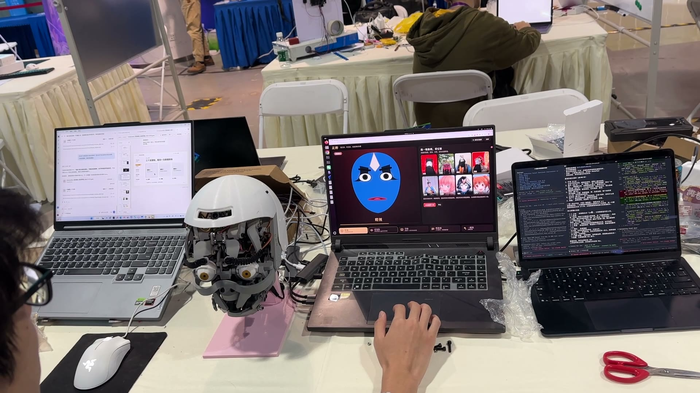
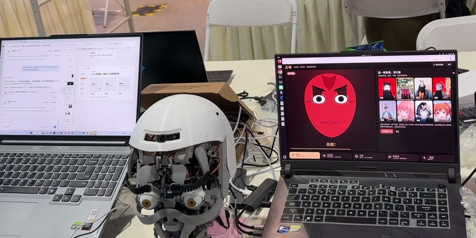
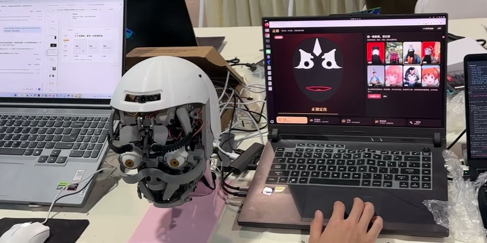
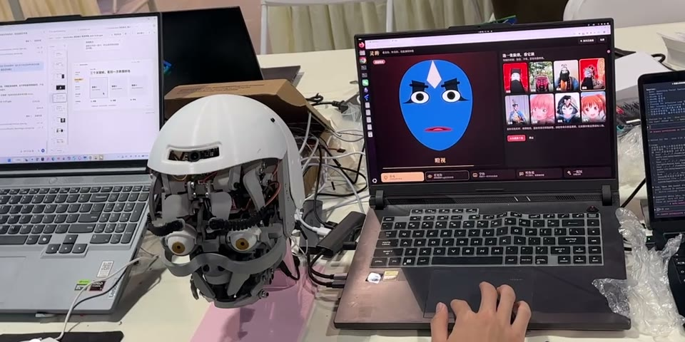
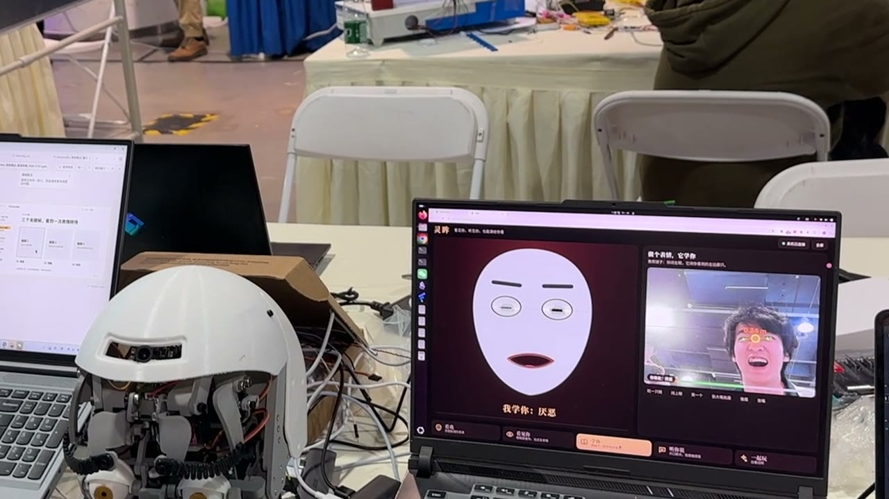
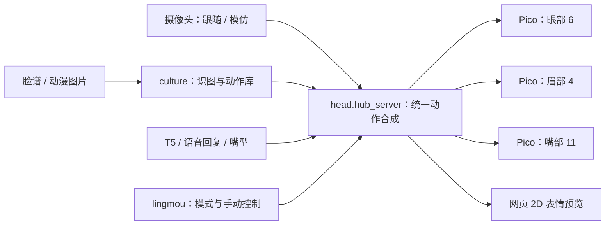
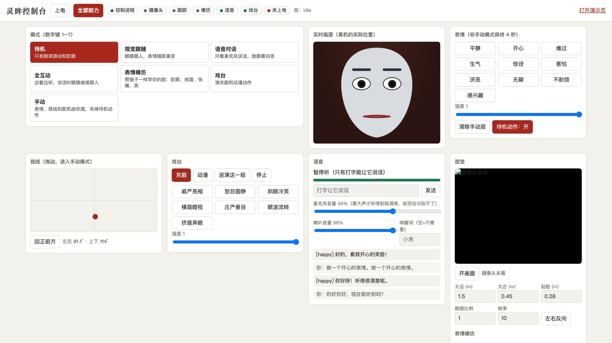
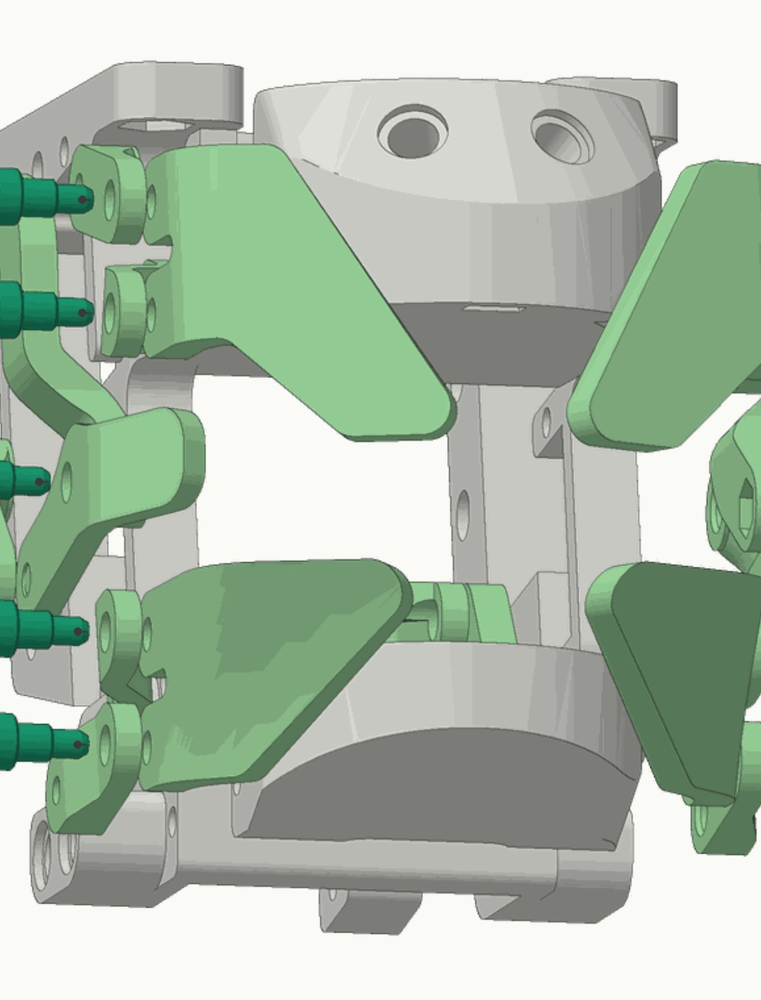
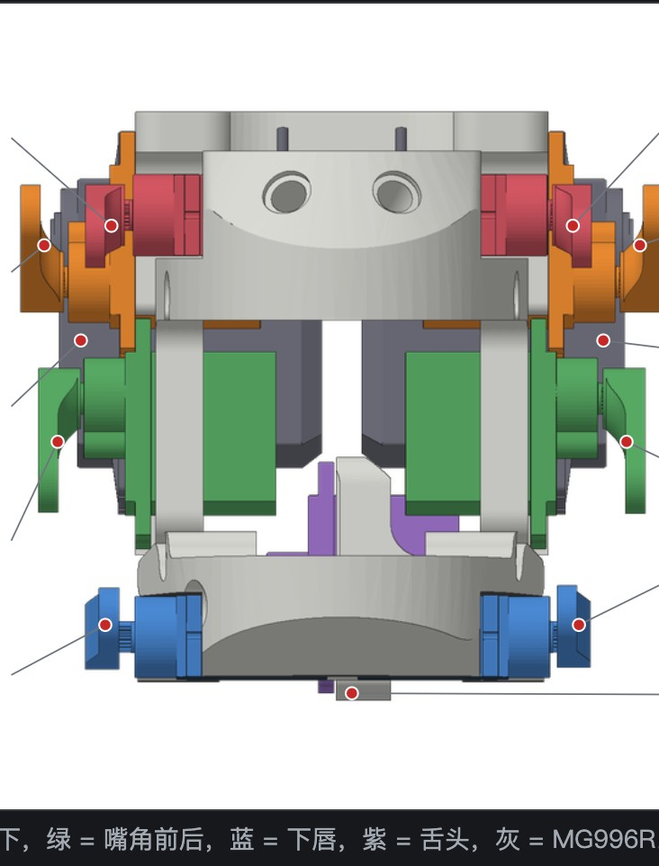

# 灵眸 · EmotionBot

**让机器人用眼神和表情演一出戏。**

灵眸是一颗能做表情、跟随视线、模仿人脸的机器人头。项目从 Will Cogley 的 Robot Head α2.0.33 复现起步，完成打印、PCB、装配和舵机调试，再接入摄像头、语音与京剧脸谱演示。

3 块 Raspberry Pi Pico 控制眼、眉、嘴共 **21 个舵机**；电脑负责感知与动作编排，T5AI 承担屏幕与音频接口。软件保留 22 个控制通道，其中 `EXA` 是未接的预留通道。



[看 Demo](#demo) · [运行入口](#运行入口) · [制作与联调资料](docs/资料导航.md) · [素材与版本说明](docs/项目版本与素材.md)

> 2026-11-09 整合：原 T9 工作区的灵眸演示代码已纳入仓库，并与原 main 的感知管线合并。两套运行入口均保留；模型、现场环境和大文件仍需另行准备。

## Demo

**看戏：给一张脸谱，选出动作，让屏幕和机器头一起演。**

| 红脸 · 威严亮相 | 黑脸 · 怒目圆睁 | 蓝脸 · 横眉瞪视 |
|---|---|---|
| [](docs/media/opera-red.mp4) | [](docs/media/opera-black.mp4) | [](docs/media/opera-blue.mp4) |
| [播放 3 秒片段](docs/media/opera-red.mp4) | [播放 3 秒片段](docs/media/opera-black.mp4) | [播放 3 秒片段](docs/media/opera-blue.mp4) |

三个片段来自已有现场录像，合计约 1.7 MiB。GitHub 如果只显示文件信息，可下载后播放。脸谱颜色显示在网页中，实体头通过眼、眉、嘴表达动作。

**学你：把眨眼、挑眉、张嘴和笑映射到机器人脸上。**



另有约 66 秒的主 Demo 和 14 秒的表情模仿视频，完整文件及原始 MOV 保存在外置盘，见[素材清单](docs/项目版本与素材.md)。视觉跟随和语音对话有代码与调试记录；路演稿里的这两段独立视频仍是预留位。

## 做到了什么

| 模块 | 当前成果 | 边界 |
|---|---|---|
| 机械表情 | 眼、眉、嘴的装配与控制；基本表情、眨眼、扫视；保留现场录像 | 命令返回 `OK` 不等于机械动作已标定正确 |
| 灵眸戏台 | 京剧 / 动漫预设动作；图像识别选择动作；2D 脸与真机同步 | 预设可离线；上传新图需要模型接口。动作尚未经过戏曲专业评审 |
| 视觉交互 | 人脸位置与距离驱动视线和表情；表情模仿 | 依赖摄像头、FaceLandmarker 模型与实际标定 |
| 统一控制 | 多来源动作合成、意图过期、手动接管、卸力与失联保护 | 没有舵机实际位置或电流反馈 |
| T5AI | EB2 屏幕与双向 PCM 协议；已有板端传输实测 | 音质、回声消除和长期稳定性仍需现场验证 |
| 情感识别研究 | FER / SER / TER 评测；包含感知、融合、规则决策与运行时 | 研究管线与灵眸现场版保留各自运行入口，未统一成一套控制流程 |

## 系统怎么工作



灵眸演示版由 `head.hub_server` 独占三块 Pico 串口。视觉、戏台、语音和网页提交带有效期的意图，控制器按 `reflex → manual → lips → dialog → vision → idle` 的优先级合成。当前下唇 `LLL/LLR` 固定在 90°，`EXA` 不驱动。详见[统一控制进程](docs/统一控制进程.md)。



## 运行入口

### 基础表情预览：GitHub 与本地版都有

使用 Python 3.11 或 3.12，在仓库根目录执行：

```bash
uv venv --python 3.12
uv pip install -e '.[dev]'
.venv/bin/python scripts/demo_expressions.py --viz
```

输出 `outputs/expressions.png`，不连接硬件。Windows 使用 `.venv\Scripts\python.exe` 替换解释器路径。

### 灵眸演示版

演示代码位于 `camera/`、`culture/`、`lingmou/`、`head/hub*.py` 和 `firmware_t5/`，已随仓库保存。

```bash
# 2D 控制台：默认不打开串口
.venv/bin/python -m head.hub_server
# http://127.0.0.1:8780

# 另一个终端：预设戏台，可先只看网页效果
.venv/bin/python -m culture.server
# http://127.0.0.1:8790
```

摄像头预览需安装 `uv pip install -e '.[vision]'` 并准备 `models/face_landmarker.task`，然后运行 `python -m camera.track --viz`，见[视觉模块](camera/README.md)。上传新图片另需配置 `CULTURE_API_BASE`、`CULTURE_API_KEY`、`CULTURE_MODEL`；网页不会接收密钥。

现场总控入口是 `python -m lingmou.server`（端口 `8800`，演示页 `/demo`）。它依赖 ROG/Linux 的摄像头目录、独立语音环境和服务配置，启动时会拉起子进程；请按[灵眸戏台与现场部署](docs/灵眸戏台.md)复原环境。新机器先用上面的独立预览入口。

### 多模态研究管线

`perception/`、`agent/`、`app/` 提供另一条链路：音频 / 人脸 / 文本 → 情感融合与矛盾检测 → 规则策略 → 表情与 TTS，现已与演示代码保存在同一仓库。

基础依赖安装后，运行 `.venv/bin/python -m app.run --stub --sim --source none --no-face --no-tts` 预览仪表盘，访问 `http://127.0.0.1:8000`；此命令不打开麦克风、摄像头或串口。完整模型环境使用 [Linux 安装脚本](scripts/setup_env.sh)或 [Windows 安装脚本](scripts/setup_env.ps1)，接口见[实时管道说明](docs/实时管道-队友接口.md)。`app.run` 与 `camera.web` 默认都用 8000 端口，真机模式也会占用串口；两套运行入口分开启动。

### 接真机

先完成[电源与接线](docs/电源与接线.md)、[上电检查](docs/舵机接线与上电检查.html)和[标定交接](docs/舵机标定与表情交接-2026-11-07.md)。固件在 `firmware/`，引脚与范围以各板 `config_*.py` 为准。

调试台与控制进程不能同时占用串口；双下巴要成对标定，先逐组检查。`--allow-unverified` 是现场调试选项，不是新机器的默认启动步骤。此次文档整理未连接硬件或重新验证机械参数。

## 从打印到表情

| 装配过程 | 舵机标定 |
|---|---|
|  |  |

1. **准备与制造**：[复现计划](docs/复现计划.md)、[螺丝与热熔螺母清单](docs/螺丝与热熔螺母清单.md)、`pcb/` 工程与 Gerber。
2. **焊接与装配**：[焊接流程](docs/焊接流程.html)、[组装流程](docs/组装流程.html)、[眼部传动与组装](docs/眼部传动与组装.html)。HTML 下载到本地后用浏览器打开。
3. **接线与标定**：[眉毛板接线图](docs/眉毛板杜邦线接线图.html)、[舵机标定图](docs/舵机标定图.html)、[表情调试日志](docs/表情调试日志.html)。
4. **控制与演示**：[统一控制进程](docs/统一控制进程.md)、[视觉模块](docs/视觉模块-眼球跟随与距离表情.md)、[T5 EB2 协议](docs/T5屏幕与语音协议-EB2.md)、[灵眸戏台](docs/灵眸戏台.md)。
5. **研究与评测**：[情感模块](docs/情感识别模块/README.md)、[实验报告](docs/情感识别模块/06-实验报告.md)、[评测代码](emo_bench/README.md)。

## 目录与资料存放

| 路径 | 用途 |
|---|---|
| `firmware/`、`head/` | Pico 固件、动作空间、电脑端控制 |
| `camera/`、`culture/`、`lingmou/` | 灵眸演示：视觉、戏台、总控 |
| `firmware_t5/` | T5 EB2 固件扩展，完整 SDK 另行准备 |
| `perception/`、`agent/`、`app/` | 多模态研究管线 |
| `scripts/`、`tests/` | 调试、渲染、CAD 辅助脚本与自动化测试 |
| `pcb/`、`print_package/` | 板卡工程与打印资料；完整打印包留外置盘 |
| `emo_bench/` | 情感识别测评代码与结果摘要 |
| `docs/`、`docs/media/` | 仓库文档、精选小图与三段短 Demo |

学习笔记集中在 note 仓库的 `inbound/learningnote/robotic/复现项目/head/`。完整视频、PPTX、CAD/OBJ、模型、数据集、缓存、环境和原始日志继续保留在 T9；具体路径、版本差异及归档方式见[项目版本与素材](docs/项目版本与素材.md)。

## 上游与致谢

机械结构来自 Will Cogley 的 [Robot Head α2.0.33](https://willcogley.notion.site/Robot-Head-2-0-33-1d724779b64d80568fd9cf1c7abd3e64) 与 [EyeMech](https://github.com/will-cogley/EyeMech_Epsilon)。本项目在复现基础上补充 PCB、打印与装配说明、控制固件、标定工具及交互演示。

机械 / 打印 / PCB 衍生资料沿用项目原有的 **CC BY-NC-SA 4.0** 标注；第三方代码、模型、数据和图片分别遵循各自来源条款。上游 [RobotHead 代码仓库](https://github.com/will-cogley/RobotHead) 与机械下载包是不同来源，授权范围不要混用。
