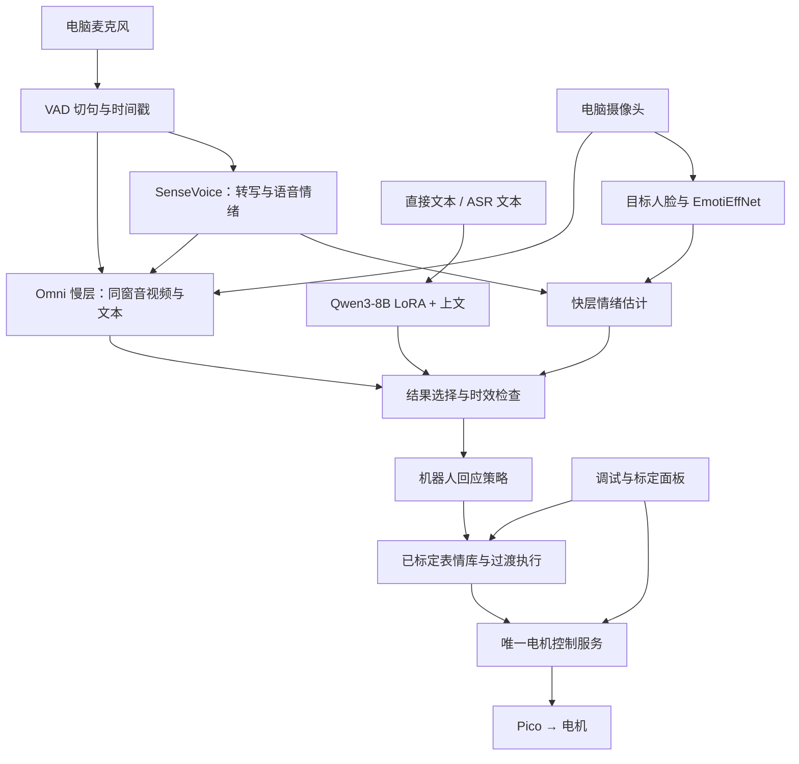

# 下一阶段方案：上位机情绪识别与表情标定

> 2026-11-10。硬件决策已确定：后续不使用 T5 开发板。
> 本文固定下一阶段架构和模型选择；“采用”表示选定方案，不表示模型服务、标定库或新流程已经完成接入。

> 2026-11-11 进展：[标定闭环与标签 API](表情标定闭环.md)已实现并通过仿真验证。真实七类表情仍待人工标定，推荐模型实时接入和旧控制路径收敛尚未完成。

## 1. 硬件与职责

- 电脑端直接接入麦克风、摄像头；需要语音输出时使用电脑或 USB 扬声器。
- 上位机负责采集、识别、时间对齐、情绪决策、标定面板和动作编排。
- 三块 Pico 继续负责眼、眉、嘴的底层电机控制，不因取消 T5 而取消 Pico。
- 新流程不依赖 T5 屏幕、EB2 协议、T5 音频传输或板端 SDK。已有 T5 代码与联调记录保留为历史资料，不作为新阶段启动条件。
- 原始音视频、模型权重、数据集和日志仍保存在 T9；Git 保存代码、配置、标定参数、文档和精选小图。

## 2. 从实验结论确定模型

依据是 [06 实验报告](情感识别模块/06-实验报告.md) 的 2.1–2.4、2.6 和第 3 节，以及 [快层评测](../emo_bench/results/fast_layer.md)。早期学习资源和算力预估不是最终选型依据。

| 位置 | 采用方案 | 输入与职责 | 接入条件 |
|---|---|---|---|
| 本地语音快层 | SenseVoiceSmall，`ban_emo_unk=True` | 同一段语音同时得到转写和语音情绪标签 | 复用 `perception/asr_ser.py`；不额外把同一模型的结果重复投票 |
| 本地视频快层 | EmotiEffNet-B0，`enet_b0_8_va_mtl`，AffectNet 预训练头 | 对目标人脸逐帧识别，在语音窗口内汇总 | 复用 `perception/fer.py`；第一版限定单人交互，多人时不把最大脸自动视为说话人 |
| 独立文本识别 | Qwen3-8B + 实验训练的 LoRA + 前 8 句上文 | 对直接输入文本或 ASR 转写做情绪分类 | 中文使用 CPED 对应适配器；必须找到实际微调权重，原始 Qwen3-8B 不等价 |
| 综合判断慢层 | 实验中的百炼 `qwen3.8-omni-flash` | 接收同一时间窗的音频、视频和可用文本，结合语气与语义判断 | 模型名是实验记录；部署前核实账号可用型号与接口，锁定实际模型版本。当前未验证服务可用性 |

快层服务于及时反应；独立文本模块服务于文本输入及单模态调试；Omni 慢层服务于完整交互判断。不要把文本模块与 Omni 对同一份文本的判断当成独立证据重复加权。

### 为什么这样选

- **快层基线**：SenseVoice + EmotiEffNet 在 RAVDESS / CREMA-D 完整集 UA 为 66.1 / 61.7，但 MELD 为 28.3。它适合作为可落地的本地基线，不能据此声称已经解决真实对话情绪识别。
- **文本方案**：Qwen3-8B LoRA + 上文在 CPED 的 macro-F1 为 35.7，高于 RoBERTa + 上文的 28.6。MELD 标注文本为 54.0，换成 ASR 文本后为 36.3，说明输入转写质量必须单独检查。
- **慢层覆盖快层**：MELD 对应小样本上，Omni 慢层 UA 为 55.1，和 SenseVoice + EmotiEffNet 等权混合后为 45.6；加入 emotion2vec+ 后的混合为 32.3。采用“快层先响应，慢层有效结果到达后修正”，不采用快慢等权投票。该慢层结果来自小样本，不能直接当作现场准确率。
- **emotion2vec+ 不作为默认主模型**：实验标注了训练数据重叠问题，表演数据集上的高分不能证明现场泛化能力。保留为后续对照项。
- **WavLM-large 探针作为离线增强方向**：已有较好的实验成绩，但需要配套的特征层选择、分类头和标签映射，不是下载骨干后即可获得相同结果。
- **Qwen2.5-Omni-7B 不纳入默认方案**：按本轮实验，其情绪识别效果不足以支持替换专用模型。

## 3. 输入到表情的模块边界

### 输入规范

- 统一情绪类别：`neutral / happy / sad / angry / surprise / fear / disgust`。
- 统一保留输入来源、片段 ID、时间窗口、目标人物、模型版本、类别分布和有效性。
- 无人脸、静音、超时、模型不可用和未知类别属于无有效判断，不伪装成中性情绪。
- 语音按句切段，单段上限约 15 秒；视频与文本绑定同一片段。上下文按会话管理，新会话清空，第一版最多保留前 8 句。
- SenseVoice 的硬标签转成平滑分布只是接口适配，不代表已经校准的概率；关键词规则也不能冒充实验模型。

### 快慢层结果处理

1. 快层产生暂定结果，不等待网络请求。
2. 慢层处理同一片段；返回后检查片段 ID、结果有效性和时效，防止旧回复覆盖新输入。
3. 有效慢层结果替换该片段的暂定判断，不与快层等权平均。
4. 慢层关闭、超时或失败时继续使用有效快层结果，并记录降级原因。全模态不可用时进入无输入状态。
5. 纯文本输入走文本模块；没有音视频时，不伪造另外两路输入。LoRA 不可用时显示文本模型未就绪。
6. 第一版回应策略采用镜像表情，后续“安慰、关切”等策略单独扩展。识别的人的情绪与机器人选择的回应分开记录。

云端慢层需要单独配置和显式启用；本地预览、面板调试和七类表情标定不以联网为前提。云端调用会发送所选输入片段，配置和运行日志应明确实际启用的输入类型与模型。

## 4. 标定与执行

先做电机标定，再做表情标定。

- 电机标定：编号、中心补偿、运动方向、验证范围、速度、联动关系。
- 表情标定：以实际中性姿态为基准，记录七类表情的目标指令、参与电机、过渡、保持时间、照片和标定版本。
- 未参与本次表情的电机必须有明确的基准或保持规则，避免依赖上一动作的残留状态。
- 标定模式独占控制权，暂停自动表情、眨眼和视线动作；下颌等耦合机构按组调整。
- 保存、加载、重放、草稿与确认采用分开；重要参数进入版本控制，原始日志和视频保存在 T9。
- 上层输出 `表情类别 + 强度 + 过渡时间 + 保持时间`，执行器再查标定库。识别置信度与表情强度分别处理。
- 当前硬件没有实际位置反馈，保存的是目标控制指令；照片和实机重放用于验证实际呈现。

## 5. 现有代码与待完成工作

| 项目 | 当前情况 | 下一步 |
|---|---|---|
| 电脑输入 | `app.run` 已默认 `mic`，有摄像头与电脑 TTS | 将无 T5 拓扑作为正式运行说明；旧 T5 路径移出主流程 |
| 快层模型 | SenseVoice 与 EmotiEffNet 适配已有；`app.run` 仍优先加载 emotion2vec+ 做 SER | 默认配置切换到选定快层，保留 emotion2vec+ 为显式对照项 |
| 文本模型 | 当前 `TextEmotion` 是 API / 字面关键词演示实现 | 接入训练过的 LoRA 与会话上文；取消为演示反讽而强制只判字面的限制 |
| 文本权重 | 本机项目 `models/` 未找到 Qwen3-8B LoRA；不据此推断远端不存在 | 找回 CPED / MELD 适配器、训练配置、标签顺序与权重校验值，留在 T9 |
| 慢层 | `emo_bench` 有离线调用和评测；实时管线没有快慢层调度 | 核实服务，接入异步调用、片段绑定、超时和过期丢弃 |
| 人脸选择 | 当前取最大人脸 | 先限制单人交互，再增加目标跟踪或主动说话人检测 |
| 控制入口 | `head.hub`、`HeadBridge`、标定台分别有串口路径 | 收敛到唯一电机控制服务，标定与自动模式互斥 |
| 表情保存 | 标定台已有独立 JSON 库、加载预览、重放与标签 API；旧运行入口仍用预设 | 完成真机七类标定，再把识别流程接到此接口 |

模型部分保持原实验依据；标定闭环的实际进度以上方更新为准，不将历史联调说明视为新架构。

## 6. 实施与验收顺序

1. **标定闭环**：分组控制、中性姿态、七类表情保存；重启后可加载和重放。
2. **统一控制**：手动标签驱动表情，检查过渡、接管、停止与输入失效行为。
3. **本地识别**：用固定录音和单人视频验证 SenseVoice + EmotiEffNet，再接实时采集。
4. **文本识别**：使用实际 LoRA 权重验证直接文本、ASR 文本、上下文和会话重置。
5. **慢层接入**：同一片段的快层先输出、慢层后修正；验证超时、乱序、旧结果与无网情况。
6. **自采场景评测**：分别记录识别质量、ASR 错误、延迟和表情呈现，避免把数据集成绩直接当真机效果。
