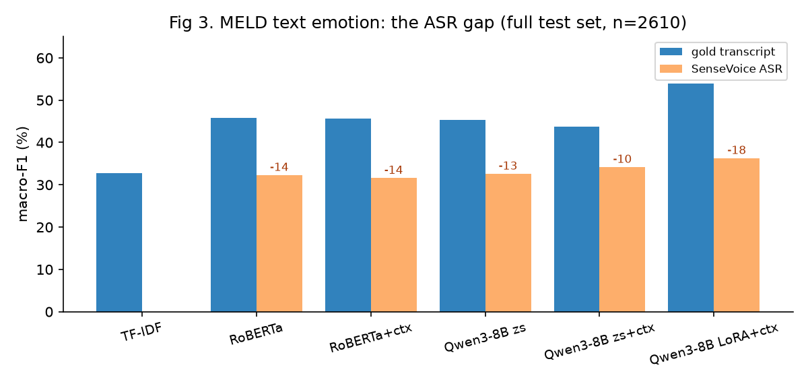
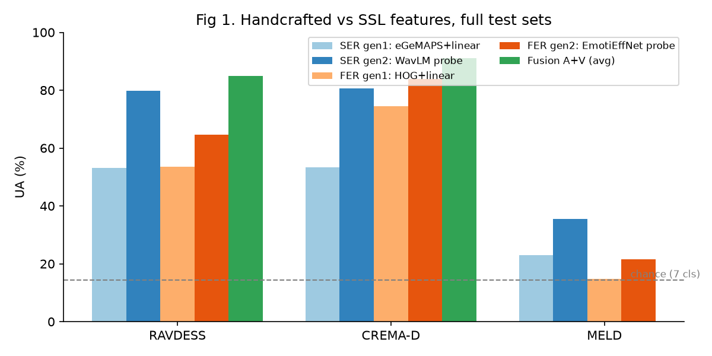
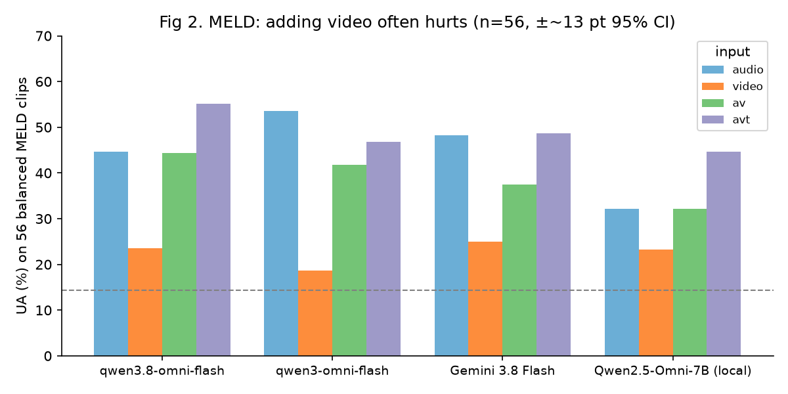

# 06 实验报告：FER / SER / TER 前沿方法测评

> 日期：2026-10-19
> 对照文档：[03-验收标准.md](03-验收标准.md)（逐条对照见第 4 节）
> 代码与原始结果：`emo_bench/`（`results/results.jsonl` 是全部数字的原始记录，`results/same_subset.md` 是闭源对比表）
> 算力：featurize 1 × RTX 4090（24 GB），约 5 小时，约 10 元；闭源 API：OpenRouter 1.66 美元 + 百炼（免费额度 + 少量按量）
> **交互式网页版**：`emo_bench/report/index.html`（可逐条看样本视频和每个模型的回答；整个 `report/` 目录是静态网站，约 15 MB，可直接部署；由 `src/build_report.py` 生成；目录说明见 `emo_bench/README.md`）

---

## 0. 结论先行

1. **文本这一路，LLM + LoRA + 对话上文是当前最强的本地方案。** Qwen3-8B QLoRA（带前 8 句上文）在 MELD 上 macro-F1 54.0，比 RoBERTa 微调高 8.2；在 CPED（中文）上 35.7，比 RoBERTa+上文高 7.1。零样本的 Qwen3-8B 打不过微调过的 RoBERTa。
2. **真实部署的最大损失在 ASR，不在情感分类器。** 同一个模型，MELD 输入从标注文本换成 SenseVoice 转写后，macro-F1 掉 13–18 个点（图 3）。
3. **表演数据集上，自监督特征 + 线性头已经很强，而且本地模型全面胜过闭源大模型。** 在同一批 56 条样本上，RAVDESS：本地 WavLM 探针 UA 85.7，最好的闭源（Gemini 3.8 Flash av、qwen3.8-omni-flash av）66.1；CREMA-D：本地 EmotiEffNet 探针 88.9，最好的闭源 59.3。
4. **真实对话（MELD）上，闭源全模态模型的优势是"听懂内容"，不是"看懂表情"。** 闭源模型只听音频 UA 45–54，只看画面全部在 19–27（和本地人脸模型一样接近随机）；加画面经常反而更差（图 2）。原因是 MELD 画面里的人经常不是说话人。
5. **人脸这一路在对话场景下的瓶颈是"找对人"。** 取画面最大人脸的策略在 MELD 上让所有 FER 方法接近随机（UA 15–22）；部署必须先做主动说话人检测（active speaker detection）。
6. **融合只在各模态都有用时才有用。** RAVDESS / CREMA-D 上 A+V 平均融合比最佳单模态高 5.2 / 7.1（UA）；MELD 上把接近随机的人脸和偏弱的语音加到标注文本上反而拉低（54.0 → 48.7 macro-F1）；但在部署条件（ASR 文本）下，融合能补回 4.6 个点。
7. **开源全模态 Qwen2.5-Omni-7B 目前不可用于情绪识别**：同一批样本上各模式 UA 17–45，比所有闭源和本地专用模型都差。

---

## 1. 实验设置

### 1.1 数据集

| 数据集 | 内容 | 划分 | 测试样本 | 用在 |
|---|---|---|---|---|
| RAVDESS | 24 名演员，英文，两句固定台词，绿幕正脸 | EmoBox 6 折（按说话人） | 1,440（统一 7 类后 1,248） | SER / FER / 融合 |
| CREMA-D | 91 名演员，英文，12 句台词，480p，6 类 | EmoBox fold 1 | 1,856 | SER / FER / 融合 |
| MELD | 《老友记》对话，7 类，严重不平衡（neutral 47%） | 官方 train/dev/test | 2,610 | SER / FER / TER / 融合 |
| CPED | 中文电视剧对话，仅文本，13 类 → 7 类 | 官方 | 21,208 | TER |

预览页：`emo_bench/preview/index.html`（每个数据集 2 条样本 + FER 实际看到的人脸裁剪）。

**和计划的差异**：03 里的共用评测集 M3ED、FER 标准集 AffectNet / RAF-DB / DFEW 都需要申请，本轮没有拿到。所以：C1 用 MELD 代替 M3ED（英文），中文只测了文本（CPED）；B1–B3 没有测。

### 1.2 统一标签和指标

- 7 类：neutral / happy / sad / angry / surprise / fear / disgust；其余（calm、contempt、CPED 的 relaxed 等）记为 other，不计分。
- **UA**（unweighted accuracy = 各类召回率平均 = UAR）：类别不平衡时比准确率可靠，随机猜 7 类是 14.3。
- **WA**（weighted accuracy = 普通准确率）、**macro-F1**、**weighted-F1**。
- 零样本模型的 argmax 只在该数据集出现的类别里取（CREMA-D 没有 surprise）。

### 1.3 三代方法

| | SER（语音） | FER（人脸） | TER（文本） |
|---|---|---|---|
| 第 1 代：手工特征 | eGeMAPS（88 维）+ 线性 | HOG（1764 维）+ 线性 | TF-IDF + LR |
| 第 2 代：自监督 / 专用模型 | WavLM-large 逐层探针；emotion2vec base / plus；audeering w2v2-dim | EmotiEffNet-B0/B2（AffectNet 预训练）探针 & 零样本；DFER-CLIP（DFEW） | RoBERTa-base 微调（± 上文）；j-hartmann 情感模型 |
| 第 3 代：大模型 | SenseVoiceSmall；Qwen2.5-Omni-7B | Qwen2.5-Omni-7B；闭源 VLM | Qwen3-8B 零样本 / QLoRA |
| 闭源 API | Gemini 3.8 Flash、qwen3-omni-flash、qwen3.8-omni-flash（音频 / 视频 / 音视频 / 加字幕）；MiniMax M3、Kimi K3、Seed 2.0 Lite（只看视频）；以上加 qwen3.5-plus 测 CPED 文本 | | |

- 探针（probe）= 冻结特征 + 带类别权重的线性分类器；层和正则从按说话人切出的内部验证集上选（不碰测试集）。
- LLM 打分：取回答第一个 token 在 7 个标签词上的 logits 做 softmax，不做自由生成，所以不存在"解析不到标签"。
- 闭源 API：temperature 0，关思考模式（百炼）或 reasoning effort low（OpenRouter），只要一个标签词。

### 1.4 闭源的抽样口径（读表前必看）

闭源模型只按用户要求"看个大概"：每个数据集分层抽 **56 条**（每类 8 条；CREMA-D 6 类每类 9 条，共 54）。**56 条的 UA 95% 置信区间大约 ±13 个点**，所以两个模型相差 10 分以内都不能说谁更好。为了公平，本地模型也在**完全相同的 56 条**上重新算了分数（第 2.5 节）；本地模型在这些样本上的预测都来自没见过它们的模型（RAVDESS 是交叉验证的 out-of-fold 预测）。

---

## 2. 结果

### 2.1 SER（语音），完整测试集

| 方法 | 代 | RAVDESS UA | CREMA-D UA | MELD UA / macro-F1 |
|---|---|---|---|---|
| eGeMAPS + 线性 | 1 | 53.1 | 53.3 | 23.0 / 19.1 |
| WavLM-large 探针（逐折选层） | 2 | 79.8 | 80.6 | 35.5 / 30.3 |
| emotion2vec base 探针 | 2 | 68.4 | 70.5 | 33.0 / 28.0 |
| emotion2vec+ 探针 ⚠ | 2 | 91.4 | 76.6 | 30.6 / 27.9 |
| emotion2vec+ 零样本 ⚠ | 2 | 91.9 | 76.0 | 29.8 / 28.5 |
| audeering w2v2-dim 探针 | 2 | 79.5 | 76.1 | 32.4 / 28.8 |
| SenseVoiceSmall 零样本（默认） | 3 | 16.2 | 19.5 | 14.8 / 10.3 |
| SenseVoiceSmall 零样本（`ban_emo_unk`） | 3 | 49.3 | 54.5 | 28.4 / 28.7 |

- ⚠ **数据污染**：emotion2vec+ 的训练数据包含 EmoBox 学术集（含 RAVDESS / CREMA-D / MELD 训练集），所以它"零样本"91.9 ≈ 探针 91.4。这个数字不能当泛化能力看。
- **SenseVoice 的坑**：默认设置下它大多数时候输出 EMO_UNKNOWN（UA 只有 16–20）；打开 `ban_emo_unk=True` 强制从 7 类里选一个后，RAVDESS 49.3、CREMA-D 54.5。部署时必须开这个选项。
- **语音在对话里很弱**：所有方法在 MELD 上 UA ≤ 36。表演数据集到真实对话的落差约 45 个点。

**WavLM 选层实验**（对照 B4）：

| WavLM-large 线性探针   | RAVDESS UA           | CREMA-D UA |
| ------------------ | -------------------- | ---------- |
| 固定最后一层（EmoBox 的做法） | 73.0                 | 77.4       |
| 固定第 12 层           | 78.1                 | 80.8       |
| 25 层取平均            | 77.5                 | 82.1       |
| 每折在验证集上选层          | 77.1（8 类）/ 79.8（7 类） | 80.8       |

情绪信息主要在中间层，最后一层最差。部署时用中间层或可学习的层加权（SUPERB 的做法），不要直接取最后一层。

**维度检验**（V/A 回归模型是否抓到了效价 / 唤醒）：用 AUC 衡量"高唤醒类（angry / happy / fear / surprise）vs 低唤醒类（sad / neutral）"和"正效价（happy）vs 负效价（angry / sad / disgust / fear）"能否被模型输出的 arousal / valence 区分开。50 是随机，100 是完全分开。

| | 语音 audeering arousal AUC | 语音 valence AUC | 人脸 EmotiEffNet arousal AUC | 人脸 valence AUC |
|---|---|---|---|---|
| RAVDESS | 87.6 | 71.2 | 90.7 | 99.9 |
| CREMA-D | 87.2 | 68.9 | 76.2 | 98.2 |
| MELD | 68.6 | 74.6 | 57.5 | 74.5 |

表演数据里，**人脸擅长效价（开不开心），语音擅长唤醒（激不激动）**，两者互补，这是 A+V 融合有效的根本原因。到了 MELD 两者都退化到 70 左右。

### 2.2 FER（人脸），完整测试集

| 方法 | 代 | RAVDESS UA | CREMA-D UA | MELD UA / macro-F1 |
|---|---|---|---|---|
| HOG + 线性 | 1 | 53.5 | 74.5 | 14.7 / 13.2 |
| EmotiEffNet-B0 探针 | 2 | 64.7 | 84.0 | 21.5 / 17.9 |
| EmotiEffNet-B2 探针 | 2 | 70.4 | 82.6 | 22.2 / 18.5 |
| EmotiEffNet-B0 零样本（AffectNet 头） | 2 | 63.0 | 52.8 | 21.6 / 18.2 |
| DFER-CLIP 零样本（DFEW 训练） | 2 | 46.7 | 40.5 | 21.3 / 19.1 |

- 帧级的 EmotiEffNet 跨数据集迁移比视频级的 DFER-CLIP 好：DFER-CLIP 在 DFEW（野外电影片段）上训练，迁移到正脸表演视频反而掉得多。
- **MELD 上所有 FER 方法接近随机。** 主要原因是预处理"取画面中最大的人脸"在多人镜头里经常取到的不是说话人（预览页 `test_dia12_utt5`：说话的是 Ross，最大的脸是 Chandler）。这不是模型问题，是"找人"的问题。

### 2.3 TER（文本），完整测试集

| 方法 | MELD macro-F1（标注文本） | MELD macro-F1（SenseVoice 转写） | CPED macro-F1 |
|---|---|---|---|
| TF-IDF + LR | 32.7 | – | 25.9 |
| j-hartmann（在含 MELD 的数据上训练过 ⚠） | 35.7 | – | – |
| RoBERTa-base 微调 | 45.8 | 32.3 | 26.6 |
| RoBERTa-base 微调 + 前 3 句上文 | 45.6 | 31.6 | 28.6 |
| Qwen3-8B 零样本 | 45.3 | 32.6 | 22.3 |
| Qwen3-8B 零样本 + 前 8 句上文 | 43.7 | 34.2 | 26.6 |
| **Qwen3-8B QLoRA + 前 8 句上文** | **54.0**（UA 49.8，wF1 69.3） | **36.3** | **35.7** |

- CPED 用的是中文 RoBERTa（`chinese-roberta-wwm-ext`），MELD 用英文 `roberta-base`。QLoRA 训练样本：MELD 抽 1 万句、CPED 抽 2 万句（seed 0），1 个 epoch。
- **上文的作用因数据集而异**：CPED 上上文明显有用（RoBERTa +2.0，Qwen 零样本 +4.3）；MELD 标注文本上基本没用甚至略降。但 MELD 的 ASR 文本上，上文让 Qwen 零样本 +1.6——当前句被识别错时，前文能补回一部分信息。
- **对照文献**：MELD 7 类文本 weighted-F1 的近年 SOTA 在 66–70 左右（InstructERC 等 LLM ERC 方法），我们的 Qwen3-8B LoRA wF1 69.3，在这个区间内。



**图 3 怎么读**：横轴是 6 种文本方法，纵轴是 MELD 完整测试集（2,610 句）上的 macro-F1。蓝柱是用人工标注的台词，橙柱是用 SenseVoice 自动转写的台词，橙柱上方的红色数字是两者之差。数字来自模型在测试集上的预测（不是训练曲线）。读法：每种方法换成 ASR 后都掉 13–18 分，而方法之间的差距（蓝柱之间）最大也就 8 分左右——**ASR 质量比换分类器更重要**。

### 2.4 融合（late fusion），完整测试集

| 数据集 | 输入 | 最佳单模态 | avg 融合（log 概率等权平均） | stack 融合（LR，按说话人 / 对话分组 5 折） |
|---|---|---|---|---|
| RAVDESS | WavLM + EmotiEffNet-B0 | A：UA 79.8 | **UA 85.0（+5.2）** | UA 82.8 |
| CREMA-D | 同上 | V：UA 84.0 | UA 91.1（+7.1） | **UA 91.6（+7.6）** |
| MELD | 同上 + Qwen3-8B LoRA（标注文本） | T：macro-F1 54.0 | macro-F1 48.7（−5.3） | UA 56.9 / macro-F1 48.8 |
| MELD | 同上 + Qwen3-8B LoRA（ASR 文本） | T：macro-F1 36.3 | **macro-F1 40.9（+4.6）** | UA 45.2 / macro-F1 37.0 |
| MELD | 只用 A + T（ASR） | T：macro-F1 36.3 | macro-F1 41.3（+5.0） | – |



**图 1 怎么读**：横轴是三个数据集，纵轴是完整测试集上的 UA。浅蓝 / 深蓝是语音的第 1 代（eGeMAPS）和第 2 代（WavLM），浅橙 / 深橙是人脸的第 1 代（HOG）和第 2 代（EmotiEffNet），绿色是语音 + 人脸平均融合（MELD 没画，见上表）。灰色虚线是 7 类随机水平。数字来自测试集预测。读法：从第 1 代到第 2 代，表演数据上提升 10–27 分；融合在两个表演数据集上都超过最好的单模态；到 MELD 所有柱子都塌到 15–36。

### 2.5 闭源 vs 本地：同一批 56 条样本

完整表在 `results/same_subset.md`，这里摘要（UA；括号是该模型最好的输入方式）：

| 方法 | RAVDESS | CREMA-D | MELD | CPED 文本 |
|---|---|---|---|---|
| **本地最好的专用模型** | 85.7（WavLM 探针） | 88.9（EmotiEffNet 探针） | 42.9（Qwen3-8B LoRA，标注文本） | **46.4**（Qwen3-8B LoRA） |
| **本地 late fusion（avg）** | **89.3**（A+V） | **94.4**（A+V） | 37.5（A+V+T）/ 32.1（ASR 文本） | – |
| qwen3.8-omni-flash（百炼） | 66.1（av） | 53.7（video / av） | **55.1**（avt） | 44.6 |
| Gemini 3.8 Flash（OpenRouter） | 66.1（av） | 59.3（av） | 48.7（avt） | 46.4 |
| qwen3-omni-flash（百炼） | 57.1（av） | 42.6（video） | 53.6（audio） | – |
| MiniMax M3（只看视频） | 55.4 | 46.3 | 23.2 | 41.1 |
| Kimi K3（只看视频） | 53.6 | 44.4 | 26.8 | 41.1 |
| Seed 2.0 Lite（只看视频） | 35.7 | 40.7 | 23.2 | 39.3 |
| qwen3.5-plus（文本） | – | – | – | 41.1 |
| Qwen2.5-Omni-7B（本地开源） | 41.1（av） | 27.8（video） | 44.6（avt） | – |
| Nemotron 3 Nano Omni（免费） | – | – | 28.6（av） | – |



**图 2 怎么读**：横轴是 4 个全模态模型，纵轴是同一批 56 条 MELD 样本（每类 8 条）上的 UA。四种颜色是四种输入：只给音频、只给无声视频、视频 + 音频、视频 + 音频 + 台词文本。灰色虚线是随机水平 14.3。数字来自 API 回答 / 模型预测，不是训练结果。**注意每根柱子的 95% 置信区间约 ±13**，只看大趋势。读法：橙柱（只看画面）全部贴着随机线；绿柱（加了画面）在 4 个模型里有 3 个低于或等于蓝柱（只听音频）；紫柱（再加台词）普遍最高。

几点解读：

- **表演数据上闭源全面落后本地专用模型 20–30 个点。** 通用大模型没有针对"演员的夸张表情 / 语气 → 情绪类别"做过专门训练，而本地模型是在这个分布上训练过的（探针）或者在相近分布上预训练过的。这说明**机器人场景值得花力气做专门模型，而不是直接调大模型 API**。
- **MELD 上闭源的音频模式比本地 WavLM 探针（41.1）高，是因为它们能听懂台词。** qwen3-omni-flash 只听音频 53.6，本质上是"语气 + 语义"一起判。
- **MELD 上本地 LoRA 模型在这 56 条上只有 42.9**，比它在完整测试集上的 UA 49.8 低：它在不平衡的训练集上训练，偏向多数类 neutral，而这 56 条每类等量，少数类（fear、disgust）占比被放大。闭源零样本模型没有这个偏向，所以在类别均衡的抽样上更占便宜。
- **CPED 中文文本**上本地 LoRA（46.4）和最好的闭源（Gemini 46.4、qwen3.8-omni 44.6）打平；本地模型可以离线部署、成本固定，是更合适的选择。
- **新版有进步**：qwen3.8-omni-flash 比 qwen3-omni-flash 在 RAVDESS 音频上 +23（28.6 → 51.8）、CREMA-D 音频 +18.5；而且 MELD 上加画面后几乎不掉分（44.6 → 44.4），另两个模型掉 11–12 分。

- **MELD 上本地 late fusion 不如端到端 omni**：同一批 56 条上 late fusion 37.5，闭源 omni avt 46.8–55.1，连开源 Qwen2.5-Omni avt 也有 44.6。端到端模型能把台词、语气、画面放在一起理解；late fusion 只是把三个各自偏弱（且偏向 neutral）的单模态概率平均。这是 05 里"LLM 融合 / 端到端"方向值得做的直接证据。
- qwen3-omni-flash / qwen3.8-omni-flash 的 MELD video / av / avt 是 53 条（3 条在限流后补跑时服务器断开，未补上）。

### 2.6 推荐方案验证：零样本快层 + omni 慢层（2026-10-20 补）

快层 = 不在目标数据上训练的 SenseVoice（`ban_emo_unk`）/ emotion2vec+（语音）+ EmotiEffNet-B0 AffectNet 头（人脸），log 概率平均；慢层 = qwen3.8-omni-flash；混合 = 快层 + 慢层等权 log 平均（硬标签按 0.7 / 其余平分转成概率）。脚本 `src/fast_layer.py`，完整表 `results/fast_layer.md`。UA：

| 方案 | RAVDESS 完整 / 子集 | CREMA-D 完整 / 子集 | MELD 完整 / 子集 |
|---|---|---|---|
| 快层 SenseVoice + EmotiEffNet（无污染） | 66.1 / 73.2 | 61.7 / 64.8 | 28.3 / 28.6 |
| 快层 三个都用 ⚠ | 91.7 / 91.1 | 77.6 / 81.5 | 31.2 / 30.4 |
| 慢层 qwen3.8-omni-flash | – / 66.1 | – / 53.7 | – / **55.1** |
| 混合 SV + ENet + 慢层 | – / 69.6 | – / 55.6 | – / 45.6 |
| 混合 三个 + 慢层 ⚠ | – / 92.9 | – / 81.5 | – / 32.3 |

- 不训练、无污染的快层在表演数据上 62–73，在真实对话上只有 28；emotion2vec+ 在表演集上的 90 分是污染带来的，MELD 上它也只有 29.8。
- **等权混合在 MELD 上把慢层拉低 10–23 分**：快层三票里两三票是错的，会盖过慢层。所以混合不能等权平均，应该是"慢层有结果就以慢层为准，快层只负责慢层出结果前的即时反应"，或者按置信度 / 场景学权重（需要自采数据）。

**费用与速度**：OpenRouter 全部约 1,300 次调用花了 1.66 美元（Kimi K3 因为强制思考占了一半）；百炼单次延迟中位数 0.6–1.7 秒，Gemini 4–5 秒，MiniMax / Kimi 7–27 秒，Nemotron 免费版约 26 秒。只有百炼的 omni 模型满足 03 里 E2"一句话结束到出结果 ≤ 500 ms"的量级要求——而且仍然超了。

---

## 3. 机器人部署相关的发现

1. **先找对人，再看表情。** D4（画面两个人只输出主说话人）要从"人工检查"升级为管线里的一个模块：主动说话人检测（如 TalkNet / Light-ASD）或至少"嘴部运动 + 声源方向"的启发式。没有它，FER 在多人场景下等于随机。
2. **ASR 是 TER 的天花板。** 优先换更强的中文 ASR（Paraformer-large / SenseVoice-Large / Whisper-large-v3），或者把 ASR n-best 一起喂给 LLM。
3. **长音频必须切段。** MELD 里有一条 305 秒的异常长片段（中位数 2.5 秒），曾导致 GPU 显存爆掉（注意力是平方复杂度）。部署时用 VAD 切句，**单段上限约 15 秒**。
4. **SenseVoice 情感头要开 `ban_emo_unk=True`**，否则大部分输出是 UNKNOWN。
5. **WavLM / 同类 SSL 模型取中间层**（约第 8–16 层）或层加权，不要取最后一层。
6. **云端部署路线**：文本用 Qwen3-8B + LoRA（4-bit 约 6 GB 显存）；语音用 WavLM-large 探针或 emotion2vec base（避免用 emotion2vec+ 的污染数字做决策）；人脸用 EmotiEffNet-B0（GPU 批处理每段 16 帧约 0.04 秒）；一张 4090 可以同时放下全部三路。

---

## 4. 对照验收标准

| 编号 | 内容 | 结果 | 状态 |
|---|---|---|---|
| A1–A5 | 统一接口、映射表单测、实时管线、一键评测 | 离线评测脚本已有（`emo_bench/`），统一 `EmotionEstimate` 接口和实时管线还没写 | ⏳ 未做 |
| B1 | EmotiEffNet-B0 AffectNet val 8 类 61.93 ±1.5 | 没有 AffectNet 授权 | ⏸ 未测 |
| B2 | 同上 V/A CCC | 同上 | ⏸ 未测 |
| B3 | MAE-DFER on DFEW | 没有 DFEW 授权；用 DFER-CLIP 官方权重做了跨数据集零样本（RAVDESS 46.7 / CREMA-D 40.5） | ⏸ 替代 |
| B4 | SER 线性探针按 EmoBox 划分，UA 差 ≤ 2 | 用 WavLM-large 替代 emotion2vec+ large（后者有污染且没抽特征）：RAVDESS 固定最后一层 73.0 vs EmoBox 72.0，差 1.0；CREMA-D 77.4，EmoBox 对应数字待查原表 | ✅ RAVDESS（替代模型）/ ⏳ CREMA-D |
| B5 | SenseVoiceSmall 零样本 vs README | RAVDESS UA 49.3（`ban_emo_unk`）/ 16.2（默认）；尚未与 README 表格逐项核对（README 的数字用的是它自己的评测脚本） | ⏳ 待核对 |
| B6 | Chinese RoBERTa 在 M3ED 文本 | 没有 M3ED；在 CPED 上：单句 26.6，加上文 28.6 | ⏸ 替代 |
| B7 | LLM ERC 比 B6 高 ≥ 3 macro-F1 | CPED：Qwen3-8B QLoRA+上文 35.7 vs RoBERTa 26.6（+9.1）/ vs RoBERTa+上文 28.6（+7.1）；MELD：54.0 vs 45.8（+8.2） | ✅（CPED/MELD 替代 M3ED） |
| C1 单模态 | 各模态最佳 UAR ≥ 25 | MELD：T 49.8、A 35.8 通过；V 22.2 不通过（找人问题） | ⚠ 部分 |
| C1 融合 | 融合 ≥ 最佳单模态 + 3 macro-F1 | MELD 标注文本 −5.3 ❌；MELD ASR 文本 +4.6 ✅；RAVDESS +5.2 / CREMA-D +7.1 ✅ | ⚠ 部署条件下通过 |
| C1 Omni | 报告数字并和 late fusion 对比 | 同一批 56 条 MELD 上：闭源 omni avt 46.8–55.1，开源 Qwen2.5-Omni avt 44.6，本地 late fusion 37.5（标注文本）/ 32.1（ASR）。对话场景下端到端 omni 胜过本地 late fusion；表演数据上相反（late fusion 89.3 / 94.4 vs omni ≤ 66） | ✅ 已报告 |
| C1 ASR 代价 | 差距 > 5 要分析 | 13–18 个点，原因分析见 2.3 和 3.2 | ✅ |
| C2 / C3 / D | 自采数据、矛盾集、鲁棒性 | 需要机器人头和录制 | ⏸ 未开始 |
| E1–E5 | Mac 实时性能 | 未测（本轮在云端）；计划改为云 GPU 部署，E 组阈值需要按云端重定 | ⏸ 未测 |
| F1 | 全部大文件在 /Volumes/Robotics | 是：代码、venv、结果、API 缓存都在 `emo_bench/`；笔记只有 Markdown 和 3 张图 | ✅ |
| F2 | 固定 seed 可复现 | 所有抽样 seed 0；脚本见第 6 节；未做第二次独立重跑 | ⏳ |
| F3 | 许可证 | audeering（CC BY-NC-SA）、DFER-CLIP（DFEW 权重仅研究）、CPED / MELD（研究用）需要在 README 标注 | ⏳ |
| F4 | 每张图有读法说明 | 本报告 3 张图都有 | ✅ |

**总体**：方法层面（B4、B7、C1 的 ASR 代价、Omni 对比）已经有了可信的结论；缺口集中在三处——**受限数据集授权**（AffectNet / DFEW / M3ED）、**实时管线和统一接口**（A 组）、**机器人实机数据**（C2 / C3 / D）。

---

## 5. 局限

- **英文为主**：音视频三模态只在英文数据上测了，中文只有文本。M3ED 授权到了以后要重跑 C1。
- **闭源只抽了 56 条**：置信区间约 ±13，只能看大趋势，不能用来给模型排细名次。
- **emotion2vec+ 和 j-hartmann 有数据污染**，表里用 ⚠ 标出，没有用于结论。
- **MELD 上的人脸结果被预处理拖累**：换成主动说话人检测后 FER 数字会变，目前的结论是"取最大人脸不可用"，不是"FER 模型不行"。
- **RoBERTa 只跑了一个 seed**；文本模型之间 1–2 分的差距不显著。
- **SenseVoice 转写的质量没有单独测 WER**。

---

## 6. 复现

```bash
# 服务器（~/emo/code = 本地 emo_bench/src/ 的同步，命令在 ~/emo/code 下执行）
python prep.py                                   # meta + 16k wav + 人脸 npy
python ser_feats.py <ds> <feat>; python fer_feats.py <ds> <feat>
python zeroshot.py <ds>; python probe.py <ds> <feat> [--space label7] [--layer last|mean|12]
python dfer_clip_eval.py <ds>
python ter_finetune.py <meld|cped> <tfidf|roberta|roberta_ctx>
python ter_llm.py <meld|cped> <zs|zs_ctx|lora_ctx> [--train_n 10000]
python fusion.py <ds> A=wavlm_label7 V=enet_b0_8_va_mtl_label7 [T=ter_qwen3_8b_lora_ctx_gold]
python omni.py <ds> <audio|video|av|avt> --api_n 56
# 闭源（Gemini 有地区限制，OpenRouter 在 Mac 上跑：bash jobs/mac/queue_api_or.sh）
python src/api_eval.py <dashscope|openrouter> <model> <ds> <mode> --n 56
# Mac 上生成表、图和网页报告（在 emo_bench/ 下执行）
python src/same_subset.py > results/same_subset.md; python src/make_figs.py; python src/build_report.py
```
