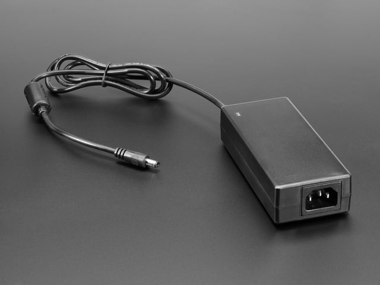
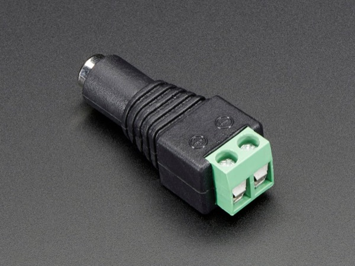
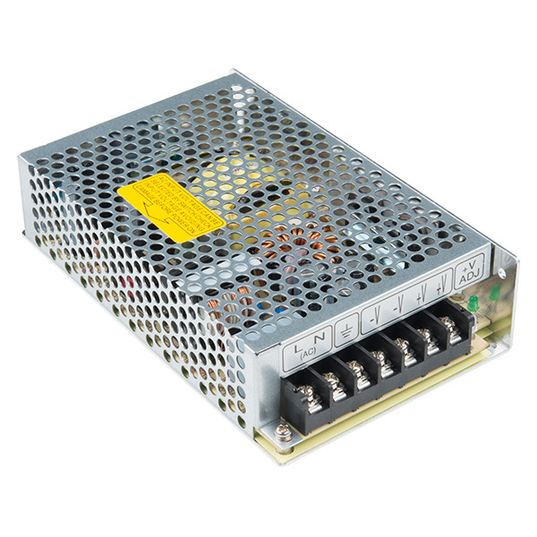
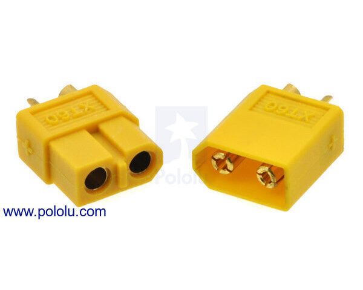
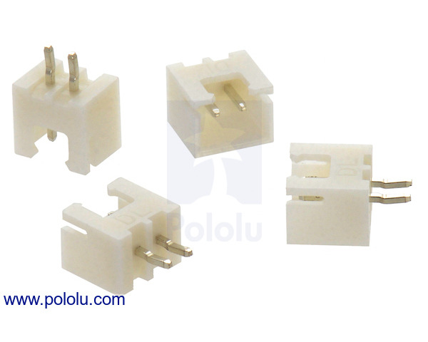
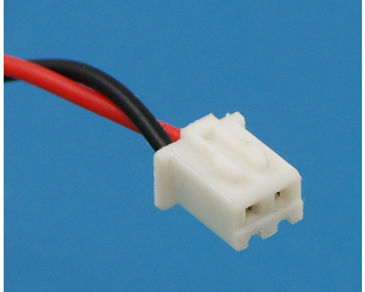

# 机器人头的电源与接线（带图）

> 2026-10-31。只回答三个问题：要买什么电源、电源从哪里出电、电线插到板子哪个口上。
> 图片在 `figs_power/` 里。照片来源见文末，只用于个人学习。

---

## 一句话版

**买一个 5V 10A 的电源适配器（和笔记本电脑那种黑色电源砖长得差不多），一头插墙上的插座，另一头是一个圆形的 DC 插头。** 圆头插进一个 “DC 母头转接线端子” 小转接头，再从转接头上分三根线出去：一根接嘴部板的 **XT60** 口，两根接眼部板和眉部板的 **XH2.54 2P** 小白口。

![[figs_power/wiring.svg]]

---

## 1. 为什么不能用 USB-C / Type-C 供电？

USB-C 和 Type-C 是同一个东西，只是两种叫法。

- USB-C 在 5V 下最多只能给 **3A**（15W）。手机快充能到几十瓦，那是把电压升到了 9V、12V、20V，不是 5V。
- 这个头有 21 个舵机，官方要求 **5V 10A**（50W）。用 USB-C 供 5V，电流只有需要的三分之一左右，舵机一动电压就往下掉，Pico 会反复重启。
- 每块板上的 Pico 自己确实有一个 USB 口，但那个口**只用来接电脑传数据、刷固件**，不能给舵机供电。

所以：**要专门买一个 5V 10A 的电源**，USB-C 不行。

---

## 2. 电源买哪种？

市面上 5V 10A 的电源主要有两种，**推荐第一种**。

### A. 电源适配器（推荐）

*一端是电源线插墙上（图右边那个口接一根普通的品字尾电源线），另一端是一根带**圆形 DC 插头**的线（图左）。*

- 淘宝搜：**“5V10A 电源适配器 DC5.5×2.5”**。
- 好处：220V 那一头已经封在盒子里，**你不会碰到高压电**，插上就能用。
- DC 圆头尺寸有 5.5×2.1 和 5.5×2.5 两种，**下面那个转接头要买同一个尺寸**。5.5×2.5 和 5.5×2.1 外面看起来一样粗，只是中间的针粗细不同，插错了会松、接触不良。这里统一用 **5.5×2.5**（5V 10A 的适配器大多是这个尺寸）。

DC 圆头不能直接插到板子上，要先接一个转接头，把圆头变成两根线：

*DC 母头转接线端子。圆头插进左边的孔；右边绿色的是两个螺丝端子，标着 + 和 −，把线头塞进去拧紧螺丝就行，不用焊。*

- 淘宝搜：**“DC 母头 接线端子 5.5×2.5”**，几块钱一个。

### B. 开关电源（铁壳子、螺丝端子）

*常见的铁壳开关电源。下面一排螺丝端子：左边 L、N、⏚ 接 220V 电源线，右边 −V、+V 是 5V 输出。最右边的 “+V ADJ” 是电压微调旋钮。*

- 型号比如明纬 **LRS-50-5**（5V 10A）。
- 好处：接线牢，能把电压精确调到 5.0V。
- 坏处：**220V 那一头要自己接线**，接错会触电。没接过 220V 的话，别选这个。

---

## 3. 板子上的两种电源口

### 嘴部板：XT60

*黄色的 XT60。**左边是母头（里面是两个孔）**，右边是公头（里面是两根金色插针）。一个面是平的、一个面有斜角，所以插反是插不进去的。*

- 嘴部板上焊的是 **XT60 母座**（立创编号 C428722，型号 XT60PW-F，就是左边那种带孔的，只不过是弯脚焊在板子边上）。
- 所以要买：**带公头（插针）的 XT60 线**。淘宝搜 **“XT60 公头 带线 16AWG”**，选一头是 XT60 公头、另一头是散线的那种。
- 散线那头：红线拧到转接头的 **+**，黑线拧到 **−**。
- 这根线要粗（16 到 18 AWG），因为嘴部板上有 2 个大舵机 MG996R，电流最大。

> 之前 `复现计划.md` 采购表里写的是 “XT60 母头线”，那是写错了，**应该买公头线**。

### 眼部板、眉部板：XH2.54 2P

板子上焊的是这种白色小座子（带两根针）：

*XH2.54 2P 座子，焊在 PCB 上，里面是两根针。*

要买的是和它配对的线：

*XH2.54 2P 端子线：白色插头里面是两个孔，后面带一红一黑两根线，插进上面那个座子就行。座子上有卡槽，方向反了插不进去。*

- 淘宝搜：**“XH2.54 2P 端子线 单头”**，要两根（眼部板一根，眉部板一根）。
- 红线接 +，黑线接 −。**插之前先对照板子丝印确认哪个脚是 VIN（+）**，线厂家的红黑顺序不一定和板子一致。如果反了，用镊子把端子挑出来换个位置就行。

---

## 4. 购物清单

| 东西                          | 数量        | 淘宝搜索词                 |
| --------------------------- | --------- | --------------------- |
| 5V 10A 电源适配器（DC 5.5×2.5 圆头） | 1         | 5V10A 电源适配器 DC5.5×2.5 |
| 品字尾电源线（如果适配器不送）             | 1         | 品字尾 电源线               |
| DC 母头转接线端子                  | 1（多买两个备用） | DC 母头 接线端子 5.5×2.5    |
| XT60 **公头**带线（还没买）               | 1         | XT60 公头 带线 16AWG      |
| ~~XH2.54 2P 端子线~~ | 2 | **已有，不用买** |

转接头一个螺丝孔里要塞三根线的 + （XT60 红线 + 两根 XH 红线），塞不下的话，把三根红线先拧在一起，或者加一个小的接线端子 / WAGO 快接头。黑线同理。

---

## 5. 第一次上电前

1. 先**不插 Pico、不接舵机**，只接电源。
2. 万用表量转接头 + 和 − 之间的电压，应该是 **5.0 到 5.2V**。超过 5.5V 不要往下接，眼眉板的 Pico 会烧。
3. **绝对不要接 12V 电源**。眼眉板上虽然印着 “12V Select”，但舵机是直接接在电源上的，12V 会把舵机烧掉。
4. 后面的步骤按 `焊接流程.html` 里 “上电前检查” 和 “上电（5V，还是不插 Pico）” 两步做。

---

## 图片来源

- XT60：Pololu 产品页 <https://www.pololu.com/product/2175>
- XH 座子：Pololu <https://www.pololu.com/product/2717>
- XH 线：Pololu <https://www.pololu.com/product/1167>
- 5V 10A 适配器：Adafruit <https://www.adafruit.com/product/658>
- DC 母头转端子：Adafruit <https://www.adafruit.com/product/368>
- 开关电源：Wikimedia Commons “Mean Well Switching Power Supply - 5VDC, 20A”（SparkFun，CC BY 2.0）
- 接线示意图 `wiring.svg`：自己画的
