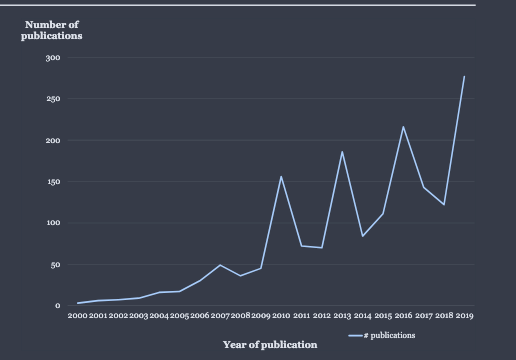
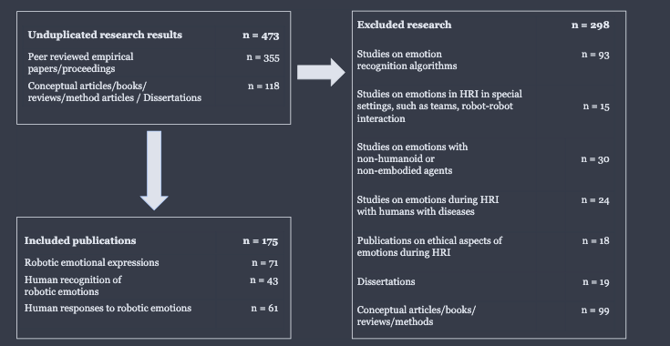
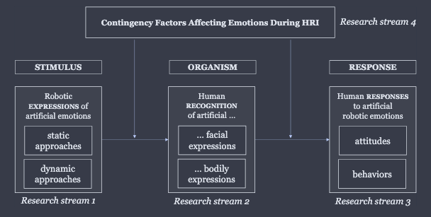
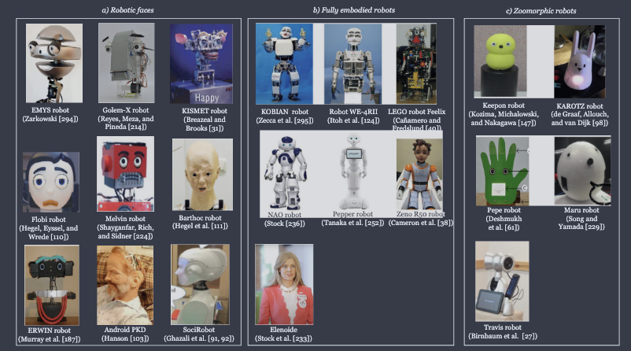
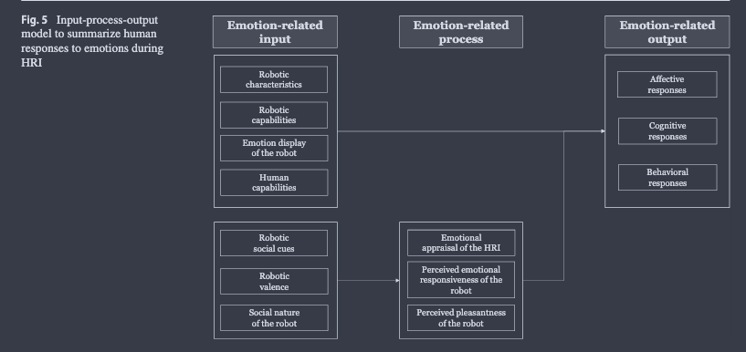

R. Stock-Homburg, "Survey of emotions in human–robot interactions: Perspectives from robotic psychology on 20 years of research," _Int. J. Soc. Robot._, vol. 14, pp. 389–411, 2022, doi: 10.1007/s12369-021-00778-6.

个：
文章从三个主题出发，对它们进行总结和概述
1. 机器人的情感表达；
2. 人对机器人情感的识别；
3. 人对机器人人工情感的反应。
没有机器人对人的情感识别，因为包括在机器人情感表达的设计和对人类情绪的建模/表征中了
# abstract

> Knowledge production within the interdisciplinary field of human–robot interaction (HRI) with social robots has accelerated, despite the continued fragmentation of the research domain.

社交机器人人机交互（HRI）是一个跨学科领域，这个领域的知识产出在加速，但研究仍然很分散。

这两点加在一起，让人很难站在研究前沿，也很难评估某个具体方向上的整体证据，比如情感在 HRI 中的作用。

> This systematic review of state-of-the-art research into humans' recognition and responses to artificial emotions of social robots during HRI encompasses the years 2000–2020.

这篇系统综述（systematic review）梳理了 2000–2020 年间的前沿研究，主题是在 HRI 中，人怎样识别和回应社交机器人的人工情感（artificial emotions）。

> In accordance with a stimulus–organism–response framework, the review advances robotic psychology by revealing current knowledge about (1) the generation of artificial robotic emotions (stimulus), (2) human recognition of robotic artificial emotions (organism), and (3) human responses to robotic emotions (response), as well as (4) other contingencies that affect emotions as moderators.

综述按照**刺激–有机体–反应（stimulus–organism–response, S–O–R）**框架组织，梳理了四方面的已有知识，以此推进机器人心理学（robotic psychology）：
1. 机器人人工情感的生成（刺激，stimulus）；
2. 人对机器人人工情感的识别（有机体，organism）；
3. 人对机器人情感的反应（反应，response）；
4. 作为调节变量（moderators）影响情感的其他情境因素（contingencies）。

# 1 Introduction

**① 背景：为什么社交机器人越来越重要**

> Due to demographic change and related skilled-worker scarcity and increased technological penetration of our private and working lives, social robots and success factors of human–robot interaction (HRI) become increasingly important.

由于人口结构变化和随之而来的技术工人短缺，加上技术越来越深入我们的私人生活和工作，社交机器人以及决定人机交互（HRI）成败的因素变得越来越重要。

HRI 研究是一个多学科领域，研究的是"人、机器人，以及它们相互影响的方式"。它汇集了机器人学、工程、计算机科学、人机交互（HCI）、认知科学和心理学等学科。在这些领域里，越来越多的研究关注人和社交机器人的互动。

> These robots "exist primarily to interact with people" or evoke social responses from them.

这类机器人"主要是为了和人互动而存在的"，或者能引起人的社交反应。社交机器人有很多角色，比如博物馆导览、前台接待、教育辅导、家庭帮手和护理员。

**② 情感表达和社会临场感**

> Due to their automated social presence, such robots make humans "feel that they are in the company of another social entity".

因为具有自动化的社会临场感（social presence），这类机器人会让人"感觉自己和另一个社会实体在一起"。社会临场感通常和机器人表达人工情感、促进社会关系的能力有关。

- 情感信号已经被证明是人际关系中的重要因素；
- 机器人表达情感，能提高人对 HRI **透明度**的感知；
- 这些信号让人能用熟悉的社交线索去解读机器人的行为，这些线索是人从以往人际互动中学来的；
- 社交机器人越接近人，它们的情感表达就越能促进社交型 HRI。

> Robotic psychology is defined as interdisciplinary field examines emotional, cognitive, social, and physical human responses to human-robot interactions by also considering physical and social environments.

**机器人心理学（robotic psychology）**被定义为一个跨学科领域，研究人在人机交互中的情感、认知、社交和身体反应，同时也考虑物理环境和社会环境。这篇综述的目的，是整合社交机器人 HRI 中关于情感的研究知识。

**③ 研究现状：数量多、很分散**

随着社交机器人越来越流行，关于它们所表现情感的研究也在加速：2000 到 2020 年，这个方向发表了 **1600 多篇**文献。如 Fig. 1 所示，二十年间发表数量持续增长。

**Fig. 1**：HRI 中研究情感的文献发表数量（数据来源：dimensions.ai），2000–2019 年逐年上升，后期接近每年 300 篇。

> Empirical studies of emotions during HRI mainly revolve around three topics: (1) emotion expression by robots, (2) human recognition of robotic emotions, and (3) human responses to robotic artificial emotions.

HRI 中情感的实证研究主要围绕三个主题：
1. 机器人的情感表达；
2. 人对机器人情感的识别；
3. 人对机器人人工情感的反应。

一些概念/综述类文章、HRI 中的情感识别研究以及相关领域的文献，也能为这次文献整合提供信息。这个领域复杂而分散，研究者很难跟上前沿发现，也很难把握某个方向上的全部证据。所以做一次文献综述既及时又必要。本综述只关注社交机器人 HRI 中的情感（制造业机器人的研究另见其他文献），流程见 Fig. 2。

**④ 文献筛选过程**

- **检索**：先在数字图书馆（Google Scholar、ScienceDirect、Dimensions）用关键词检索，比如 "human–robot interaction / HRI AND emotion"、"robots AND emotion"、"social robots AND emotions"；再手动检索重要期刊和会议的论文集（完整列表见 Web-Appendix 1）。
- **初筛**：初步扫描得到 1600 多篇，其中很多是专利报告、短报告或书的章节，排除后剩 **473 篇**。
- **进一步排除**，标准有四条：
  1. 只关注社交机器人 HRI 中的情感；
  2. 广义上 HRI 包括工业机器人、远程临场、虚拟现实、可穿戴设备等很多主题，本综述只看**具身（embodied）HRI**，所以排除了和非人形或非具身智能体（比如虚拟化身、可穿戴设备）互动的研究；
  3. 只关注**典型发展的人**和社交机器人之间的**二元（dyadic）互动**，排除特殊情境（比如依赖其他动态效应的人–机器人团队），也排除针对有健康问题的人、医学诊断是定义 HRI 关键的研究（被排除的研究列在 Web-Appendix 2）；
  4. 只要经过**双盲同行评审**的原创实证研究，排除概念性文章和学位论文；HRI 中情感的伦理研究以概念为主，也被排除。
- **结果**：最终保留 **175 篇**。

**Fig. 2：文献筛选流程**

```
去重后的研究结果 n = 473
├── 同行评审的实证论文/会议论文 n = 355
│   ├── 纳入 n = 175
│   │   ├── 机器人的情感表达 n = 71（研究流 1）
│   │   ├── 人对机器人情感的识别 n = 43（研究流 2）
│   │   └── 人对机器人情感的反应 n = 61（研究流 3）
│   └── 排除 n = 180（另含下面的学位论文和概念类，共排除 298）
│       ├── 情感识别算法研究 n = 93
│       ├── 特殊情境（团队、机器人–机器人互动等）n = 15
│       ├── 非人形或非具身智能体 n = 30
│       ├── 患病人群的 HRI n = 24
│       └── HRI 中情感的伦理问题 n = 18
└── 概念文章/书/综述/方法/学位论文 n = 118
    ├── 学位论文 n = 19
    └── 概念文章/书/综述/方法 n = 99
```

**⑤ 五个研究问题**

这篇综述也可以促进理论发展。已有研究表明，有几个方向需要更多研究，学界也在呼吁建立 HRI 中情感的概念模型和实证模型。所以本综述要回答五个研究问题：

1. 生成机器人情感表达用了哪些方法？
2. 人能多好地识别机器人的人工情感？
3. 人怎样回应机器人的人工情感？
4. 情境因素怎样影响 HRI 中机器人情感和人的反应之间的关系？
5. 关于 HRI 中的情感，还有什么需要研究？

按照系统文献综述的规范，综述会说明背后的理论视角、实证设计问题和主要发现，为推进知识打下基础。把视角和实证发现结合起来，就能找出哪些地方研究结果不一致、或者呈现跨学科的不同看法。

文章结构：第 2 节介绍作为综述组织结构的概念框架；第 3 节按研究流介绍研究现状；第 4 节给出未来研究方向；第 5 节是结论。

> [!note] 小结
> 第 1 节交代背景和方法：
> - **为什么**：人口变化和技术渗透让社交机器人越来越重要；情感表达带来**社会临场感**和**透明度**，让人能用熟悉的人际线索去理解机器人。
> - **怎么做**：从 1600+ 篇文献筛到 473 篇，再按"具身 + 二元互动 + 典型人群 + 同行评审实证"筛到 **175 篇**，分成三个研究流：表达 71、识别 43、反应 61。
> - **问什么**：五个研究问题，分别对应生成、识别、反应、调节因素和未来方向。
> - 注意：**情感识别算法的研究（93 篇）被排除了**，这篇综述关注的是"人怎么看机器人的情感"，不是"机器人怎么识别人的情感"。

# 2 Framework of the Overview（综述框架）

> A detailed review of published articles reveals four main streams of research on (1) emotional expressions by robots, (2) the human recognition of artificial robotic emotions, (3) human responses to robotic emotions, and (4) contingency factors.

仔细阅读已发表的文章后，可以归纳出四个主要研究流：
1. 机器人的情感表达；
2. 人对机器人人工情感的识别；
3. 人对机器人情感的反应；
4. 情境因素（contingency factors）。

这些研究流构成了 Fig. 3 中综述框架的基础。

**S–O–R 范式**

> To present extant research, this article organizes the discussions along a causal chain, which parallels the notions of the stimulus–organism–response (S–O–R) paradigm.

为了呈现已有研究，本文沿着一条因果链组织讨论，这条链对应**刺激–有机体–反应（S–O–R）范式**。按照这个框架，环境的某些特征（刺激）会影响人的认知和情感状态（有机体），进而驱动行为反应（反应）。

对应到本综述：

| S–O–R | 在本综述中的含义 | 变量角色 |
|---|---|---|
| Stimulus（刺激） | HRI，具体是机器人表达的人工情感 | 自变量（independent variable） |
| Organism（有机体） | 人类参与者、他们的认知或情感状态、以往经验 | 中介变量（mediator） |
| Response（反应） | HRI 中的行为 | 因变量（dependent variable） |

> This relationship is not automatic but rather tends to be shaped by the context and people's own experience.

这种关系不是自动发生的，往往会受到情境和人自身经验的影响（这就是研究流 4 情境因素的位置）。

**Fig. 3：综述的概念框架**

```
                    情境因素：影响 HRI 中情感的调节变量（研究流 4）
   ┌──────────────────────────────────────────────────────────────┐
   STIMULUS                  ORGANISM                  RESPONSE
   机器人人工情感的表达   →   人对机器人人工情感的识别  →   人对机器人人工情感的反应
   · 静态方法                · 面部表情                   · 态度
   · 动态方法                · 身体表情                   · 行为
   （研究流 1）              （研究流 2）                 （研究流 3）
```

> [!note] 小结
> 第 2 节给出全文骨架：用心理学 / 营销学里常见的 **S–O–R** 因果链，把 HRI 情感研究分成**表达 → 识别 → 反应**三段，再加上一层**调节因素**。后面第 3 节的四个小节和这四个研究流一一对应。

# 3 State of the Art（研究现状）

## 3.1 Research Stream 1: Robotic Expressions of Artificial Emotions（研究流 1：机器人的人工情感表达）

> The first research stream includes 71 reviewed studies and relates to the stimulus, depicted in Fig. 3. Reviewing this research attempts to answer the first research question: What methods have been applied for robotic emotional expression generation?

第一个研究流包括 **71 篇**研究，对应 Fig. 3 中的**刺激**，回答第一个研究问题：生成机器人情感表达用了哪些方法？

在经典的 S–O–R 范式里，刺激可以包括另一个人内部状态的表达；在本框架里，刺激是机器人对人工情感的表达。观察者会把情感感知为强烈的感受，所以无论在人际互动还是 HRI 中，情感都是重要的刺激。

**① 学科来源**

这些研究的基础来自机器人学和 HRI，还有一些研究扎根于人机交互（HCI）、工程和哲学。

**② 理论方法**

- **多层次情感加工理论（multilevel process theory of emotion）**：认为人在一个三层的层级系统中感知情感：
  - 感觉层（sensory level）：产生初级情绪；
  - 图式层（schematic level）：在记忆系统中整合感知和反应；
  - 概念层（conceptual level）：把以往经验和对未来的预测整合起来。
  
  这个模型对理解 HRI 中的认知过程很有帮助。
- **其他分类标准**：有的研究者基于概念性考虑、**面部动作编码系统（FACS）**的情绪，或**情感环形模型（circumplex model of emotions）**，提出机器人情感表达的分类标准。
  - FACS 包括六种基本情绪：快乐（happiness）、惊讶（surprise）、愤怒（anger）、悲伤（sadness）、恐惧（fear）和厌恶（disgust），据说人和非人都能体验到。相反，兴趣、好奇等**次级情绪（secondary emotions）**是人特有的。
  - 还有的分类依据用户反应、情绪仿真或情绪动画。
  - 环形模型建议按**效价（valence）**和**唤醒度（arousal）**两个维度刻画机器人的人工情感表达。它的基本前提是：人的情感状态分布在一个圆的圆周上，各个维度可以按正面或负面情感的程度来划分。

**③ 生成人工情感的方法：静态 vs 动态**

> The applied methods can be classified into two major categories: (1) static and (2) dynamic.

已有方法可以分为两大类：**静态（static）**和**动态（dynamic）**。

**静态方法**

> Static approaches to robotic emotion generation create manually coded, pose-to-pose robotic animations based on stable system architectures of robotic emotions, using hand-crafted categorizations of robotic emotions.

静态方法基于固定的机器人情感系统架构，用手工设计的情感分类，生成**手工编码的、关键姿态到关键姿态（pose-to-pose）**的机器人动画。已有的情感架构基于：
- 预定义脚本；
- 预定义的情感空间；
- 气动执行器的运动；
- 模糊情感系统（fuzzy emotion system）。

**动态方法**，又分为主动式（proactive）和反应式（reactive）：

- **主动式生成**：可以借鉴图形动画设计，比如迪士尼的 **12 条基本动画原则**，用它们也能生成栩栩如生的机器人情感。这些原则的核心思想是"用关键姿态动画，定义若干关键帧，再在关键帧之间插值得到中间姿态"。这种以创意设计为导向的方法能生成高质量的机器人动画，因为它是针对机器人的形态（morphology）调整的。情感也可以来自特征组合、手工设计、创意设计方法和对人体的直接模仿。
- **反应式生成**：依赖的是**识别人的情感**所得到的数据，来源包括人脸、头部动作、身体动作/手势、语音、触觉或脑反馈（各识别领域见 Table 1）。这类研究大多尝试**直接模仿**：用计算机视觉技术或特殊标记和传感器追踪人的情感表达，然后把关键位置映射到机器人的运动空间。映射方式可以是数据驱动处理，也可以是为机器人形态定义合适的传递函数（transfer functions）。

**Table 1：基于人类情感的机器人情感生成研究**（按人类情感表达的识别通道分类）

| 识别通道 | 研究举例 |
|---|---|
| 人脸（Face） | 研究最多，约 30 篇，如 Ahmed et al.、Alonso-Martin et al.、Kim et al.、Li et al.、Zhang et al. 等 |
| 身体（Body） | Inthiam et al.、Nunes、Vithanawasam & Madhusanka、Wang et al. |
| 语音（Speech） | 约 20 篇，包括 Breazeal、Breazeal & Aryananda（Kismet 的语调识别）、Devillers et al.、Kwon et al. 等 |
| 脑反馈（Brain feedback） | Schaaff & Schultz、Su et al.、Tsuchiya et al.、Val-Calvo et al. |
| 热成像（Thermal imaging） | 如基于面部皮肤温度，Abd et al. |
| 生物反馈（Biofeedback） | Kurono et al.、Rani & Sarkar、Sugaya、Yang et al. |
| 多模态信息（Multimodal） | Bien et al.、Castillo et al.、Cid et al.、Yu & Tapus 等 |
| 在线视听情感识别 | Kansizoglou et al. |

**④ 发现总结**

> Hand-coded robotic animations can offer high quality. However, these static approaches are limited because "robot performance based on a static emotional state cannot vividly display dynamic and complex emotional transference".

手工编码的机器人动画质量可以很高。但静态方法有局限，因为"基于静态情感状态的机器人表现，无法生动地展示动态而复杂的情感转换"。另外，情感种类有限会增加**行为重复**的可能，这在 HRI 中可能显得不合适。

因此研究建议，机器人的情感生成应该基于能**识别人类情感的动态算法**。不过这种方法虽然有优势，也有挑战：人和机器人的运动能力不同。

> [!note] 小结
> 研究流 1（71 篇）讲**机器人怎么生成情感表达**：
> - 理论依据：多层次加工理论、**FACS 六种基本情绪**、**环形模型（valence × arousal）**。
> - 方法分两大类：
>   - **静态**：手工设计的 pose-to-pose 动画 + 固定情感架构（脚本、预定义情感空间、模糊系统）。质量高，但容易**重复、不够生动**。
>   - **动态**：**主动式**借鉴迪士尼 12 条动画原则，关键帧加插值，针对机器人形态设计；**反应式**识别人的情感（脸 / 语音 / 身体 / 脑电 / 生理）再模仿映射。
> - 结论：倾向于动态方法，但难点在于**人和机器人的运动空间不一致**，映射困难。

## 3.2 Research Stream 2: Human Recognition of Artificial Robotic Emotions（研究流 2：人对机器人人工情感的识别）

> The second research stream includes 43 reviewed studies and relates to the organism depicted in Fig. 3. Reviewing this research attempts to answer the second research question: How well can robotic artificial emotions be recognized by humans?

第二个研究流包括 **43 篇**研究，对应 Fig. 3 中的**有机体**，回答第二个研究问题：人能多好地识别机器人的人工情感？

在 S–O–R 范式里，有机体指的是"介于外部刺激和人最终发出的行动、反应之间的任何内部过程和结构"。在本综述中，有机体表现为人对机器人人工情感的识别，这些情感通过脸、身体或两者共同表达（研究细节见 Web-Appendix 3）。

**① 地理来源**

这个研究流的大多数研究只在**单一国家**进行，分布在欧洲（奥地利、法国、德国、荷兰、葡萄牙、瑞士、英国）、亚洲（中国、印度、日本、韩国、台湾）和美洲（美国、墨西哥）。只有 **4 篇**研究跨多个国家考察人对机器人情感的识别：
- 有研究发现，美国、亚洲和欧洲参与者在情感识别上存在文化差异；
- 另一项研究在丹麦、英国和德国之间也发现了差异；
- 其他研究虽然收集了德国、匈牙利、印度、荷兰、波兰、葡萄牙、英国，或德国、斯洛伐克、西班牙的数据，但没有明确考察文化差异。

**② 学科与理论**

- 学科：主要来自机器人学、人机交互、HRI 和社交机器人学，有一篇来自神经科学。
- 理论：大多数研究基于 **FACS 模型**；也有好几篇用了**环形模型**（见 3.1 节）；和环形模型密切相关的 **Plutchik 情绪轮（wheel of emotions）**在两篇研究中用到。

**③ 所考察的情感和表达方式**

Table 2 总结了人对 FACS 六种基本情绪的识别率。平均百分比是根据各研究报告的识别率详细列表（Web-Appendix 4）算出来的。被识别出的情感是"评估和判断事件、判断事件对生物整体价值（比如正面或负面、想要或不想要）的基础"。

> A closer look at the studies reveals that there is only little consistency across the reviewed studies. Rather, they are heterogeneous in several important respects:

仔细看这些研究会发现，它们之间几乎**没有一致性**，在几个重要方面差异很大：

- **被操纵的情感**：大多数研究根据 FACS 或环形模型来选择要操纵的情感，所以很大一部分集中在快乐、惊讶、愤怒、恐惧、悲伤和厌恶上。
- **机器人**：可以分成拟人（Fig. 4 中 a、b 类）和拟动物（zoomorphic，c 类）两种。因为身体和/或脸的自由度不同，它们表达情感的能力也不同。
- **用来表达情感的身体部位**：和社会心理学的观点一致，已有文献关注机器人在 HRI 中的面部表情、身体表情或两者都有。这种差异可能也来自可用机器人的不同（见 Fig. 4）。
- **HRI 情境**：大多数研究在实验室或线上进行，只有两项在真实环境中，分别是家庭和临床环境。
- **HRI 场景**：互动方式有面对面、基于视频、基于图片几种。

**Table 2：人对机器人情感表达的平均识别率，以及 Mann–Whitney U 检验结果**

（I）人对机器人情感表达的平均识别率（%）

| 表达方式 | 快乐 | 惊讶 | 愤怒 | 恐惧 | 悲伤 | 厌恶 | 该方式平均 |
|---|---|---|---|---|---|---|---|
| (a) 面部表情 | 71.24 | 57.14 | 63.49 | 38.89 | 68.09 | 53.72 | **58.76** |
| (b) 身体表情 | 65.04 | 59.65 | 61.62 | 56.53 | 72.96 | 31.40 | **57.87** |
| 面部 + 身体 | 62.09 | 76.08 | 56.77 | 36.12 | 55.95 | 66.08 | **58.85** |
| 各情绪平均 | **66.12** | 64.29 | 60.62 | **43.84** | 65.67 | 50.40 | **58.49** |

（II）面部 vs 身体表情比较：Mann–Whitney U 检验

| | 快乐 | 惊讶 | 愤怒 | 恐惧 | 悲伤 | 厌恶 |
|---|---|---|---|---|---|---|
| z | −.14 | −.20 | −.44 | −.94 | −.04 | −.19 |
| p | .89 | .84 | .66 | .35 | .97 | .23 |
| U | 182.0 | 83.5 | 136.0 | 47.5 | 110.5 | 8.0 |

显著性水平 .05，双尾检验；所有 p 都大于 .05，也就是**都不显著**。

**④ 面部 vs 身体：Mann–Whitney U 检验**

一个有意思的问题是：情感由机器人的脸表达还是由身体表达，人的识别能力会不会不同？因为大多数研究只报告了平均识别率百分比，不满足独立样本 t 检验的前提，所以本综述用 **Mann–Whitney U 检验**。这个检验判断两个独立样本（比如面部表情识别研究和身体表情识别研究）的集中趋势是否不同。Mann–Whitney U 统计量定义如下：

$$U_x = n_x n_y + \frac{n_x(n_x+1)}{2} - R_x \tag{1}$$

$$U_y = n_x n_y + \frac{n_y(n_y+1)}{2} - R_y \tag{2}$$

| 符号 | 含义 |
|---|---|
| $n_x$ | 第一组研究的观测数（比如面部表情识别研究） |
| $n_y$ | 第二组研究的观测数（比如身体表情识别研究） |
| $R_x$ | 第一组被赋予的秩（rank）之和 |
| $R_y$ | 第二组被赋予的秩之和 |

> That is, the Mann–Whitney U test is based on the idea of ranking the data; the measured values themselves are not used in the calculations, but instead are replaced by ranks, which inform the actual test.

也就是说，Mann–Whitney U 检验的思路是**给数据排秩**：计算时不用测量值本身，而是用秩替代，检验基于秩进行。所以计算只依据数据的顺序（大于、小于），不考虑数值之间的绝对距离。

**结果**：

> However, in the current review, no significant differences arise in participants' recognition rates of emotions, expressed by a robot using either facial or bodily expressions (see Table 2).

有研究者认为，HRI 中面部表情比身体表情更重要。这个研究流中很大一部分研究考察的是面对面的人机交互，另一些研究用图片来表达机器人情感。这些研究给出了用面部表情和身体特征编程机器人人工表情的有效方法。但在本综述中：
- 机器人用**面部表情还是身体表情**表达情感，参与者的识别率**没有显著差异**（见 Table 2）；
- Mann–Whitney U 检验还表明，和**实体具身机器人**互动时的识别率，**并不高于**和基于图片或视频的机器人互动时的识别率，这和一些已有发现一致。

**⑤ 机器人类型**

**Fig. 4：机器人化身举例**

| 类别 | 机器人举例 | 常用于 |
|---|---|---|
| (a) 机器人脸（robotic faces） | EMYS、Golem-X、**KISMET**、Flobi、Melvin、ERWIN、Android PKD、SociRobot、LEGO 机器人 Feelix | 面部情感表达研究 |
| (b) 全身具身机器人（fully embodied robots） | KOBIAN、Barthoc、NAO、Elenoide、WE-4RII、Pepper、Zeno R50 | 身体情感表达研究 |
| (c) 拟动物机器人（zoomorphic robots） | Keepon、KAROTZ、Pepe、Maru、Travis | — |

**⑥ 研究设置与参与者**

- **设置**：大多数研究在**实验室**进行；另一批设计成**线上实验**；De Graaf、Allouch 和 van Dijk 的一项研究用了质性访谈。**没有研究使用实地（field）设置**。
- **参与者**：
  - 大多数研究用**成年学生**样本；
  - 三项研究用成年非学生受访者，具体是家庭成员、临床/非临床人员和一线员工；
  - 有的通过线上渠道获得成年人混合样本；
  - 少数例外用了儿童。Cañamero 和 Fredslund 比较了成人和儿童的识别能力，发现**儿童识别机器人情感比成人更好**；
  - 还有好几项研究没有说清楚参与者是谁。

**⑦ 发现总结**

> These studies affirm that robots can be programmed to express emotions, despite not actually having them.

这些研究证实，机器人虽然实际上没有情感，但可以被编程来表达情感。不同情感的平均识别率可以作为指标，但不同的机器人仍然需要充分的编程和测试，才能建立起机器人的情感表达。

尽管机器人之间有差异，揭示出的识别率也能提供一些指导，说明哪些机器人表情和哪些情感相关：
- Table 2 中大多数研究的平均识别率都远高于早期 HRI 研究建议的 **15% 阈值**，面部表情 58.76%，身体表情 57.87%；
- 所以未来的 HRI 研究应该争取让面部和身体表情的情感识别率**至少达到 50%**；
- 这些被考察过的情感为建立**标准化的摆拍情感表情（standardized, posed emotional expressions）**提供了初步基础，这类表情能准确可靠地传达信息。在机器人研究中经过验证的表情，也不太容易出现没有标准化体系的情感表达刺激常有的问题。

但很少有研究提供检测率的均值差异数据，大多只报告百分比，这限制了做组间显著性检验的能力。

> Although the results provide initial indications, an empirically validated "gold standard" for expressing robotic emotions is not yet available.

虽然结果提供了初步指示，但目前还**没有**一个经过实证验证的机器人情感表达"**金标准**"。

> [!note] 小结
> 研究流 2（43 篇）讲**人能不能认出机器人的情感**：
> - 理论：大多基于 **FACS**，其次是环形模型、Plutchik 情绪轮。
> - **识别率**（Table 2）：总体平均 **58.49%**。最好认的是**快乐（66%）和悲伤（66%）**，最难认的是**恐惧（44%）**（和 Kismet 那篇的结果一致：fear 最难）。
> - **Mann–Whitney U 检验**（基于秩的非参数检验）：**脸 vs 身体没有显著差异**；**实体机器人 vs 图片/视频也没有显著差异**。
> - 机器人分三类：只有脸（Kismet、Flobi…）、全身（NAO、Pepper…）、拟动物（Keepon…）。
> - 方法学问题：研究高度**异质**；以**实验室 + 学生**为主，**没有实地研究**；大多只报告百分比，没法做显著性检验。
> - 建议：识别率目标 **≥ 50%**；目前**还没有"金标准"**。

## 3.3 Research Stream 3: Human Responses to Artificial Robotic Emotions（研究流 3：人对机器人人工情感的反应）

> The third research stream includes 61 reviewed studies and relates to the response depicted in Fig. 3. Reviewing this research attempts to answer the third research question: How do humans respond to artificial robotic emotions?

第三个研究流包括 **61 篇**研究，对应 Fig. 3 中的**反应**，回答第三个研究问题：人怎样回应机器人的人工情感？在 S–O–R 范式里，反应是人对刺激的回应。所以研究流 3 包括人对机器人情感反应的研究（细节见 Web-Appendix 5）。

**① 地理来源：跨文化研究很少**

这个研究流的研究大多在单一国家进行，但覆盖了世界大部分地区：亚洲（韩国、日本、印度、中国）、欧洲（法国、荷兰、芬兰、德国、意大利、西班牙、瑞典、英国），以及美国、加拿大、以色列、澳大利亚、新西兰和巴西。

只有 **3 项**研究包括多个国家，它们揭示了可能影响 HRI 中人类反应效应强度的情境因素：
- 一项研究覆盖美国和日本：两国的人对机器人的**喜悦**评分相似，但看起来代表**另一种文化**的机器人会被视为**外群体（outgroup）**的一员；
- 另一项研究覆盖澳大利亚和日本：澳大利亚参与者对一个仿真机器人（android）的感知比日本参与者更正面；
- 一项比较丹麦、英国和德国母语者的研究发现，不同群体对机器人情感表达有不同的**期望**。

**② 学科与理论**

- 学科：大多数研究来自机器人学、人机交互或 HRI。HRI 中的情绪反应也引起了社会互动方面的关注，比如行为机器人学、认知科学、人因工程、社交机器人学和心理学。
- 理论：
  - **社会认同理论（social identity theory）**和**相似吸引范式（similarity attraction paradigm）**：最早由 Tajfel 等人提出，用来考察人会把机器人看作自己社会**内群体（ingroup）**还是**外群体（outgroup）**的一员；
  - **整合技术接受理论（unified theory of acceptance）**和**技术接受模型（TAM）**：源自研究人如何接受技术的信息系统研究，也被用到 HRI 中。在 TAM 里，**感知有用性（perceived usefulness）**和**感知易用性（ease of use）**决定使用系统的行为意向，行为意向再预测实际使用；
  - **认知评价理论（cognitive appraisal theory）**和认知评价的层级模型：为开发能表现情绪反应的人工智能体提供了框架；
  - **恐怖谷（uncanny valley）范式**：最早由森政弘（Mori）提出，根据机器人的**类人程度**（像人的程度）来预测人对它的情绪反应。

**③ 所考察的关系：输入–过程–输出模型**

> The investigated variables can be organized into an input-process-output model, depicted in Fig. 5.

不同变量分别代表机器人的情感行为（作为与情感相关的输入）和人对机器人情感的反应（或 HRI 中人的反应）。有几个变量一方面被当作机器人情感的结果来研究，另一方面又被当作人对机器人情感反应的前因，这类变量称为**与情感相关的中介变量（emotion-related mediators）**。被考察的变量可以组织成一个**输入–过程–输出（input-process-output）模型**，见 Fig. 5。

**Fig. 5：HRI 中人对情感反应的输入–过程–输出模型**

```
与情感相关的输入            与情感相关的过程（中介）          与情感相关的输出
· 机器人特征           →   · 对 HRI 的情感评价          →   · 情感反应
· 机器人能力               · 感知到的机器人情感回应性         · 认知反应
· 机器人的情感展示         · 机器人的社会属性                 · 行为反应
· 人的能力                 · 感知到的机器人愉悦度
· 机器人的社交线索
· 机器人的效价
```

**输入（input）**：

- **机器人特征**：比如表现出的个性、共情或类人程度，会影响 HRI 中的情感。例如机器人和人的个性相似度以及类人程度会影响人的接受度；
- **机器人的情感展示和情感能力**：比如使用非言语线索、叫人的名字，也能提高机器人的接受度；
- **人的特征**：比如情绪智力（emotional intelligence）和与机器人打交道的经验，同样会影响 HRI 中的情感；
- **社交线索**：包括情感表达的时长或方式，也有助于决定 HRI 中的情感。

**过程（中介变量）**：

> Only one study examines indirect effects pertaining to emotions during HRI. It shows that a robot's emotional valence indirectly affects user perceptions through their emotional appraisals of the HRI.

中介变量帮助解释与情感相关的输入怎样联系到人对 HRI 的反应。**只有一项研究**考察了 HRI 中与情感相关的**间接效应**：机器人的情感效价通过用户对 HRI 的情感评价，间接影响用户的感知。

还有几项研究虽然没有明确按这个思路来做，但也为可能在"输入–人的反应"之间起中介作用的情感变量提供了线索。它们同时考察了一组构念的前因和人的反应，从而找出了 Fig. 5 中所说的中介变量，包括机器人被感知到的**社会属性（social nature）**、**情感回应性（emotional responsiveness）**和**愉悦度（pleasantness）**。

**输出（人的反应）**，分为情感、认知和行为三类：

| 类别 | 包括的变量 |
|---|---|
| **情感反应（affective）** | 情感（affect）、喜爱度（likability）、共情（empathy）、对机器人的兴趣、诡异感（uncanniness）、对机器人情感的情绪适应、对机器人的信任 |
| **认知反应（cognitive）** | 对机器人的注意、社会能动性判断（social agency judgements）、对机器人的整体感知、感知到的类人程度、情绪解读、情感效价、感知到的内群体联系；从 TAM 看，目前只有**感知有用性**被当作因变量用于研究 HRI 中的情感 |
| **行为反应（behavioral）** | 互动强度、正面反应、回避、对机器人的利他行为、人的任务表现 |

**④ 实证设计与样本**

- **实验室为主**：大多数研究用**实验室实验**，参与者是**学生**；参与者通常是没有进一步说明的成年人，或者是儿童。实验室里受控的 HRI 模拟，可能反映了主流机器人研究中**实证主义范式（positivist paradigm）**仍然占主导：按照这个范式，算得上知识的发现应该限于"实证的"，也就是实际的、感官可感知的、可验证的发现。但这类研究的**可推广性往往有限**。
- **线上和真实环境很少**：少数研究包括线上实验，或者来自不同背景的线上参与者的数据。只有 3 项实验研究在真实环境中进行，收集的是访客或养老护理机构客户的数据。
- **样本小**：大多数研究样本不到 50 人，只有约 **20%** 的研究有 50 人或更多。
- **全部依赖自评**：

> All reviewed studies rely on participants' self-ratings, which are useful to assess their characteristics. Gauging emotions or behaviors with self-ratings may create a threat of common method variance.

  所有被综述的研究都依赖参与者的**自评（self-ratings）**。自评对评估参与者的特征有用，但用自评测量情感或行为可能带来**共同方法偏差（common method variance）**的威胁，也就是"归因于测量方法、而不是归因于测量所代表的构念"的变异。它会制造一种虚假的内部一致性，让变量之间看起来有相关，但这种相关其实是由共同来源产生的。
- **大多是单次互动**：大多数研究只关注和机器人的**一次互动**，隐含的假设是人的情绪反应保持不变，不会随时间或更多次互动而变化。少数**纵向研究（longitudinal studies）**让同一个用户和机器人互动多次，例如：
  - 一项为期 **6 个月**的实地实验表明，和**有情感的机器人**（表达快乐或悲伤）互动，比和中性机器人互动持续得**更久**；
  - 在购物中心进行的一项为期 **26 天**的实地研究发现，对机器人评价正面的参与者，也表现出对互动更大的兴趣；
  - 一项为期 **9 周**的研究发现，人对情感表达给予的共情程度，和对言语表达给予的共情程度**没有差别**。
  
  纵向研究更费力、更耗时，而且直到最近，技术才足够稳健，能让机器人在用户长时间使用时有一定自主性。但"纵向研究对考察用户行为和体验随时间的变化极其有用"。

**⑤ 发现总结**

> Emotions are particularly important during HRI with social robots. During HRI, humans express emotional, cognitive, and behavioral responses.

情感在社交机器人 HRI 中特别重要。在 HRI 中，人会表现出情感、认知和行为三方面的反应。尤其是机器人与情感相关的特征、情感能力和情感展示，对 HRI 很重要。

> A robot that expresses positive emotions is more accepted as technology than one that does not.

一个**表达正面情感的机器人**，比不表达的机器人**更容易被当作技术接受**。

> [!note] 小结
> 研究流 3（61 篇）讲**人对机器人情感会做出什么反应**：
> - 理论：**社会认同 / 相似吸引**（内群体还是外群体）、**TAM**（有用性 + 易用性 → 接受）、**认知评价**、**恐怖谷**。
> - **IPO 模型**（Fig. 5）：输入（机器人特征 / 能力 / 情感展示 / 社交线索 + 人的特征）→ 中介（情感评价、情感回应性、社会属性、愉悦度）→ 输出（**情感 / 认知 / 行为**三类反应）。
> - **关键缺口**：几乎只研究直接效应，**只有 1 篇**检验了中介（间接）效应。
> - 方法学问题：实验室 + 学生 + **样本 < 50**（约 80%）+ **全部自评**（共同方法偏差）+ **大多单次互动**。
> - 纵向研究的发现：有情感的机器人互动更持久（6 个月）；正面评价的人兴趣更大（26 天）。
> - 核心结论：**表达正面情感的机器人更容易被接受**。

## 3.4 Research Stream 4: Contingency Factors Affecting Emotions During HRI（研究流 4：影响 HRI 中情感的情境因素）

> The fourth research stream includes 14 studies that relate to the contingencies in which the interaction takes place (see Fig. 3).

第四个研究流包括 **14 篇**研究，关注互动发生的情境因素（见 Fig. 3）。这些研究是研究流 3 中被综述研究的一个子集（见 3.3 节），所以细节也可以在 Web-Appendix 5 中找到。

这部分回答第四个研究问题：情境因素怎样影响 HRI 中机器人情感和人的反应之间的关系？

> A contingency or moderator variable either strengthens or weakens the relationship between two or more variables.

**情境变量**或**调节变量（moderator variable）**会增强或削弱两个或多个变量之间的关系。考虑情境因素，让这个研究流超出了经典的 S–O–R 逻辑：它承认基本效应并不是在所有情况下都一样强，基本效应是否存在、有多强，可能系统地取决于情境因素。

**① 互动双方的特征**

- **人的性别**：5 项研究检验了人的性别是否影响 HRI 中的情感。有几项研究发现了差异；另一些研究表明，男性更愿意和愉悦的（相对于中性的）机器人互动，而女性没有表现出这种偏好差异。
- **机器人的特征**：包括情绪智力和类人程度，也被当作调节变量研究过。

**② 互动本身的特征**

- 和机器人玩游戏时的**注视线索（gaze cues）**，会提高参与者对 geminoid 机器人（按某个特定真人外貌设计的机器人）社会期许度的感知，但对类人程度较低的机器人（比如 Robovie）没有这个效果；
- 在 HRI 中**对机器人有控制权**，也会提高参与者在看到仿真机器人面部表情时表现出的情感。

**③ 互动时长**

> Six studies note long-term effects of emotions during HRI with a social robot. Relying on longitudinal data from adult participants, these studies consistently reveal that social cues and emotions, expressed by a social robot, trigger HRI over time.

6 项研究注意到了社交机器人 HRI 中情感的**长期效应**。基于成年参与者的纵向数据，这些研究一致表明：社交机器人表达的社交线索和情感，能**随时间持续引发** HRI。但有一项研究表明，**3–4 岁的儿童**会随着时间推移对机器人**失去兴趣**。

**④ 环境因素**

**文化差异**、**任务特征**等外部因素也被考察过（见 Web-Appendix 5）。已有研究清楚地揭示了人对 HRI 中情感的反应存在文化差异。另外还表明，**任务复杂度**会影响 HRI 中对机器人的信任。

**⑤ 发现总结**

环境特征（比如参与者的文化）和互动双方（人或机器人）的特征都很重要。另外，**对机器人的控制**会提高 HRI 中机器人的接受度。研究还表明，互动时长会影响人对 HRI 的情绪反应。由于已有研究大多是**横断面（cross-sectional）**的，它们的结论应该谨慎看待。

> [!note] 小结
> 研究流 4（14 篇，是研究流 3 的子集）讲**调节变量**，也就是什么情况下效应会变强或变弱：
> - **人和机器人的特征**：性别（男性更偏好愉悦的机器人）、机器人的情绪智力和类人程度。
> - **互动特征**：注视线索只对高度拟人的 geminoid 有效；**有控制权**会提升情感。
> - **时长**：成人长期互动效果持续，但 **3–4 岁儿童会失去兴趣**。
> - **环境**：文化差异明显；任务复杂度影响信任。
> - 这正是"超出 S–O–R"的地方：同一个刺激，在不同情境下效果不同。

# 4 Discussion（讨论）

## 4.1 What Do We Know?（我们已经知道什么？）

回答本综述前四个研究问题，是想提供关于 HRI 中情感的现有实证知识（见第 1 节）。

> This review reveals that the field is well researched, with many methodologically sound empirical studies.

综述表明，这个领域研究得比较充分，有很多方法上可靠的实证研究。这个领域整合了机器人学、HRI 和心理学的发现，但不同学科的研究重点有所不同：
- **机器人学**研究主要寻求改进 HRI 的技术规格；
- **HRI、社交机器人学或心理学**传统的研究者主要关心人对互动的反应。

**① 理论的三类来源**

在理论背景上，后几个领域更偏**理论驱动**，机器人学研究更偏**技术导向**。已有研究中用到的具体理论可以分成三类：

| 类别            | 理论举例                                                           | 作用                          |
| ------------- | -------------------------------------------------------------- | --------------------------- |
| (1) 人类情感的经典概念 | FACS、环形模型、Plutchik 情绪轮                                         | 专门处理人类基本情绪的表达，可以迁移到机器人情感表达上 |
| (2) 社会互动方面的理论 | 社会认同理论、相似吸引范式、情绪感染（emotional contagion）、社会能动性（social agency）视角 | 更宽泛，解释人在人际互动中以某种方式回应的底层机制   |
| (3) HRI 专门的概念 | 恐怖谷范式                                                          | 同上                          |

**② 人的反应模式相当一致**

> Previous research suggests a fairly consistent pattern of human responses. Robot acceptance depends strongly on the robot's exhibited characteristics (e.g., empathy, personality), emotional displays, and emotional capabilities (e.g., competence), as well as the human's prior experience with robots.

已有研究显示出相当一致的人类反应模式：机器人的**接受度**强烈依赖于机器人表现出的特征（比如共情、个性）、情感展示和情感能力（比如胜任力），以及人以往和机器人打交道的经验。

研究通常分析这些与情感相关的输入变量和机器人接受度之间的**直接**联系，而不考虑可能的**间接**效应（比如通过中介变量）。这个缺口令人惊讶，因为好几个过程变量（比如被感知到的机器人自然度、情感回应性和愉悦度）在已有研究中都被当作前因或结果研究过。

**③ 调节变量确实重要**

此外，综述提供了明确证据：**调节变量**对研究情感和机器人接受度是相关的。也就是说，情感输入变量和机器人接受度之间联系的强度，会系统地受到其他变量的影响。但关于这类调节效应的研究相当分散，需要更多研究。

## 4.2 What Remains to be Learned?（还有什么需要研究？）

尽管 HRI 中情感的实证研究取得了相当进展，本综述也揭示了以往实证研究的几个局限。这一节对应本综述的第五个研究问题（见第 1 节），也就是"关于 HRI 中的情感还有什么需要研究？"，并为 HRI 和机器人心理学的后续实证研究提出**七条建议**。

**建议 1：更好地理解人对机器人情感做出反应的底层机制**

> Clarifying underlying mechanisms that drive human responses to robotic emotions would provide an answer to an important "Why" question: Why do humans respond in the way they do to artificial emotions?

弄清驱动人对机器人情感做出反应的底层机制，能回答一个重要的"**为什么**"问题：人为什么会这样回应人工情感？可能的解释有：
- 是因为人把自己对机器人的**期望**和在 HRI 中感知到的机器人情感做比较，就像**期望–不一致范式（expectation-disconfirmation paradigm）**说的那样？
- 是因为人把自己的情感和机器人表达的情感做**比较**？
- 是因为人把机器人归入自己的或另一个**社会群体**，就像社会认同理论说的那样？
- 还是因为人被机器人的情感"**感染**"了，类似人际互动中的情绪感染？

以往研究提供了丰富的理论来预测合适的机器人情感（比如 FACS 模型、环形模型），或预测人对机器人情感的反应（比如情绪感染理论、社会认同理论、TAM）。但仍有很多研究**没有明确基于理论**来建立或论证假设。假设的提出应该牢固地建立在人际互动中已经成熟的理论上，或者应该发展关于 HRI 的新理论。Table 3 概括了一些可能有用的心理学理论（可以直接用，也可以扩展），以及一些示例研究问题，用来更深入地理解 HRI 中起作用的理论机制。

**Table 3：关于人如何回应 HRI 中情感的机制的部分理论**

| 理论（作者），领域 | 核心假设 | 对 HRI 研究的贡献 |
|---|---|---|
| **期望–不一致范式**（Oliver；Venkatesh），营销学、计算机科学 | 人把对某项技术的期望 (E) 和它被感知到的表现 (P) 做比较：E > P → 负向不一致，人不满意；E < P → 正向不一致；E = P → 一致，人满意 | 人把对机器人情感的期望 (E) 和在 HRI 中感知到的情感 (P) 做比较：E > P → 人在 HRI 中感到不舒服；E < P 或 E = P → 人应该感到舒服 |
| **社会认同理论**（Tajfel），心理学 | 人倾向于把社会环境里的行动者分成内群体（和自己的价值观、特征和/或兴趣很像的成员）和外群体；内群体成员往往比外群体成员得到更好的看待和对待 | 人可能把表达情感的社交机器人归入内群体；以真实（authentic）方式表达情感的机器人，可能比不表达情感的机器人得到更好的看待和对待 |
| **社会比较理论**（Festinger），心理学 | 人把自己在人际互动中的经历和情绪或行为反应，与别人的做比较；可能和特别好的（向上比较）或特别差的（向下比较）互动做比较 | 人把自己在 HRI 中的经历和人际互动中的经历做比较；也可能和特别好或特别差的人机交互做比较 |
| **情绪感染理论**（Hatfield et al.），心理学 | 人能把正面和负面情绪"传染"给别人；底层机制包括通过模仿发生的原始感染，和通过社会比较发生的有意识感染 | 人可能从机器人那里"染上"情绪；当人模仿机器人的面部或身体情感表达时，情绪很可能被传递 |

**建议 2：更多地研究情境（调节）效应**

> The logic for examining contingency factors proposes that there is not one best HRI design.

研究情境因素的逻辑是：**不存在唯一最佳的 HRI 设计**。HRI 中与人相关的结果取决于文化、设置、场景和人类参与者。一些关注 HRI 中情感的实证研究提到了调节变量（见 3.4 节），但这方面的研究仍然很少。概念性文章区分了几类可能相关的情境因素，比如互动设置和互动时长，但还没有发表过对情境变量的整合性实证分析。研究者应该在这方面做出贡献。

**建议 3：为 HRI 情感实验研究制定统一标准**

本综述中的大多数研究是实验研究，但它们的实验设计相当**异质**，尤其体现在重复次数、研究周期、样本和互动形式上（比如直接面对面，还是间接的线上或虚拟现实），见 Web-Appendix 3 和 5。这种异质性带来两方面的挑战：
1. 难以比较不同研究的发现；
2. 难以评估发现的质量，特别是因为缺少专门研究人对 HRI 反应的**设计科学（design science）**研究。

现有的少数相关贡献值得更多关注，这个方向也需要更多工作。

**建议 4：比较不同 HRI 场景的有效性**

从可能的场景看，研究可以按 HRI 是直接还是间接进行来区分（见 Fig. 6）：
- **媒介支持的 HRI（media-supported HRI）**：大多用于线上研究，或在面对面实验中使用机器人的图片或视频；
- **直接 HRI（direct HRI）**：大多用于面对面实验，人类参与者和真实机器人或机器人的一部分（比如头、上半身）互动。

**Fig. 6：已有 HRI 研究的实证设计特征**。横轴是 HRI 模式：媒介支持（机器人图片 / 机器人视频）和直接 HRI（真实机器人）；纵轴是研究设置：线上 / 实验室 / 真实世界。研究大多集中在"实验室 + 真实机器人"和"线上 + 图片/视频"这几格；"真实世界"一行只有少数研究（如 Kanda et al.、Kirby et al.、Kozima et al.、Sabelli et al.、Gockley et al.）。

虽然本综述没有发现不同 HRI 场景之间情感识别率的差异，但沉浸程度不同，很可能让人对机器人图片或视频的反应不同于对真实世界中面对面 HRI 的反应。考虑到所纳入实验研究的高度异质性，Mann–Whitney 检验中场景之间没有差异这一点也应该谨慎看待。虽然有少数研究涉及这些问题，但还没有明确的发现。

**建议 5：在真实世界环境中检验 HRI 中情感的效果**

最近有一些 HRI 研究在真实环境中进行，比如家庭、工作场所、养老护理机构、学校、购物中心或大学校园。但大多数研究仍然依赖实验室设置（见 Fig. 6）。

> This setting has the advantage of limiting external errors, due to the controlled nature of the experiment. However, the external validity of the results is limited, and they are difficult to generalize to real–world settings.

实验室设置的优点是实验受控，能限制外部误差；但结果的**外部效度（external validity）**有限，很难推广到真实世界。也就是说，结果可能在实验环境中成立，在现实环境中却不成立。Levitt 和 List 明确指出，把实验室实验的数据解释外推到实验室以外的世界是有问题的。缺少走出实验室的研究也令人惊讶，因为**真实生活中面对面的 HRI 场景信息量最大**。随着机器人在社会和商业中承担更多角色，后续研究应该在真实世界的私人环境和商业环境中研究 HRI 中的情感，包括**顾客–机器人**和**员工–机器人**互动。

**建议 6：分析 HRI 中情感的纵向效应**

> Most studies rely on cross-sectional data, so their findings stem from a single interaction, which could reflect humans' sense of surprise when they met a robot for the first time.

大多数研究依赖横断面数据，所以发现来自单次互动，这可能只反映了人**第一次见到机器人时的惊讶感**。现有的少数纵向研究清楚地表明，HRI 的时长和重复次数对人的情绪反应有影响。

更多研究应该考察情感的纵向效应：不仅考虑**第一印象效应**，也考虑情感的效果以及 HRI 随时间可能发生的变化。理解社交机器人 HRI 中情感的长期效应很重要，因为大多数真实应用都希望长期使用机器人。研究者可以考察人和机器人或和其他人的交流是否、以及怎样随时间变化。

另一个有意思的问题和随时间可能发生的**责任转移**有关，典型例子是使用汽车导航系统后**自动化偏差（automation bias）**增加。已有研究表明，HRI 中也可能出现自动化偏差。后续研究可以考察长期 HRI 中是否会发生类似的责任转移，以及它怎样影响人的情感。

**建议 7：更多地研究 HRI 中的反馈回路**

> This review indicates that extant studies tend to analyze relationships between emotion-related input variables of robot acceptance by humans according to simplistic, "one–stage" models (see Fig. 5).

本综述表明，已有研究倾向于用简单的"**单阶段（one-stage）**"模型分析与情感相关的输入变量和人对机器人接受度之间的关系（见 Fig. 5）。分析这种简单模型，对 HRI 驱动力的理解很有限，因为它们**无法区分**对机器人接受度的**直接效应和间接效应**。这个局限很关键，因为某些类别的成功因素（比如机器人的社交线索）很可能只是**间接**地影响机器人接受度，而不是直接影响。只有使用能在一个模型中同时分析直接和间接效应的复杂整合模型，才能系统地分析这类结构。这种整合研究也符合 S–O–R 模型的逻辑。

> Furthermore, the logic of the S–O–R model should be extended with potential feedback loops to consider the dynamic robotic expression of emotion.

此外，S–O–R 模型的逻辑应该扩展，加入可能的**反馈回路（feedback loops）**，来考虑机器人情感表达的动态性：
- 例如，**PSI 理论**处理的是动机性刺激、认知过程和结果之间的相互作用；
- 一个交互式反馈模型也会考虑机器人对人正在做什么的**敏感性**（这样机器人就需要一个复杂的系统来识别人的情感）；
- 似乎需要一个能解释 HRI 中情感动态性和适应性的**控制论框架（cybernetic framework）**（见 Fig. 7）。

**Fig. 7：HRI 中情感的控制论框架**

```
                 情境因素：影响 HRI 中情感的调节变量
   ┌──────────────────────────────────────────────────────┐
   STIMULUS              ORGANISM              RESPONSE
   机器人人工情感的表达 → 人对机器人人工情感的识别 → 人对机器人人工情感的反应
        ↑                                                │
        └──────────── 反馈回路：人–机器人随时间相互适应 ────┘

   上层：基于 S–O–R 基本逻辑的 HRI 关系
   下层：基于 S–O–R 模型扩展的 HRI 关系（情境调节 + 反馈回路）
```

> [!note] 小结
> **4.1 已知**：
> - 领域研究较充分。**机器人学偏技术，HRI / 心理学偏理论**。
> - 理论分三类：经典情感概念（FACS / 环形 / Plutchik）、社会互动理论（社会认同、相似吸引、情绪感染）、HRI 专有概念（恐怖谷）。
> - 一致的发现：**接受度**取决于机器人特征、情感展示、情感能力，以及人的经验。
> - 缺口：只研究直接效应、忽略中介；调节效应的研究很分散。
>
> **4.2 七条建议**：
> 1. 搞清**为什么**（Table 3：期望–不一致、社会认同、社会比较、情绪感染）；
> 2. 更多研究**调节效应**，不存在唯一最佳设计；
> 3. 制定**统一实验标准**；
> 4. 比较**媒介支持 vs 直接 HRI**；
> 5. 走进**真实世界**，提高外部效度；
> 6. 做**纵向**研究，区分第一印象和长期效应、关注自动化偏差；
> 7. 把单阶段 S–O–R 扩展成带**反馈回路**的**控制论框架**（Fig. 7），机器人也要识别人的情感并适应。

# 5 Conclusion（结论）

> Social robots are an increasingly pervasive reality in daily lives, and they have prompted more than 1,600 studies in the past two decades.

社交机器人在日常生活中越来越普遍，过去二十年催生了 1600 多项研究。但社交机器人 HRI 中情感的研究跨学科而且分散，研究者很难利用已有研究发展出新的见解和想法。本综述系统地凝练了已有知识。

> Although such studies include different robots and emotional expression modes (facial, bodily, both), humans can recognize on average about 50% of a robot's emotions correctly; for some high arousal emotions, such as happiness and anger, the average recognition rates are even higher.

- **识别**：在人对机器人情感的识别方面，综述找出了考察 FACS 模型中基本情绪的研究。虽然这些研究用的机器人和情感表达方式（面部、身体、两者兼有）各不相同，人平均能正确识别机器人**大约 50%** 的情感；对一些**高唤醒情绪**，比如快乐和愤怒，平均识别率还更高。
- **反应**：在人对 HRI 中机器人情感的反应方面，已有研究取得了很大进展。情感影响**互动强度**以及人对机器人的**正面反应**。
- 本综述的发现为后续研究提出了概念和方法上的建议，有望产生有意义的影响，并鼓励这个领域更多的实证研究。

> [!note] 小结
> 一句话：20 年、175 篇实证研究表明，**机器人的情感能被人认出来（约 50–60%，脸和身体差不多），也确实能提升互动强度和接受度**。但这个领域**理论薄弱、方法异质、实验室化、横断面化**，下一步需要机制解释、调节变量、真实场景、纵向设计和**带反馈回路的动态框架**。
