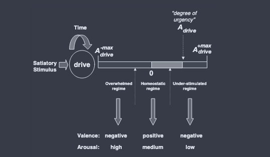
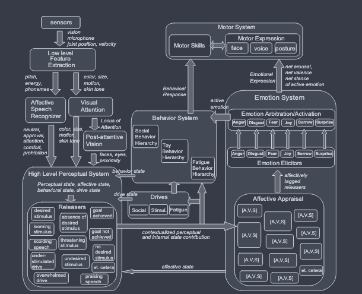
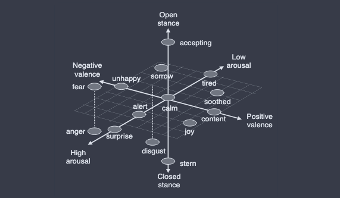
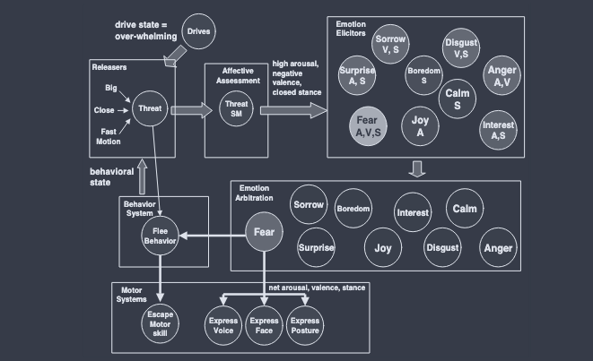
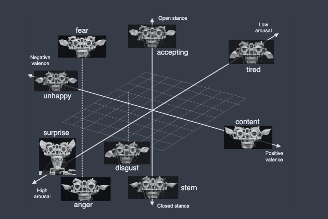
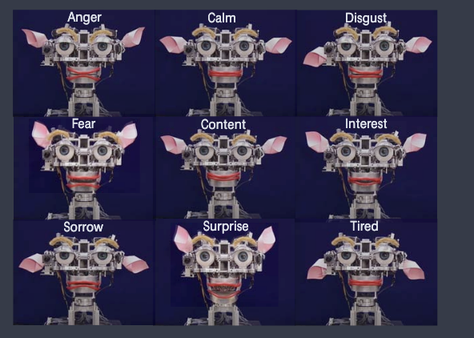

C. Breazeal, "Emotion and sociable humanoid robots," _Int. J. Human-Comput. Stud._, vol. 59, no. 1–2, pp. 119–155, Jul. 2003, doi: 10.1016/S1071-5819(03)00018-1.

> [!abstract] 一句话
> Kismet 把所有输入（外部感知 + 内部状态）都换算成一个点 $[A, V, S]$，用它来**选情绪**，再用**同一个点**来**生成表情**；赢的情绪同时驱动一个行为。人看到表情后会改变自己的行为，于是形成一个闭环。

## 1 输入是怎么定义的

论文不直接拿传感器数据做输入，而是分三层把它"翻译"成情绪系统能用的东西。

**第 1 层：原始信号**

| 来源 | 内容 |
|---|---|
| 视觉 | 4 个 CCD 相机 → color、size、motion、skin tone → 脸、眼睛、距离（proximity） |
| 听觉 | 耳朵麦克风 + 领夹麦克风 → pitch、energy、phonemes → 情感语音识别器，分类为 praise / prohibition / attention / soothing / neutral（只看语调韵律，不看语义） |
| 本体 | 关节位置、速度 |
| 内部状态 | 3 个 drive（social / stimulation / fatigue）各自处在哪个区间（不足 / 稳态 / 过载）；当前活跃行为的进度（success-achieved / level-of-frustration）；当前情感状态 |

**第 2 层：Releaser（释放器）**，这是论文对"输入"的真正定义

> 输入 = **感知特征 + 语境**（当前 drive、当前情感状态、当前行为）组合出来的、手工设计的"对行为有意义的感知类别"。

所以同一个物理刺激，在不同语境下是不同的输入。比如同一个玩具：stimulation drive 主导时是 `desired-toy`，social drive 主导时是 `undesired-toy`，太近太快时是 `threatening-toy`。

**第 3 层：$[A, V, S]$ 标签（躯体标记）**

每个激活的 releaser 被打上三个数，每维取值 $[-1250, 1250]$：

- **A**（arousal，唤醒度）：刺激多强烈；
- **V**（valence，效价）：对机器人有利还是不利；
- **S**（stance，姿态）：该趋近还是退缩。

例：`threatening-toy` = (1200, −1000, −1000)。赋值依据是**强度、相关性、内在情感、目标导向**四个因素。

所以，**输入最终被定义成情感空间中的一组 $[A, V, S]$ 向量**，也就是"通用货币"，感知、drive、行为都用同一种单位表示。

## 2 中间怎么处理

```
[A,V,S] 标签 → Elicitor（三维区域匹配，三维都满足才激活）
            → Activation：A = E + B + P − δ（相关性 + 偏置 + 惯性 − 秒级衰减）
            → Arbitration：9 种情绪赢者通吃
```

9 种情绪是 anger、disgust、fear、joy、sorrow、surprise、interest、boredom、calm。

## 3 输出是什么

赢的情绪产生**两路输出**，各有一个阈值，**表情阈值 < 行为阈值**，所以表情先出、行为后出。

| 输出 | 怎么生成 | 落到哪里 |
|---|---|---|
| **① 表达（expression）** | 把净 $[A, V, S]$ 送进表情插值：$P_{net} = C_{arousal} + C_{valence} + C_{stance}$，在 9 个基础姿态之间加权混合（6 个轴端点 + anger / fear / disgust 3 个专门姿态） | 15 个面部 DoF（眉、眼睑、唇、耳）+ 颈部姿态 + 声音特质；连续、可混合、实时；强度随离原点的距离增大而增大 |
| **② 行为（behavior）** | 赢的情绪把激活能量传给行为系统中对应的行为（Table 2） | 例如 fear → flee → escape（闭眼 + 转头）；sorrow → 博取照料者关注；boredom → seek；interest → orient |

此外还有一个**间接输出**：人读到表情后会**改变自己的行为**（退开、安抚、拿玩具来），这又成为机器人的下一轮输入。

## 4 对这个 system 的总结

- **闭环 + 稳态**：目标不是"识别情绪"，而是把和人的互动维持在**刺激恰到好处**的状态（drive 处在稳态区间）。情绪的作用是偏离时把它拉回来。
- **两个时间尺度**：drive 变化慢，决定 mood；emotion 是秒级的，先强烈表达再衰减；加上惯性项，情绪不会来回乱跳。
- **一个空间，两种用途**：$[A, V, S]$ 既用来**评价输入、选情绪**，又用来**生成表情**，评价和表达天然一致。Stance 这一维是为了把 anger（趋近）和 fear（退缩）分开。
- **行为系统主导**：情绪只是行为仲裁的输入之一，大部分时间机器人处在 content / interest 状态，在愉快地玩。
- **时序很重要**：反馈要在 1 秒以内；先出表情、后出行为，让人能提前读懂并调整自己。
- **局限**：releaser 和 $[A, V, S]$ 标签全是**手工设定**，参数凭经验调，**没有学习**；也不推理人的情绪（没有 theory of mind）。

# abstract

>  This paper focuses on the role of emotion and expressive behavior in regulating social interaction between humans and expressive anthropomorphic robots, either in communicative or teaching scenarios.

本文关注的是，在人类与有表现力的拟人化机器人之间，无论是交流场景还是教学场景，情感和表达行为（expressive behavior）在调节社交互动中起什么作用。

我们先介绍我们的人形机器人的情感模型（emotion models）和表达行为背后的科学依据，再说明这些科学观点在当前实现中是怎样被改编和落地的。我们的机器人还能通过语调（tone of voice）识别情感意图（affective intent），这部分实现借鉴了发展心理语言学（developmental psycholinguistics）领域的科学发现。我们先单独评估机器人的表情展示（expressive displays）。

> Next, we evaluate the robot's overall emotive behavior (i.e., the coordination of the affective recognition system, the emotion and motivation systems, and the expression system) as it socially engages naïve human subjects face-to-face

然后，当机器人与没有相关经验的受试者（naïve human subjects）面对面进行社交互动时，我们评估它整体的情绪行为（emotive behavior），也就是情感识别系统（affective recognition system）、情感与动机系统（emotion and motivation systems）和表达系统（expression system）三者之间的协调。

# 1 intruduction


> we introduce our expressive humanoid robot, Kismet, and highlight our own efforts in building sociable humanoid robots that engage people through expressive social cues (including emotive responses).

我们介绍我们的表达型人形机器人 Kismet，并重点说明我们自己在构建社交型人形机器人方面的工作，这类机器人通过富有表现力的社交线索（包括情绪反应）与人互动

第 4 节介绍情感及其表达理论中的关键原则，正是这些原则启发了我们机器人情感系统和表达系统的设计。
第 5、6 节重点讲在 Kismet 上实现的情感与动机计算模型。
再下一节（第 7 节）介绍 Kismet 的表达反应是如何通过算法生成的。
第 8 节评估 Kismet 面部表情的可读性，第 9 节评估这个机器人通过表达反应与人进行社交互动的能力

# 2 Embodied Systems That Interact with Humans

来自不同研究领域的许多系统都被设计用来与人互动。

>  Many of these systems target different application domains such as computer interfaces, Web agents, synthetic characters for entertainment, or robots for physical labor.

其中许多系统面向不同的应用领域，比如计算机界面、网络智能体、用于娱乐的合成角色，或者从事体力劳动的机器人。

> In general, these systems can be either embodied (the human interacts with a robot or an animated avatar) or disembodied (the human interacts through speech or text entered at a keyboard).

总的来说，这些系统可以分为具身的（人与机器人或动画化身互动）和非具身的（人通过语音或键盘输入的文字来互动）。

具身系统的优势在于，它们能向人发送副语言交流信号，比如手势、面部表情、语调、视线方向或身体姿态。

> These embodied and expressive cues can be used to complement or enhance the agent's message.

这些具身的、富有表现力的线索可以用来补充或增强智能体要传达的信息。

有时候，副语言线索本身就能传达信息，比如带情绪的面部表情或手势。

>  These embodied systems must also address the issue of sensing the human, often focusing on perceiving the human's embodied social cues.

这些具身系统还必须解决感知人的问题，通常侧重于感知人的具身社交线索。

因此，这些系统面临的感知问题比非具身系统更有挑战性。
本节重点介绍几个具身系统，包括动画类的和机器人类的。


## 2.1 Embodied Conversation Agents（具身对话智能体）

> There are a number of graphics-based systems that combine natural language with an embodied avatar. The focus is on natural, conversational discourse accompanied by gesture, facial expression, and so forth (Cassell, 1999).

有不少基于图形的系统把自然语言和具身化身（embodied avatar）结合在一起。它们的重点是自然的对话式交谈，同时配合手势、面部表情等（Cassell, 1999）。

**① 任务型：Rea**

在一些应用中，人用这类系统来完成某项任务。

> One of the most advanced systems in this respect is Rea from the Media Lab at MIT (Cassell et al., 2000).

这方面最先进的系统之一是 MIT Media Lab 的 Rea（Cassell et al., 2000）。Rea 是一个处在虚拟世界里的合成房地产经纪人，人们可以向它咨询买房的事。它通过语音、语调、视线方向、手势和面部表情来交流，能感知房间里人的位置，也能识别几种简单的手势。

**② 辅导型：Steve**

另一个重要的应用领域是辅导系统（tutoring systems），智能体帮助人学会完成某项任务。

> An advanced pedagogical system is Steve, developed at USC (Rickel & Johnson, 2000).

南加州大学（USC）开发的 Steve 是一个先进的教学系统（Rickel & Johnson, 2000）。人沉浸在虚拟现实中与这个化身互动。Steve 的能力不依赖具体领域，可以支持三维虚拟世界中面向任务的对话。比如它训练人操作一艘虚拟船上的各种设备，并带着人在船上走动，告诉他们设备在哪里。

**③ 交流型：虚拟聊天室**

有时候，任务只是在虚拟空间里和别人交流，相当于一种带具身化身的动画"聊天室"（Vilhjalmsson & Cassell, 1998）。

**④ 只有一张脸的化身：Takeuchi & Nagao、Greta**

还有一些图形系统，它们的化身主要只有一张脸，几乎或完全没有身体。

> In Takeuchi & Nagao (1993), for instance, the use of an expressive graphical face to accompany dialogue is explored. They found that the facial component was good for initiating new users to the system, but its benefit was not as pronounced over time.

例如，Takeuchi 和 Nagao（1993）探索了用一张富有表现力的图形面孔来配合对话。他们发现，脸能帮助新用户上手这个系统，但随着时间推移，这个好处就不那么明显了。

同样值得注意的是同一期期刊里 de Rosis 等人关于 Greta 的论文，它介绍了 Greta 的言语信号和非言语信号（verbal and non-verbal signals）如何同步，并用三维动画呈现出来。

> [!note] 小结
> 2.1 讲的是**屏幕里的虚拟角色**：按用途分成任务型（Rea）、教学型（Steve）、交流型（聊天室）和只有脸的类型（Takeuchi & Nagao、Greta）。共同点是用多种通道（语音 + 表情 + 手势 + 视线）来增强对话。Takeuchi & Nagao 的发现提示我们：**脸的作用会随着新鲜感消退而减弱**。

## 2.2 Human-Friendly Robots（人类友好型机器人）

> The ability to interact with people in the human environment has been a recent motivator of the humanoid robotics community and the service robotics community.

能在人类环境中与人互动，是近年来推动人形机器人领域和服务机器人领域发展的一个动力。

对这类系统来说，安全、尽量少干扰人的生活空间都是重要问题，性能和易用性也一样重要。

按应用方向可以分成几类：

- **助老助残**：例如 MOVAID 系统（Dario & Susani, 1996）和范德堡大学（Vanderbilt University）的类似项目（Kawamura et al., 1996），重点是帮助老年人或残障人士。
- **教育**：世界各地有不少移动的博物馆导览机器人，比如匹兹堡大学的 Sage（Nourbakhsh et al., 1999）。
- **娱乐**：合成宠物越来越多，最有名的之一是 Sony 的机器狗 Aibo。

> Much of the research in the humanoid robotics community has focused on traditional challenges of robot locomotion (e.g., Honda's P3 bipedal walker (Hirai, 1998)) and upper-torso control for object manipulation tasks (e.g., ATR's humanoid, DB). A few humanoid projects have explored the social dimension, such as Cog at the MIT AI Lab (Brooks et al., 1999).

人形机器人领域的大部分研究集中在传统难题上：机器人行走（比如本田的双足机器人 P3，Hirai, 1998），以及用于抓取操作的上半身控制（比如 ATR 的人形机器人 DB）。只有少数人形机器人项目探索了社交这个维度，比如 MIT AI Lab 的 Cog（Brooks et al., 1999）。

> [!note] 小结
> 2.2 讲**实体服务机器人**：按场景分成助老助残、导览、娱乐宠物。关键对比是：当时人形机器人的主流在做**运动和操作**，做**社交**的很少（Cog 算一个）。这正是 Kismet 要补的空白。

## 2.3 Expressive Face Robots（表情脸机器人）

> There are several projects that focus on the development of expressive robot faces, ranging in appearance from being graphically animated (Bruce et al., 2001), to resembling a mechanical cartoon (Takanobu et al., 1999; Scheef et al., 2000), to pursuing a more organic appearance (Hara, 1998; Hara & Kobayashi, 1996).

有好几个项目专门开发有表情的机器人脸。它们的外观差别很大：有图形动画式的（Bruce et al., 2001），有像机械卡通的（Takanobu et al., 1999；Scheef et al., 2000），也有追求更接近真人外观的（Hara, 1998；Hara & Kobayashi, 1996）。

**① 拟真路线：东京理科大学（Hara）**

> For instance, researchers at the Science University of Tokyo have developed the most human-like robotic faces (typically resembling a Japanese woman) that incorporate hair, teeth, silicone skin, and a large number of control points (Hara, 1998) that map to the facial action units of the human face (Ekman & Friesen, 1982).

例如，东京理科大学（Science University of Tokyo）的研究者做出了最像真人的机器人脸，外形通常像一位日本女性。它有头发、牙齿、硅胶皮肤，还有大量控制点（Hara, 1998），这些控制点对应人脸的面部动作单元（facial action units，Ekman & Friesen, 1982）。

这个机器人左眼里装了一个相机，能识别并做出一组预先定义好的情绪表情：愤怒（anger）、恐惧（fear）、厌恶（disgust）、快乐（happiness）、悲伤（sorrow）和惊讶（surprise）。

**② 简化路线：早稻田大学、Feelix**

- 早稻田大学开发了几个比较简单的表情脸，其中一个能根据光照强度调节眼睛睁开的程度和脖子的姿态（Takanobu et al., 1999）。
- Cañamero 和 Fredslund（2001）做的 Feelix 是一个用乐高（Lego）搭的脸部机器人，用来研究和人之间的触觉互动与情感互动。

**③ 集成路线：脸 + 移动平台**

把有表情的脸装到移动机器人上，让它在教育或娱乐场景中和人互动，这种做法越来越常见，比如博物馆导览机器人（Nourbakhsh et al., 1999；Burgard et al., 1998）。

**④ 研究人怎么看待这些脸**

> As expressive faces are incorporated into service or entertainment robots, there is a growing interest in understanding how humans react to and interact with them.

随着有表情的脸被用到服务或娱乐机器人上，人们越来越想弄清楚人会对它们做出什么反应、怎样和它们互动。

- Kiesler 和 Goetz（2002）研究了怎样刻画人对机器人的心智模型（mental models），以及这个模型会怎样受机器人外观和对话风格的影响：让机器人显得更活泼外向，或者更体贴严肃。
- Bruce 等人（2001）研究了在一次简短互动（让机器人做个民意调查）中，机器人有没有表情脸、能不能表现出自己在注意对方，会怎样影响人愿不愿意和它互动。

> [!note] 小结
> 2.3 按**外观**把表情脸机器人排成一条谱系：图形动画 → 机械卡通 → 拟真（Hara 的硅胶脸，按 FACS 动作单元驱动），同时出现了一个新问题：**人如何感知、如何建立心智模型**（Kiesler & Goetz、Bruce et al.）。Kismet 属于"机械卡通"风格，Feelix 后面会作为识别率的对比对象出现（第 8 节）。

# 3 Kismet and the Sociable Machines Project（Kismet 与社交机器项目）

> The ability for people to naturally communicate with such machines is important. However, for suitably complex environments and tasks, the ability for people to intuitively teach these robots will also be important.

让人能和这类机器自然地交流很重要。但面对足够复杂的环境和任务，让人能直观地**教**这些机器人也同样重要。

理想情况下，机器人能进行各种形式的社会学习（social learning），比如模仿（imitation）、仿效（emulation）、指导（tutelage），这样人就能像教另一个人一样教它。已有的探索包括：

- 通过示范学习物理技能，比如倒立摆平衡（Atkeson & Schaal, 1997a,b；Schaal, 1997）；
- 通过模仿学习一种原始语言（proto-language）（Billard, 2002）；
- 通过模仿学会做一连串手势（Demiris & Hayes, 2002；Mataric, 2000）。

> Although current work in imitation-based learning with humanoid robots has dominantly focused on articulated motor coordination, social and emotional aspects can play a profound role in building robots that can communicate with and learn from people.

目前人形机器人的模仿学习主要集中在多关节的运动协调上，但对于造出能和人交流、能向人学习的机器人来说，社交和情感层面可能起着很深的作用。

**① Kismet 硬件**

> The Sociable Machines Project develops an expressive anthropomorphic robot called Kismet (see Figure 1) that engages people in natural and expressive face-to-face interaction.

社交机器项目（Sociable Machines Project）开发了一个有表现力的拟人机器人 Kismet（见 Figure 1），它能和人进行自然、富有表现力的面对面互动。项目概况见 Breazeal（2002a）。

- 大小：约为成人头部的 1.5 倍；
- 自由度：共 21 DoF。3 个控制视线方向，3 个控制头部朝向，其余 15 个驱动面部特征（眼睑、眉毛、嘴唇、耳朵）；
- 视觉：4 个彩色 CCD 相机。每个瞳孔后面有一个窄视场（narrow field of view）相机，另外两个广角（wide field of view）相机装在两眼之间；
- 听觉：两只耳朵上各有一个小麦克风；和它互动的人还要戴一个领夹麦克风（lavalier microphone），用来处理人的发声。

**② 设计思路：像亲子互动一样**

> Inspired by infant social development, psychology, ethology, and evolution, this work integrates theories and concepts from these diverse viewpoints to enable Kismet to enter into natural and intuitive social interaction with a human and to eventually learn from them, reminiscent of parent-infant exchanges.

这项工作受婴儿社会性发展、心理学、动物行为学（ethology）和进化论的启发，把这些不同视角的理论和概念整合起来，让 Kismet 能和人进行自然、直观的社交互动，并最终向人学习，就像父母和婴儿之间的交流那样。

为此，Kismet 从视觉和听觉通道感知各种自然的社交线索，并通过视线方向、面部表情、身体姿态和咿呀声（vocal babbles）向人发出社交信号。评估从几个角度进行：

- 没有经验的受试者能否读懂、解释机器人的社交线索；
- 机器人能否感知人的社交线索并恰当回应；
- 人是否愿意提供脚手架（scaffolding），帮助机器人学习；
- 这些因素能否形成一种丰富、灵活、动态的互动：它是身体的、情感的、社交的，并且提供丰富的学习机会。

> This paper focuses on the role of emotion and expressive behavior in social interaction between robots and humans.

本文聚焦情感和表达行为在人机社交互动中的作用。我们介绍 Kismet 的情感计算模型、它怎样表达"情绪"状态，以及它怎样把这些系统和感知系统、行为系统结合起来，调节自己和人的互动（Breazeal, 1998；Breazeal & Aryananda, 2002）。这些情感系统通过没有经验的受试者来评估（Breazeal & Aryananda, 2002；Breazeal, 2002b）。

> [!note] 小结
> 第 3 节交代动机和平台。动机是：当时的模仿学习主要做**运动**，而社交和情感可能是"向人学习"的关键。平台是 Kismet，一个 21 DoF 的头，4 个相机加麦克风。设计隐喻是**亲子互动**：机器人发出类似婴儿的社交信号，引导人主动给它"搭脚手架"。

# 4 Emotions and their Expression in Living Systems（生物系统中的情感及其表达）

> Emotions are an important motivation system for complex organisms. They seem to be centrally involved in determining the behavioral reaction to environmental (often social) and internal events of major significance for the needs and goals of a creature (Plutchik, 1991; Izard, 1977).

情感是复杂生物体的一个重要动机系统。当环境事件（往往是社交事件）或内部事件对生物的需求和目标有重大意义时，情感在决定生物如何做出行为反应上起核心作用（Plutchik, 1991；Izard, 1977）。

- **正面情绪**：Frijda（1994a）认为，正面情绪由满足某种动机、增强生存能力或成功施展自身能力的事件引发。它往往表示朝向目标的活动可以结束了，或者资源可以腾出来做别的事。
- **负面情绪**：很多负面情绪来自痛苦的感觉或有威胁的情境，它会促使生物采取行动来纠正问题，或者阻止坏事发生。

## 4.1 Theory of Basic Emotions（基本情绪理论）

**① 基本情绪**

> Several theorists argue that a few select emotions are basic or primary — they are endowed by evolution because of their proven ability to facilitate adaptive responses to the vast array of demands and opportunities a creature faces in its daily life (Ekman, 1992; Izard, 1993).

一些理论家认为，少数几种情绪是**基本的（basic）或原初的（primary）**。它们由进化赋予，因为它们已经被证明能帮助生物对日常生活中面对的大量要求和机会做出适应性反应（Ekman, 1992；Izard, 1993）。

愤怒（anger）、厌恶（disgust）、恐惧（fear）、喜悦（joy）、悲伤（sorrow）和惊讶（surprise）常被认为是基本情绪，依据来自进化、发展和跨文化研究（Ekman & Oster, 1982）。每种基本情绪都被认为有特定功能（通常是生物功能或社交功能），在特定情境中出现，让生物准备好并受驱动去做出适应性反应。情绪也是学习新行为的重要强化物（reinforcers）。另外，情绪会在一生的情感发展中不断细化，新的情绪也会被习得，社交经验在这个过程中起重要作用（Ekman & Oster, 1982）。

**② 评价理论（appraisal）**

> Several theorists argue that emotion has evolved as a relevance-detection and response-preparation system.

一些理论家认为，情绪是作为一个"**相关性检测 + 反应准备**"系统进化出来的。他们假设存在一个评价系统（appraisal system），根据生物的福祉（well-being）、计划和目标，来评估觉察到的前因条件（Levenson, 1994；Izard, 1994；Frijda, 1994c；Lazarus, 1994）。Scherer（1994）研究了人类的这种评估过程，认为人会从以下几个方面对事件做情感评价：**新奇性（novelty）、内在愉悦度（intrinsic pleasantness）、目标/需求相关性（goal/need significance）、应对能力（coping）、规范/自我相容性（norm/self compatibility）**。因此，评价所需的认知水平差别可以很大。

**③ 行为稳态（behavioral homeostasis）**

这些评价（加上疼痛、激素水平、驱力等其他因素）会引发某种特定情绪，这种情绪调动多个系统的反应倾向：

- 生理变化（比如通过自主神经系统调节唤醒水平）；
- 主观体验的调整；
- 引发行为反应（比如接近、攻击、逃跑等）；
- 展示表情。

> Plutchik (1991) calls this stabilizing feedback process behavioral homeostasis. Through this process, emotions establish a desired relation between the organism and the environment that pulls the creature toward certain stimuli and events and pushes it away from others.

这些系统协同起来，构成了应对原始前因条件的一种通用解决方案。Plutchik（1991）把这种起稳定作用的反馈过程叫作**行为稳态（behavioral homeostasis）**。通过这个过程，情绪在生物和环境之间建立一种理想的关系：把生物拉向某些刺激和事件，推离另一些。其中很多关系活动是社交性的，比如寻求亲近、回避社交、赶走冒犯者等（Frijda, 1994b）。

**④ 表情的交流功能**

声音、脸、手势和姿态中的情绪表达特征，起着向他人传达情绪状态的重要作用。Levenson（1994）认为这在两方面对人有益：一是把感受传达给别人，二是影响别人的行为。比如婴儿的哭声能有力地唤起成人的照料行为。

> Darwin (1872) argued that emotive signaling functions were selected for during the course of evolution because of their communicative efficacy.

Darwin（1872）认为，情绪的信号功能是因为它的交流效力而在进化中被选择下来的。对社会性物种来说，一个行为的结果往往部分取决于在场的重要他人怎样反应。Scherer（1994）认为，生物对他人如何回应各种可能行为的预期，在很大程度上决定了它的行为选择。情绪信号传达的是生物对某个刺激事件（或行为）的评价反应，因此能缩小观察者可能推断出的行为意图范围。

**Fig. 2**：Russell 的愉悦–唤醒（pleasure-arousal）面部表情空间。横轴从 displeasure 到 pleasure，纵轴从 sleep 到 arousal；surprise、afraid、elated、happy、content、relaxed、sleepy、bored、sad、frustrated 等表情分布在四周（改编自 Russell, 1997）。

## 4.2 Componential Approaches to Facial Expression（面部表情的成分论方法）

**Table 1**：Smith & Scott（1997）提出的面部动作 → 情感维度映射。列是面部动作（皱眉、扬眉、抬上眼睑、抬下眼睑、嘴角上扬、张嘴、抿嘴、抬下巴），行是情感含义（愉悦度、目标受阻/差距、预期努力、注意活动、确定性、新奇性、个人能动性/控制感）。上箭头表示这个面部动作会随该维度增强而增强，下箭头表示会随该维度减弱而增强。例如愉悦度越高，嘴角越往上翘；越不愉快，嘴角越往下。

> Instead of viewing emotions in terms of categories (happiness, anger, fear, etc.), one school of thought is to conceptualize the dimensions that could span the relationship between different emotions (arousal and valence, for instance).

另一派观点不把情绪看成类别（快乐、愤怒、恐惧等），而是去刻画能张成不同情绪之间关系的**维度**，比如唤醒度（arousal）和效价（valence）。持这种观点的心理学家认为，面部表情有系统、连贯、有意义的结构，可以映射到情感维度上（Russell, 1997；Lazarus, 1991；Plutchik, 1984；Smith, 1989；Woodworth, 1938），见 Figure 2。

> Instead of taking a production-based approach to facial expression (how do emotions generate facial expressions), Russell (1997) takes a perceptual stance (what information can an observer read from a facial expression).

Russell（1997）不采用"生成"视角（情绪怎样产生面部表情），而采用"**感知**"视角（观察者能从面部表情中读出什么信息）。通过分析构成这种结构的各个面部动作成分，就能揭示被表达情绪的很多底层属性。由此可见，表情的某些单独特征本身就有信号价值。

这样的信号系统稳健、灵活、有弹性（Smith & Scott, 1997）：

- 各个成分可以**混合**，表达范围很广的情感信息，而不是每种情绪只能对应一种固定模式；
- 特征可以被强调、弱化、添加或省略，用来微调表情；
- 任何一种情绪都可以由一系列表情同样好地传达，只要这些表情有"家族相似性（family resemblance）"。之所以相似，是因为它们共享面部动作单元（facial action units）。

面部动作单元刻画的是每块面部肌肉（或肌肉组合）怎样牵动皮肤和面部特征，从而产生人的表情和面部动作（Ekman & Friesen, 1982）。不同情绪的表情会共享部分动作成分，比如恐惧和惊讶都会扬眉。Smith & Scott（1997）假设，这些共有特征给各个表情赋予了共同的情感含义，比如扬眉在恐惧和惊讶中都表示**注意活动（attentional activity）**。

> [!note] 小结
> 第 4 节是理论基础，有两条线：
> 1. **基本情绪 + 评价理论 + 行为稳态**：情绪 = 对事件的相关性评价 → 调动生理、行为、表情 → 把生物拉回理想的"生物–环境"关系。这条线对应 Kismet 的情绪系统（第 5、6 节）。
> 2. **成分论表情**：表情不是"一种情绪一个固定模板"，而是可组合的面部动作，每个动作对应一个情感维度。这条线对应 Kismet 的表情生成（第 7 节）。
>
> 另外还强调：表情的核心价值在于**交流**，它能让观察者预测你接下来要做什么。

# 5 Models of Emotion and Drives for a Sociable Robot（社交机器人的情感与驱力模型）

> Kismet's motivations (i.e., its "drives" and "emotions") establish its nature by defining its "needs" and influencing how and when it acts to satisfy them.

Kismet 的动机（也就是它的"驱力（drives）"和"情绪（emotions）"）定义了它的"需求"，并影响它怎样、在什么时候行动来满足这些需求，从而确立了它的本性。

> [!info] 记号约定
> 原文用等宽字体（如 `emotion`、`drive`）表示系统里具体的计算过程；带引号的"emotion"表示和动物、人的情绪做类比。本笔记沿用这个写法。

> The nature of Kismet is to socially engage people and ultimately to learn from them.

Kismet 的本性是和人进行社交互动，并最终向人学习。Kismet 的 `emotion` 和 `drive` 过程是这样设计的：当它和人互动良好、互动既不过载（overwhelming）也不过于贫乏（under-stimulating）时，机器人处于一种**警觉、轻度正效价**的状态。这种环境学习潜力最高，因为互动对机器人有一点挑战，但它也能表现得不错。

## 5.1 Overview of the Drive System（驱力系统概述）

> The design of Kismet's "drives" (Breazeal, 1998) is heavily inspired by ethological views of the analogous process in animals (although it is a simplified and idealized model) (McFarland & Bosser, 1993).

Kismet "驱力"的设计（Breazeal, 1998）深受动物行为学对动物中类似过程的看法启发，不过是一个简化、理想化的模型（McFarland & Bosser, 1993）。任何时刻，机器人的行为都围绕满足（satiate）它的"驱力"来组织。每个 `drive` 都是一个独立的过程（见 Figure 3）。Kismet 实现了三个 `drive`，构成机器人的顶层目标：和人互动、和玩具互动、偶尔休息。

`drive` 有两个特点：

- **时间上的周期性**：没有刺激时，`drive` 的强度会不断增加，除非被满足。这类似动物的饥饿或疲劳，都是周期变化的；
- **稳态（homeostatic）**：每个 `drive` 都要把强度维持在一个有界范围内，不太多也不太少。强度的变化反映机器人当前的"需求"，以及处理这个需求有多紧迫。

**Fig. 3**：`drive` 过程的稳态模型。圆圈表示 `drive` 这个计算过程，箭头是输入，温度计形状的条表示强度。每个 `drive` 有一个时间输入，用来实现周期行为。激活能量 $A_{drive}$ 取值在 $[A^{-max}_{drive}, A^{+max}_{drive}]$ 之间，大小表示强度：大的正值对应环境刺激不足，大的负值对应环境刺激过度。遇到满足刺激（satiatory stimulus）时，`drive` 会回到稳态区间。

| 区间 | 条件 | 效价（Valence） | 唤醒度（Arousal） |
|---|---|---|---|
| 过载区（overwhelmed regime） | 满足刺激太强（太近、太快） | 负 | 高 |
| 稳态区（homeostatic regime） | 满足刺激存在且强度合适 | 正 | 中 |
| 刺激不足区（under-stimulated regime） | 没有满足刺激，或强度太低 | 负 | 低 |

> Hence, to remain in balance, it is not sufficient that the satiatory stimulus be present; it must also be of an appropriate intensity.

所以要保持平衡，光有满足刺激还不够，它的强度还得合适。

`drive` 的作用：

1. **影响行为选择**：直接、优先地把激活传给某些行为，也就是能满足这个 `drive` 的那些行为；
2. **提供功能语境**：告诉系统机器人当前在努力满足哪个"需求"，以此组织行为和感知；
3. **影响情感状态**：直接贡献效价和唤醒度（细节见 6.2 节），从而通过情绪系统间接影响行为。因为 `drive` 的时间尺度比 `emotion` 慢，它们决定的是机器人长期的情感状态，也就是"心境（mood）"及其表达。

**三个 drive**：

- **social drive（社交驱力）**：促使机器人待在人身边并和人互动。在刺激不足的一端，机器人"孤独"，倾向于寻找面对面接触；在过载的一端（比如人动作太多或离眼睛太近），它倾向于回避面对面接触；
- **stimulation drive（刺激驱力）**：类似地，促使机器人和东西互动，比如色彩鲜艳的玩具；
- **fatigue drive（疲劳驱力）**：和前两个不同，它的作用是让机器人屏蔽外部世界，而不是调节和外部世界的互动。机器人"醒着"时会不断受到环境或自身的刺激，随着时间推移，这个 `drive` 会逐渐接近"筋疲力尽"的一端。强度超过某个阈值，机器人就该"睡觉"了。睡觉时**所有** `drive` 都会回到稳态区间；如果环境没有明显刺激，机器人就能借此满足各个驱力。

## 5.2 Overview of the Emotion System（情绪系统概述）

> The organization and operation of the emotion system is strongly inspired by various theories of emotions in humans.

情绪系统（emotion system）的组织和运行方式深受人类情绪的各种理论启发。它和机器人的 `drive` 配合，被设计成一个灵活的系统，在环境刺激和内部刺激之间进行调和，引发适应性的行为反应，服务于社交功能或自我维护功能。

`emotion` 由那些被评估为对机器人"福祉（well-being）"有重要意义的事件触发。每个 `emotion` 被触发后，都会发挥一组特定功能，在机器人和环境之间建立一种理想关系：促使机器人接触那些有利于它"福祉"的东西，回避不利的东西。整体上，这个实现深受动物行为学关于感知、动机和行为的模型启发（Tinbergen, 1951；Lorenz, 1973），因此在高层上和 Velasquez（1996）的 Cathexis 系统思路相似，两者的重要区别在第 10 节讨论。

**Table 2**：Kismet 情绪反应总结。前因条件（antecedent conditions）指引发每个 `emotion` 的感知条件；行为（behavior）一列是 `emotion` 激活后可观察到的反应。对有些情绪，这个反应只是一个面部表情；对另一些，它是一个行为，比如逃跑（escape）。

| 前因条件 | 情绪 | 行为 | 功能 |
|---|---|---|---|
| 实现适应性行为目标时受阻、拖延 | anger, frustration | complain（抱怨） | 向照料者表示不满，让他调整行为 |
| 出现不想要的刺激 | disgust | withdraw（退缩） | 向照料者表示拒绝所给的刺激 |
| 出现有威胁的、压倒性的刺激 | fear, distress | escape（逃跑） | 远离可能危险的刺激 |
| 想要的刺激持续存在 | calm | engage（投入） | 继续和想要的刺激互动 |
| 主动行为达成目标，或被表扬 | joy | display pleasure（表现愉悦） | 把资源重新分配给下一个相关行为（最终用于强化行为） |
| 想要的刺激长时间不在，或被禁止 | sorrow | display sorrow（表现悲伤） | 唤起照料者的同情和关注（最终用于抑制某种行为） |
| 突然出现的近距离刺激 | surprise | startle response（惊吓反应） | 警觉 |
| 出现新的、显著的物体 | interest | orient（定向） | 注意新的显著物体 |
| 需要一个不在场的想要的刺激 | boredom | seek（寻找） | 探索环境，寻找想要的刺激 |

注意，行为和 `drive` 一样，编码的是机器人的目标。比如 `escape` 行为的目标是远离有威胁的刺激；当 `stimulation drive` 因为一个又近又快的物体而进入过载区时，它可能偏向激活这个行为。

> It includes the six primary emotions proposed by Ekman (1992). There are several processes in the emotion system that model different arousal states (such as interest, calm, or boredom) that also have a corresponding expression and a few have an associated behavioral response.

这张表来自 Plutchik（1991）、Darwin（1872）和 Izard（1977）提出的情绪在进化、跨物种和社交方面的功能，包括 Ekman（1992）提出的六种基本情绪。情绪系统里还有几个过程用来模拟不同的唤醒状态（比如 interest、calm、boredom），它们也有对应的表情，其中几个还有对应的行为反应。这些情绪反应和人类婴儿的几种原始社交反应（proto-social responses）对应得很好，因此和 Kismet 的设计特别相关（Breazeal & Scassellati, 1999）。

**① 三个系统的分工**

> Whereas the drives address a long-term measure of the "well being" of the robot, the emotive responses work on a faster time scale.

机器人有三个系统服务于它的目标：

- **drive**：每个 `drive` 的稳态目标可以看成以生存为本的目标。所以 Kismet 有和人互动、被玩具刺激、偶尔休息这几个目标。每个驱力能否及时得到满足，构成机器人"福祉"的整体度量，这是**长期**的；
- **emotion**：促使机器人接触有利的东西、回避不利或可能有害的东西。Table 2 里的每种情绪反应都通过行为稳态，以各自的方式做到这一点，时间尺度**更快**；
- **behavior system**：由基于任务的目标层次构成，按 Tinbergen（1951）和 Lorenz（1973）的动物行为学模型的思路组织。每个行为协调感觉–运动模式来完成特定任务，比如搜索行为、接近行为、回避行为、互动行为。

`drive` 和 `emotion` 都把行为系统当作资源，通过偏置某个合适的行为反应在合适的时间激活，来实现自己的目标。

**② 为什么要模仿生物**

> By adapting these ideas to Kismet, the robot's emotional responses mirror those of biological systems and therefore should seem plausible to a human.

把这些思想改编到 Kismet 上，机器人的情绪反应就和生物系统相似，因此在人看来应该是合理的。这对社交互动很重要，因为它让机器人的情绪反应和这些反应的起因都符合人的预期。

表中每一项都有对应的情感表现，比如：

- 想要的刺激长时间不在时（比如很久没人陪它玩玩具），机器人会表现出悲伤，悲伤的表情意在引起人的注意；
- 跟行为表现有关的情感反应：目标成功达成，脸上就露出微笑；进展受阻，就露出严厉（stern）的表情；
- 探索反应包括视觉搜索想要的刺激，或者保持对想要刺激的视觉关注；
- 保护反应里最强的一种，是闭上眼睛、把头转开，避开有威胁或压倒性的刺激。

> Many of these emotive responses serve a regulatory function. They bias the robot's behavior to bring it into contact with desired stimuli (orientation or exploration), or to avoid poor quality or dangerous stimuli (protection or rejection).

很多情绪反应起**调节作用**：偏置机器人的行为，让它接触想要的刺激（定向或探索），或者回避质量差或危险的刺激（保护或拒绝）。另外，机器人脸上的表情是给人的一个社交信号，人会据此回应，进一步促进机器人的"福祉"。总的来说，这些情感反应让人把 Kismet 当作有社交意识的生物，并和它建立有意义的交流。

> [!note] 小结
> 第 5 节搭起动机层，有两种时间尺度：
> - **drive（慢，决定 mood）**：social / stimulation / fatigue 三个稳态变量。关键设计是**三区间**（不足 / 稳态 / 过载）。刺激要"恰到好处"，不是越多越好；每个区间直接对应一组 [V, A] 倾向。
> - **emotion（快，秒级）**：9 种情绪（Ekman 的 6 种加 interest / calm / boredom），每种都有"前因 → 情绪 → 行为 → 功能"（Table 2）。功能大多指向**照料者**，也就是说情绪是用来影响人的。
> - **behavior system**：真正执行动作；drive 和 emotion 都只是通过偏置它来起作用。

# 6 Components of Emotion（情绪的组成部分）

> Several theories posit that emotional reactions consist of several distinct but interrelated facets (Scherer, 1984; Izard, 1977). In addition, several appraisal theories hypothesize that a characteristic appraisal (or meaning analysis) triggers the emotional reaction in a context sensitive manner (Frijda, 1994b; Lazarus, 1994; Scherer, 1994).

一些理论认为，情绪反应由几个不同但相互关联的方面组成（Scherer, 1984；Izard, 1977）。另外，一些评价理论假设，一个有特征的评价（或意义分析）会以依赖语境的方式触发情绪反应（Frijda, 1994b；Lazarus, 1994；Scherer, 1994）。综合这些观点，Kismet 的一次"情绪"反应包括：

- 一个**诱发事件**（precipitating event）；
- 对这个事件的**情感评价**（affective appraisal）；
- 一个**特征性表达**（characteristic expression），包括脸、声音、姿态；
- 促发行为反应的**行动倾向**（action tendencies）。

在生物系统中，这些方面被认为是高度相互依赖地组织在一起的。生理活动让生物在身体上做好准备，去执行行动倾向驱动的行为；生理活动和行动倾向又都围绕引发情绪的那个评价的适应意义来组织。从功能角度看，Smith（1989）和 Russell（1997）认为，情绪面部表情的各个组成部分也和这些情绪方面高度系统地联系在一起。

**Fig. 4（全文最重要的图）**：Kismet 认知架构总览。
```
传感器(vision / microphone / joint position, velocity)
   → 低层特征提取(pitch, energy, phonemes / color, size, motion, skin tone)
   → 情感语音识别器(Affective Speech Recognizer) & 视觉注意(Visual Attention) → 注意后视觉(Post-attentive Vision)
   → 高层感知系统(High Level Perceptual System)：Releasers
   → 情感评价(Affective Appraisal)：给每个 releaser 打 [A, V, S] 标签
   → 情绪诱发器(Emotion Elicitors)：anger / disgust / fear / joy / sorrow / surprise …
   → 情绪仲裁/激活(Emotion Arbitration/Activation)
   → ① 运动表达(Motor Expression：face / voice / posture)  ② 行为系统(Behavior System)
```

原图说明：外部事件（如视觉和听觉刺激）被机器人感知，经过一系列特征提取器（颜色、运动、音高等）过滤。在高层感知系统中，这些特征被绑定到释放器（releaser）过程上，释放器编码的是机器人当前关于自身内外状态、以及自身与世界关系的一组信念。结果是一组针对具体反应的释放器，充当具体情绪反应的前因条件。活跃的释放器被送到情感评价阶段，被打上情感信息标签，也就是唤醒度、效价和姿态，记为 $[A, V, S]$。情感评价阶段所有活跃的贡献，都要经过每个情绪过程的诱发器过滤。在情绪仲裁阶段，各个 `emotion` 过程以赢者通吃（winner-take-all）的方式竞争激活。胜出者把净 $[A, V, S]$ 送到表达运动系统，产生对应的面部表情、身体姿态和声音特质；它也可能把激活能量传给行为系统中对应的行为（比如 `fear` 对应 `flee`，见 Figure 6），从而引发相应的行为反应。

## 6.1 Emotive Releasers（情绪释放器）

> External events, such as visual and auditory stimuli, are sensed by the robot and are filtered by a number of feature extractors (e.g., color, motion, pitch, etc.). In the high level perceptual system, these features are bound by releaser processes that encode the robot's current set of beliefs about the state of the robot and its relation to the world.

我们从情绪系统的输入讲起（见 Figure 4）。外部事件被机器人感知，经过一系列特征提取器过滤。在高层感知系统中，这些特征被**释放器（releaser）**过程绑定在一起，释放器编码机器人当前关于自身状态以及自身与世界关系的一组信念。

> Each releaser can be thought of as a simple "cognitive" assessment that combines lower-level perceptual features with measures of its internal state into behaviorally significant perceptual categories.

Kismet 定义了很多种释放器，每个都是**手工设计**的，各自组合了多种因素的贡献。当所有感知条件和内部条件都以足够强度出现时，释放器的激活水平就会超过阈值。每个释放器可以看成一个简单的"认知"评估，它把低层感知特征和内部状态的度量结合起来，形成**对行为有意义的感知类别**。这些类别包括：

- 刺激在不在场、持续了多久；
- 刺激的性质（比如和玩具有关还是和人有关）；
- 刺激的质量（比如强度太低、太高还是刚好）；
- 刺激是不是想要的（比如它和当前活跃的目标或动机有没有关系）。

例如，`color`、`size`、`motion`、`proximity` 这些特征会整合成一个玩具感知（toy percept）：

- 如果当前在照顾 `stimulation drive`，并且玩具不太快也不太近，`desired-toy` 释放器就激活；
- 如果当前在照顾 `social drive`，那么激活的是 `undesired-toy` 释放器；
- 如果玩具动作有攻击性（太近、太快），激活的是 `threatening-toy` 释放器。

很多释放器就是为特定情绪反应量身定做的前因条件。

所以，每个释放器都要根据机器人的"福祉"和目标来评估，这个评估结果转换成该释放器的激活水平。如果感知特征和评估使激活水平超过阈值（也就是满足了这个释放器规定的条件），它的输出就会传给行为系统中对应的行为过程，同时也传给情感评价阶段，在那里影响情绪系统。影响释放器评估的因素有以下几个：

- **Drives（驱力）**：活跃的 `drive` 为很多释放器提供重要语境，一般决定某类刺激是想要的还是不想要的。比如 `social drive` 活跃时，肤色刺激是想要的，彩色刺激是不想要的，即使它质量很好。所以这种动机语境在决定情绪反应是"接纳"还是"拒绝"一个刺激时起重要作用。另外，每个 `drive` 的每个区间都定义了一个释放器，用来表示这个 `drive` 被满足得怎么样。
- **Affective State（情感状态）**：当前情感状态也为某些释放器提供重要语境。一个好例子是 `soothing-speech` 释放器：情感语音识别器（Breazeal & Aryananda, 2002）给出"安抚（soothing）"分类后，只有 Kismet 已经处于痛苦状态时，`soothing-speech` 释放器才会激活，否则激活的是 `neutral-speech` 释放器。这第二级处理减少了"安抚"和"中性"语音之间的误分类。
- **Active Behavior(s)（活跃行为）**：行为状态在消除某些感知条件的歧义上也很重要。比如一个 `no-face`（没有脸）的感知条件可能对应几种不同情况：
  - 机器人正在执行 `seek-people` 行为：这时肤色刺激是想要的但不在场。一开始这可以编码为 `missing-desired-face` 释放器，触发探索行为；时间长了，它会转成另一个释放器 `prolonged-absence-desired-face`，表示长期缺失导致的剥夺状态；
  - 机器人正在执行 `escape` 行为：这时 `no-face` 意味着成功逃脱（由 `threatening-face-gone` 释放器表示），是一种奖励性情况。
  
  另外，每个行为都定义了一组释放器，表示这个行为的目标是否已经达成，没达成的话已经拖了多久。

## 6.2 Affective Appraisal（情感评价）

> Each releaser with activation above threshold is appraised in affective terms by an associated somatic marker (SM) process in the affective appraisal stage. This mechanism is inspired by Damasio's Somatic Marker Hypothesis where incoming perceptual, behavioral, or motivational information is "tagged" with affective information (Damasio, 1994).

在情感评价阶段，每个激活超过阈值的释放器，都会由一个对应的**躯体标记（somatic marker, SM）**过程做情感评价。这个机制受 Damasio 的躯体标记假说（Somatic Marker Hypothesis）启发：传入的感知、行为或动机信息会被"打上"情感信息的标签（Damasio, 1994）。

SM 用三类标签来刻画一个释放器的情感特征，每个标签的取值范围是 −1250 到 +1250，表示它对整体情感状态的贡献：

| 标签 | 含义 | 正值 | 负值 |
|---|---|---|---|
| **A**（arousal，唤醒度） | 这个因素对情绪系统有多"刺激"，大致对应自主神经系统的活动 | 高唤醒刺激 | 低唤醒刺激 |
| **V**（valence，效价） | 这个释放器对情绪系统有多有利 | 愉快的刺激 | 不愉快的刺激 |
| **S**（stance，姿态） | 这个感知对象对机器人来说有多可接近 | 趋近（advance） | 退缩（retreat） |

例如，有威胁的刺激（`threatening-toy` 释放器）会被打上 $A = 1200$（非常刺激）、$V = -1000$（非常不利）、$S = -1000$（强烈回避）的标签。

**① 三个来源**

除了情绪系统本身，Kismet 的认知架构里还有三个系统会通过各自的释放器和躯体标记过程，影响机器人的净情感状态（见 Figure 4 中这些系统指向释放器的箭头）：

1. **外部环境因素**：通过高层感知系统进来，引发情绪反应，比如表扬的话或有威胁的刺激。
2. **动机系统**：每个 `drive` 的每个区间对唤醒度和效价有不同的偏置，进而影响不同 `emotion` 过程的激活：
   - 稳态区：正效价 + 平衡的唤醒度，形成"满足（contented）"的情感状态；
   - 刺激不足区：负效价 + 低唤醒度，形成"无聊（bored）"的状态，最终可能滑向"悲伤（sorrow）"；
   - 过载区：负效价 + 高唤醒度，形成"痛苦（distress）"的状态。
   
   因此，当机器人和人互动、被玩具刺激的"需求"得不到充分满足时，它的情感状态就会变差。
3. **行为系统**：活跃行为朝目标的成功或进展受阻（分别由 `success-achieved` 和 `level-of-frustration` 释放器编码）也会影响情感状态。达成当前目标标记为正效价，进展受阻标记为负效价。

**② 设计者给 [A, V, S] 赋值时考虑的四个因素**

- **Intensity（强度）**：刺激对机器人有多强烈。离机器人更近、动得更快、在视野里更大的刺激，比更远、更慢、更小的刺激更强烈。刺激强度一般映射到**唤醒度**：代表有威胁或很强烈刺激的释放器被赋予高唤醒值，不在场或强度低的刺激被赋予低唤醒值。安抚的话对机器人有镇静作用，所以如果唤醒度一开始很高，它也会把唤醒度降下来。
- **Relevance（相关性）**：刺激和机器人当前目标是否相关，影响**效价和姿态**的取值。相关的刺激是"想要的"，赋予正效价和趋近的姿态值；不相关的刺激是"不想要的"，赋予负唤醒度和退缩的姿态值。
- **Intrinsic Affect of Stimuli（刺激的内在情感）**：有些刺激被硬编码，以特定方式通过释放器影响机器人的情感状态：
  - 表扬的话：正效价 + 稍高唤醒度；
  - 责骂的话：负效价 + 低唤醒度，倾向于引发 `sorrow`；
  - 吸引注意的话语（attentional bids）：让机器人警觉，赋予中等唤醒度；
  - 逼近的刺激（looming stimuli）：吓机器人一跳，赋予高唤醒度；
  - 有威胁的刺激：高唤醒度 + 负效价 + 退缩姿态，促成恐惧反应。
- **Goal Directedness（目标导向）**：行为系统中的每个行为都规定了一个完成任务的目标，也就是机器人想和环境保持的某种关系。对一个活跃行为，有两个特殊的释放器反映它朝目标前进的内部进度度量：
  - 达成目标（`success-achieved` 释放器）：赋予正效价，从而促进 `joy`；
  - 长时间未达成目标（`level-of-frustration` 释放器）：赋予负效价和退缩姿态。姿态分量会随时间慢慢增加（从退缩变为趋近），这样机器人越久达不成目标，就越容易转向 `anger`。

> Because there are potentially many different kinds of factors that modulate the robot's affective state (e.g., behaviors, motivations, perceptions), this tagging process converts the myriad of factors into a "common currency" that can be combined to determine the net affective state.

因为调节机器人情感状态的因素可能有很多种（行为、动机、感知等），这个打标签的过程把各种各样的因素都转换成一种可以合并的"**通用货币（common currency）**"，用来决定净情感状态。对 Kismet 来说，$[A, V, S]$ 三元组就是情绪系统用来决定哪种情绪反应应该激活的货币。在当前实现中，每个释放器的情感标签由设计者指定，可以是固定常数，也可以是线性变化的量。

## 6.3 Emotion Elicitors（情绪诱发器）

> All somatically marked inputs are passed to the emotion elicitor stage. Each affect process, that is, each emotion type, has an associated [A, V, S] profile (see Figure 5 which summarizes how [A, V, S] values map onto each emotion process.).

所有带躯体标记的输入都被传到情绪诱发器（emotion elicitor）阶段。每个情感过程，也就是每种情绪类型，都有一个对应的 $[A, V, S]$ 轮廓（Figure 5 总结了 $[A, V, S]$ 值怎样映射到每个 `emotion` 过程）。

诱发器阶段的作用是决定哪些打了标签的释放器会贡献给哪个情感过程（比如 `anger`、`fear` 等）的激活。这个过滤对每类情感标签独立进行。例如一个大的负效价贡献，不只会贡献给 `sorrow`，也会贡献给 `fear`、`distress`、`anger` 和 `disgust`。综合所有因素，每个诱发器计算通过它过滤器的所有唤醒度、效价和姿态值的**平均** $[A, V, S]$。

**Fig. 5**：情绪类别到唤醒度、效价、姿态三个维度 $[A, V, S]$ 的映射。三条轴分别是 Open stance ↔ Closed stance、Low arousal ↔ High arousal、Negative valence ↔ Positive valence。accepting 在开放姿态端，stern 在封闭姿态端；fear、unhappy、sorrow 在负效价侧；anger、surprise 在高唤醒侧；tired、soothed 在低唤醒侧；content、joy 在正效价侧；calm 在原点附近。

**① 激活计算**

> Intuitively, the activation level for an elicitor corresponds to how "deeply" the point specified by the net [A, V, S] lies within the arousal, valence, and stance boundaries that define the corresponding emotion region shown in Figure 5.

算出诱发器的净 $[A, V, S]$ 后，接着计算激活水平。直观地说，诱发器的激活水平对应的是：净 $[A, V, S]$ 这个点落在定义对应 `emotion` 区域（Figure 5）的唤醒度、效价、姿态边界里有多"深"。

- 这个值会按区域大小做缩放，这样在仲裁阶段不会偏向某些过程；
- 每个维度对每个诱发器的贡献分别计算；
- **只要有一个维度没被满足，激活水平就设为 0**；否则把 A、V、S 三个贡献加起来，得到诱发器的激活水平。

这个激活水平再传给仲裁阶段中对应的 `emotion` 过程。

**② 为什么不用简单平均或硬连接**

> Several different schemes for computing the net contribution to a given emotion process were tried.

作者试过好几种计算给定 `emotion` 过程净贡献的方案，选了上面这个，因为它的性质产生的行为最合适。

- **简单平均（早期版本）**：把所有输入贡献直接平均。这会把净情感状态"抹平"到不可接受的程度。比如机器人的 `fatigue-drive` 很高（偏向低唤醒），这时出现一个有威胁的玩具（贡献很强的负效价和高唤醒），平均下来只得到轻微的负效价和中性唤醒度，不足以引发 `fear` 和逃跑反应，而这时机器人本应保护自己。
- **硬连接**：把某些释放器直接连到 `emotion` 过程。但不清楚这种做法怎样支持 `drive` 和行为的影响，因为它们的情感贡献随时间变化。比如同一个 `drive` 可能根据当前所处区间，分别贡献给 `fear`、`sorrow` 或 `interest`。

> The current approach balances the constraints of having certain releasers contribute heavily and directly to the appropriate emotive response, while accommodating those influences that contribute to different emotions as a function of time.

现在的方案兼顾了两点：让某些释放器能强烈、直接地贡献给合适的情绪反应，同时容纳那些随时间贡献给不同情绪的影响。这对生成能丰富反映评价过程的面部表情也很重要。正如 Darwin（1872）最早指出的，这对社交互动很重要，第 7 节会进一步讨论这个表达上的好处。

## 6.4 Emotion Activation（情绪激活）

接下来计算每个 `emotion` 过程的激活水平。Table 2 中的每种情绪都有一个独立的过程：`joy`、`anger`、`disgust`、`fear`、`sorrow`、`surprise`、`interest`、`boredom` 和 `calm`。

每个 `emotion` 过程的激活水平 $A_{emotion}$ 取值在 $[0, A^{max}_{emotion}]$ 之间，$A^{max}_{emotion}$ 是凭经验确定的整数。这些过程一直在运行，但强度必须超过一个阈值（也是凭经验确定的）才会表现出来。每个过程的激活由下式计算：

$$A_{emotion} = E_{emotion} + B_{emotion} + P^{active}_{emotion} - \delta_t$$

| 项 | 含义 |
|---|---|
| $E_{emotion}$ | 对应诱发器过程的激活水平 |
| $B_{emotion}$ | 这个 `emotion` 特有的常数偏置，可以让它更容易被激活 |
| $P^{active}_{emotion}$ | 另一个偏置项，`emotion` 激活后给它增加持续性。本质上是引入**惯性**，让不同 `emotion` 过程不会快速来回切换 |
| $\delta_t$ | 衰减项，`emotion` 激活后把它拉回偏置值 |

> Hence, unlike drives (which contribute to the robot's longer-term "mood"), the emotions have an intense expression followed by decay to a baseline intensity. The decay takes place on the order of seconds.

所以，和 `drive`（决定机器人较长期的"心境"）不同，`emotion` 是先有一个强烈的表达，然后衰减到基线强度，衰减在**秒级**完成。$B_{emotion}$、$P^{active}_{emotion}$、$\delta_t$ 和衰减速率都凭经验确定。也就是说，$E_{emotion}$ 计算的是某个 `emotion` 和当前情况有多相关，其他几项决定它的时间特性：多容易被激活、激活后持续多久。

## 6.5 Emotion Arbitration（情绪仲裁）

> Next, the emotion processes compete for control in a winner-take-all arbitration scheme based on their activation level.

接下来，各个 `emotion` 过程根据激活水平，以**赢者通吃（winner-take-all）**的方式竞争控制权。`emotion` 过程的激活水平衡量的是它和当前情况的相关程度。

每个过程都和其他过程不同，以各自的方式调节机器人和环境的互动，在不同的环境（或内部）情况下变得活跃，并通过把激活传给行为系统中的某个特定行为过程，促发不同的可观察反应。

> If this amount of activation is strong enough, then the active emotion can "seize" temporary control and force the behavior to become expressed.

如果激活量足够强，活跃的情绪就能暂时"夺取"控制权，强制这个行为表现出来。在行为稳态的过程中（Plutchik, 1991），情绪反应通过反馈维持活动，直到机器人和环境之间建立正确的关系。

**Fig. 6：`fear` 情绪反应的实现（一个完整的例子）**

```
drive 状态 = 过载 ─┐
刺激 Big / Close / Fast Motion → Releaser: threat
   → Affective Assessment: Threat SM 打标签(高唤醒, 负效价, 封闭姿态)
   → Emotion Elicitors：只有 Fear 的 A、V、S 三个条件全部满足(颜色最深)
   → Emotion Arbitration：Fear 胜出
   → ① 净 [A,V,S] → Express Voice / Face / Posture
     ② 激活 Flee Behavior → 如果信号无效 → Escape Motor Skill(闭眼 + 转头)
```

原图说明：`threat` 释放器被传到情感评价阶段，被对应的躯体标记过程打上高唤醒、负效价、封闭姿态的标签。这个情感信息再经过每个情绪过程的诱发器过滤，颜色越深表示激活越高。只有 `fear` 诱发器的唤醒度、效价、姿态三个条件都满足，所以颜色最深，也只有它把激活传给了对应的 `emotion` 过程。`fear` 激活后，向 `flee` 行为传激活能量。`flee` 行为的目标是让机器人远离有害刺激。为此它先展示一个表达成分，把净 $[A, V, S]$ 送到表达运动系统，产生对应的面部表情、身体姿态和声音特质；如果这个交流信号没能让威胁刺激停下，就激活 `escape` 运动技能，让机器人闭上眼睛，把头从威胁刺激那边转开。

同时，活跃过程的净 $[A, V, S]$ 被送到运动系统的表达部分，表现为特定的面部表情、声音特质和身体姿态，面部表情的强度反映这个 `emotion` 的激活水平。Table 2 中其他反应的情感网络也以类似方式定义。人对 Kismet 的情绪行为有自然、直观的理解，因为它符合人对生物情绪行为的预期。

**两个阈值：表情先于行为**

> There are two threshold levels for each emotion process: one for expression and one for behavioral response. The expression threshold is lower than the behavior threshold. This allows the facial expression to lead the behavioral response.

每个 `emotion` 过程有两个阈值：一个是表情阈值，一个是行为反应阈值。**表情阈值低于行为阈值**，这样面部表情就会先于行为反应出现，让人更容易读懂和解释机器人的行为。

例如，如果人拿着玩具在机器人脸附近用有威胁的方式晃，Kismet 会先露出害怕的表情，然后才激活逃跑反应。这样分阶段反应，人马上就能从表情上得到反馈，知道自己"吓到"了机器人。如果这不是本意，人就能直观地理解机器人为什么害怕，并相应调整自己的行为。面部表情也让人对接下来会发生什么行为有了预期。结果是，人不只看到机器人在做什么，还明白它为什么这么做。

> [!note] 小结
> 第 6 节是**情绪计算流水线**，全文的核心之一：
> 1. **Releaser**：手工写的"认知"判断，把感知特征和 drive、情感状态、活跃行为这些语境合在一起。同一个玩具在不同语境下会变成 desired / undesired / threatening 三种释放器。
> 2. **Affective Appraisal**：借 Damasio 的躯体标记，给每个 releaser 打上 $[A, V, S]$ 标签，每维取值 ±1250。$[A, V, S]$ 是把感知、drive、行为统一起来的**通用货币**。赋值时考虑强度、相关性、内在情感、目标导向四个因素。
> 3. **Elicitor**：在 Fig. 5 的三维空间里做区域匹配，**三维都得满足**才激活。这一步解决了"简单平均会抹掉威胁"的问题。
> 4. **Activation**：$A = E + B + P - \delta$，其中 E 表示相关性，B 是偏置，P 是惯性，δ 是秒级衰减。
> 5. **Arbitration**：赢者通吃；**表情阈值 < 行为阈值**，所以先出表情、再出动作，人能提前读懂并调整自己。

# 7 Generating Emotive Expression（生成情绪表达）

> The emotion system influences the robot's facial expression. The human can read the robot's facial expression to interpret whether the robot is "distressed" or "content," and can adjust his/her interactions with the robot accordingly.

情绪系统影响机器人的面部表情。人可以通过读机器人的面部表情来判断它是"痛苦"还是"满足"，并相应调整自己和机器人的互动。人做调整的方式，是改变呈现给 Kismet 的刺激的类型（社交的或非社交的）和/或质量（低、中、高强度）。这些情绪线索对帮助人和机器人建立并维持合适的互动非常关键：在这种互动里，机器人的驱力得到满足，它受到足够的挑战，同时在交流中大体能应付。

**为什么要在 Russell 的二维空间上加一维**

如第 4 节所说，Russell（1997）认为人从脸上能感知到两大类情感：唤醒度和愉悦度。如 Figure 2 所示，他把几种情绪和对应的表情映射到这两个维度上。但这个方案对 Kismet 来说限制太大：

- 不清楚怎样用它表示所有基本情绪，比如没有覆盖厌恶（disgust）；
- 它也没有覆盖正效价但含蓄的表情，比如羞涩的微笑或狡黠的笑（这类表情暗示一种退缩的行为倾向）；
- 更重要的是，"愤怒"和"恐惧"在这个空间里离得很近，但它们对应的行为非常不同。

> From an evolutionary perspective, the behavioral correlate of anger is to attack (a very strong approaching behavior), and the behavioral correlate for fear is to escape (a very strong withdrawing behavior).

从进化角度看，愤怒对应的行为是攻击（很强的趋近行为），恐惧对应的行为是逃跑（很强的退缩行为）。这些是从跨物种研究中得出的刻板反应，人的行为当然变化很大。但从**生成**表情的工程角度看，最好把这两种情绪反应拉开更远的距离，减少误激活另一种的可能。加入**姿态（stance）**这一维为 Kismet 解决了这些问题。

## 7.1 Affect Space（情感空间）

> Kismet's facial expressions are generated using an interpolation-based technique over a three-dimensional space. The three dimensions correspond to arousal, valence, and stance.

Kismet 的面部表情用一种基于插值的技术在一个三维空间上生成，三个维度分别是唤醒度、效价和姿态。回顾第 5 节，同样这三个属性也被用来对影响 Kismet 情感状态的各种环境和内部因素做情感评估。我们把 $[A, V, S]$ 三元组定义的空间称为**情感空间（affect space）**。

当前情感状态在任一时刻都只占据这个空间里的一个点，机器人的情感状态变化时，这个点在空间里移动。这个空间不只映射到情绪状态（如愤怒、恐惧、悲伤），也映射到唤醒水平（如兴奋、疲劳）。情感空间可以大致划分成几个区域，每个区域对应一个 `emotion` 过程（见 Figure 5）。

**Fig. 7**：基础姿态（basis postures）在情感空间中的位置。用 Kismet 的真实照片标出 fear、accepting、tired、unhappy、content、surprise、disgust、anger、stern 九个基础姿态在三维空间中的位置。

## 7.2 Basis Postures（基础姿态）

> There are nine basis (or prototype) postures that collectively span this space of emotive expressions (see Figure 7).

一共有九个基础（或原型）姿态，合起来张成这个情绪表达空间（见 Figure 7）。虽然有些姿态对某些面部特征调整得更多，但每个原型都会在一定程度上影响大部分甚至全部面部特征。比如效价原型对嘴唇弧度影响最大，但也会调整耳朵、眼睑、眉毛和下巴的位置。

这组基础面部姿态是这样设计的：情感空间中的一个具体位置，规定了各个原型姿态的相对贡献，从而产生一个忠实对应活跃情绪的净面部表情。用这个方案，Kismet 能做出直观对应愤怒、厌恶、恐惧、快乐、悲伤、惊讶等情绪的表情，也能表达从感兴趣、平静到疲倦等不同的唤醒水平。

**① 六个主要原型（各维度两端）**

| 原型 | 位置 | 对应表情 |
|---|---|---|
| $P_{high}$ | 高唤醒 | surprise（惊讶） |
| $P_{low}$ | 低唤醒 | 疲劳（睡眠是一种行为反应，由另一个运动子系统负责） |
| $P_{positive}$ | 正效价 | content（满足） |
| $P_{negative}$ | 负效价 | unhappy（不高兴） |
| $P_{closed}$ | 封闭（退缩）姿态 | stern（严厉） |
| $P_{open}$ | 开放（趋近）姿态 | accepting（接纳） |

**② 身体姿态**

三个情感维度也映射到情感身体姿态上，同样定义了六个张成空间的原型姿态：

- 高唤醒：直立，下巴微微上扬；
- 低唤醒：垂头弯腰，颈部前倾和头部俯仰都降低；
- 效价维度上：姿态保持中性；
- 开放姿态：身体前倾，表示对所倾向的刺激有强烈兴趣；
- 封闭姿态：身体退缩，像从所看的东西前面缩回去。

**③ 三个专门原型：anger / fear / disgust**

剩下三个面部原型用来清楚区分厌恶、愤怒和恐惧的表情。回想一下，六种基本情绪中有四种是负效价。上面六个主要基础姿态可以生成从痛苦到悲伤的一系列负面表情，但强烈愤怒（暴怒）、强烈恐惧（恐慌）和强烈厌恶的表情各有独特特征：

- 厌恶原型 $P_{disgust}$ 的特点是**不对称**（这类表情的典型特征，比如一侧嘴唇翘起）；
- 愤怒原型 $P_{anger}$ 和恐惧原型 $P_{fear}$ 的嘴唇构型各不相同：暴怒时嘴唇龇出咆哮状，恐慌时嘴唇咧成苦相（grimace）。

## 7.3 Interpolation Approach（插值方法）

> Each dimension of the affect space is bounded by the minimum and maximum allowable values of (min, max) = (−1250, 1250). The current net affective assessment from the emotion system defines the [A, V, S] = (a, v, s) point in affect space. The specific (a, v, s) values are used to weight the relative motor contributions of the basis postures.

情感空间每个维度的取值范围是 $(min, max) = (-1250, 1250)$。情绪系统当前的净情感评估决定了情感空间中的点 $[A, V, S] = (a, v, s)$。具体的 $(a, v, s)$ 值被用来给各个基础姿态的运动贡献加权。用加权插值的方法算出净情绪表情 $P_{net}$：

$$P_{net} = C_{arousal} + C_{valence} + C_{stance} \tag{1}$$

其中 $C_{arousal}$、$C_{valence}$、$C_{stance}$ 分别是唤醒、效价、姿态状态带来的加权运动贡献：

$$C_{arousal} = \alpha P_{high} + (1-\alpha) P_{low}$$

$$C_{valence} = \beta P_{positive} + (1-\beta) P_{negative}$$

$$C_{stance} = F(A,V,S,N) + (1-\delta)\big(\gamma P_{open} + (1-\gamma) P_{closed}\big)$$

插值系数都在 $[0, 1]$ 之间：$\alpha$ 对应唤醒度，$\beta$ 对应效价，$\gamma$ 对应姿态，$\delta$ 对应专门原型姿态。$\delta$ 和 $F$ 的定义是：

$$\delta = f_{anger}(A,V,S,N) + f_{fear}(A,V,S,N) + f_{disgust}(A,V,S,N)$$

$$F(A,V,S,N) = f_{anger}(A,V,S,N)\cdot P_{anger} + f_{fear}(A,V,S,N)\cdot P_{fear} + f_{disgust}(A,V,S,N)\cdot P_{disgust}$$

**加权函数 $f_i$**

权重函数 $f_i(A,V,S,N)$ 限制每个专门原型姿态只在它所在的那块情感空间附近起作用。三个专门姿态 $P_i$（$i$ = anger、fear、disgust）各自位于 $(A_{P_i}, V_{P_i}, S_{P_i})$，分别是姿态 $P_i$ 的唤醒、效价、姿态坐标。

- 给定情绪系统算出的当前净情感状态 $(a, v, s)$，可以算出它到每个 $(A_{P_i}, V_{P_i}, S_{P_i})$ 的位移；
- 对每个 $P_i$，权重 $f_i$ 随离 $(A_{P_i}, V_{P_i}, S_{P_i})$ 的距离**线性衰减**，取值 $0 \le f_i \le 1$，在 $(A_{P_i}, V_{P_i}, S_{P_i})$ 处取最大值；
- 参数 $N$ 定义影响半径，设得比较小，保证各个专门原型姿态的贡献互不重叠。

Figure 8 展示了用这个技术生成的一些表情，系统实际能生成的范围要大得多。这个过程**实时**运行，这对社交互动很关键。

**Fig. 8**：Kismet 通过混合基础面部姿态，能生成强度不同的连续表情范围。面部动作以有原则的方式对应情感维度。图中示例：Anger、Calm、Disgust、Fear、Content、Interest、Sorrow、Surprise、Tired。

**和 Smith & Scott 的对应**

> Given this three dimensional affect space, this approach resonates well with the work of Smith & Scott (1997). They posit a three dimensional space of pleasure-displeasure (maps to valence here), attentional activity (maps to arousal here), and personal agency, control (roughly maps to stance here).

这个三维情感空间和 Smith & Scott（1997）的工作很契合。他们提出了一个三维空间：愉悦–不愉悦（对应这里的效价）、注意活动（对应这里的唤醒度）、个人能动性/控制感（大致对应这里的姿态）。Table 1 总结了他们提出的面部动作到这些维度的映射。他们还提出了第四个维度，和表情强度有关。对 Kismet 来说，情感状态越往空间的极端值移动，表情就越强烈：

| 维度变化 | Kismet 的面部动作 |
|---|---|
| 效价 ↑ | 嘴唇上翘，嘴张开，眉毛放松 |
| 效价 ↓ | 皱眉，下巴闭合，嘴唇下撇 |
| 唤醒度 ↑ | 耳朵竖起，眼睛睁大，嘴张开 |
| 姿态 ↑（正值增大） | 眉毛向外弯，嘴张开，耳朵打开，眼睛睁大 |

姿态维度上的这些动作大致对应 Smith & Scott 框架中个人能动性/控制感的**降低**。对 Kismet 来说，它产生的表情看起来更渴望、更接纳（对负面情绪来说则更不确定）。虽然 Kismet 的维度和 Smith & Scott 假设的维度并不完全一致，但"以有原则的方式组合有意义的面部动作单元来张成面部表情空间，并让它们和情绪类别保持一致的关系"这个思路是成立的。

> [!note] 小结
> 第 7 节讲**表情生成**，全文另一个核心：
> - Russell 的二维空间有三个问题：放不下 disgust，放不下"正效价但退缩"的表情，anger 和 fear 离得太近。所以加了**第三维 stance**。
> - 识别情绪和生成表情用的是**同一个** $[A, V, S]$ 空间，这是这个设计统一的地方。
> - **9 个基础姿态** = 6 个轴端点（surprise / tired / content / unhappy / accepting / stern）+ 3 个专门姿态（anger / fear / disgust），身体姿态也有一套对应的原型。
> - **插值**：每条轴在两端原型之间线性插值；三个专门姿态用局部的、线性衰减的权重 $f_i$ 叠加进来，影响半径 $N$ 很小，互不干扰。
> - 结果是连续、可混合、实时的表情，强度随离原点的距离增大而增大。

# 8 Static Evaluation of Expressive Behavior（表情行为的静态评估）

> To explore how recognizable Kismet's facial expressions are to people, a questionnaire was devised. Given the wide variation in language that people use to describe expressions and the small number of subjects, a forced choice paradigm was adopted.

为了考察人能多大程度认出 Kismet 的面部表情，作者设计了一份问卷。因为人描述表情的用语差别很大、受试者人数又少，所以采用了**迫选（forced choice）**范式。

**① 静态图片实验**

- **受试者**：17 人，大多是 12 岁儿童（6 个女孩、6 个男孩），另有 3 名成年男性、2 名成年女性。注意，识别表情的能力会持续发展，大约 14 岁才达到成人水平（Kolb et al., 1992）。成年人都没见过这个机器人，有些孩子通过一篇儿童杂志文章对它略有了解。
- **材料**：问卷共 7 页，每页一张 Kismet 的大彩色照片，分别展示 7 种表情之一：anger、disgust、fear、happiness、sorrow、surprise，以及一个 stern 表情。
- **任务**：从 10 个标签里选最匹配的一个（accepting、anger、bored、disgust、fear、joy、interest、sorrow、stern、surprise）。追加问题里可以圈出其他也适用的标签；对自己的首选答案，还要在 10 分制上评价对答案的信心和表情的强度。

**Table 3：静态图片评估结果**（迫选百分比，随机水平 = 10%）

| 图片 \ 选择 | accepting | anger | bored | disgust | fear | joy | interest | sorrow | stern | surprise | % correct |
|---|---|---|---|---|---|---|---|---|---|---|---|
| anger | 5.9 | **76.5** | 0 | 0 | 5.9 | 11.7 | 0 | 0 | 0 | 0 | 76.5 |
| disgust | 0 | 17.6 | 0 | **70.6** | 5.9 | 0 | 0 | 0 | 5.9 | 0 | 70.6 |
| fear | 5.9 | 5.9 | 0 | 0 | **47.1** | 17.6 | 5.9 | 0 | 0 | 17.6 | 47.1 |
| joy | 11.7 | 0 | 5.9 | 0 | 0 | **82.4** | 0 | 0 | 0 | 0 | 82.4 |
| sorrow | 0 | 5.9 | 0 | 0 | 11.7 | 0 | 0 | **83.4** | 0 | 0 | 83.4 |
| stern | 7.7 | 15.4 | 0 | 7.7 | 0 | 0 | 0 | 15.4 | **53.8** | 0 | 53.8 |
| surprise | 0 | 0 | 0 | 0 | 0 | 17.6 | 0 | 0 | 0 | **82.4** | 82.4 |

> The subjects' responses were significantly above random choice (10 percent), ranging from 47 percent to 83 percent.

受试者的回答显著高于随机水平（10%），正确率在 47% 到 83% 之间。

误判分析：

- Kismet 的**惊讶**表情似乎带有正效价，有些受试者把它匹配成"joy"；
- **严厉（stern）**表情中皱起的眉头，很可能是它被联想成愤怒、悲伤等负面情绪的原因；
- 负效价表情常被误判成别的负效价标签，比如把悲伤表情标成"fear"，把厌恶表情标成"anger"或"fear"；
- **恐惧**表情最难认。嘴唇的机械结构可能是它被联想成"joy"的原因：嘴角在和电机连接的地方有点上翘。睁大的眼睛、扬起的眉毛和竖起的耳朵暗示高唤醒，可能导致它和"surprise"混淆。

**② 视频实验（脸 + 身体姿态）**

> The still image studies were useful in understanding how people read Kismet's facial expressions, but it says very little about expressive posturing. Humans and animals not only express with their face, but with their entire body.

静态图片研究有助于理解人怎样读 Kismet 的面部表情，但几乎说明不了表达性姿态的问题。人和动物不只用脸表达，还用整个身体表达。为了考察这一点，作者给一小组受试者看了一组视频片段。

- **受试者**：7 人填写了第二份问卷，其中 6 个是 12 岁儿童（4 男 2 女），1 名成年女性；
- **材料**：每个片段里 Kismet 用脸和身体姿态做出一个协调的表情，共 7 个视频，分别是 anger、disgust、fear、joy、interest、sorrow、surprise；
- **任务**：迫选，从 7 个词（anger、disgust、fear、joy、interest、sorrow、surprise）里选一个最能描述机器人表情的；另外在 10 分制上评价表情强度和答案的确定性，并写下任何想法。随机水平是 14%。

**Table 4：视频评估结果**（迫选百分比，随机水平 = 14%）

| 视频 \ 选择 | anger | disgust | fear | joy | interest | sorrow | surprise | % correct |
|---|---|---|---|---|---|---|---|---|
| anger | **86** | 0 | 0 | 14 | 0 | 0 | 0 | 86 |
| disgust | 0 | **86** | 0 | 0 | 0 | 14 | 0 | 86 |
| fear | 0 | 0 | **86** | 0 | 0 | 0 | 14 | 86 |
| joy | 0 | 0 | 0 | **57** | 28 | 0 | 15 | 57 |
| interest | 0 | 0 | 0 | 0 | **71** | 0 | 29 | 71 |
| sorrow | 14 | 0 | 0 | 0 | 0 | **86** | 0 | 86 |
| surprise | 0 | 0 | 29 | 0 | 0 | 0 | **71** | 71 |

受试者的表现显著高于随机水平，整体识别效果比只看静态图片更好。"anger"、"disgust"、"fear"和"sorrow"的视频片段被正确分类的比例比静态图片更高，但视频实验的受试者也少得多。

- "joy"的识别率比静态图片低，很可能是因为视频里它有时会和 interest 的表情混淆：竖起的耳朵、专注的眼睛加上微笑，让机器人看起来有一种期待感，可能被理解成感兴趣。

> Misclassifications are strongly correlated with expressions having similar facial or postural components.

误判和表情在面部或姿态成分上的相似性高度相关：

- "Surprise"有时被误认为"fear"：两者都有一个快速的退缩姿态变化，眼睛都睁大、耳朵都竖起。不同之处是恐惧的退缩更像畏缩，而惊讶的姿态更挺直；
- "Surprise"有时也被误认为"interest"：两者都有警觉、专注的特质，但 interest 是趋近动作，surprise 更像受惊动作；
- "Sorrow"有时被误认为"disgust"：两者都是负面表情，姿态上都有向下的成分。悲伤的姿态变化更多是向下"耷拉"，厌恶的姿态则是慢慢"缩回"。

**③ 结论**

> Overall, the data gathered from these small evaluations suggest that people with little to no familiarity with the robot are able to interpret the robot's facial expressions and affective posturing.

总的来说，这些小规模评估的数据表明，对机器人几乎不了解的人也能读懂它的面部表情和情感姿态。在这组数据里，成人和儿童、男性和女性的识别表现没有明显差别。受试者能比较一致地把表情对应到情绪标签上，很多错误可以用面部特征相似或情感评估相似（比如共享唤醒度或效价的某些方面）来解释。

> The data from the video studies suggest that witnessing the movement of the robot's face and body strengthens the recognition of the expression. The average recognition of emotional expressions for the static images is 70.9% verses an average of 77.6% for the video case.

视频研究的数据表明，看到机器人脸和身体的动作会增强对表情的识别。静态图片的平均识别率是 **70.9%**，视频是 **77.6%**。这比 Cañamero & Fredslund（2001）报告的结果好：在类似的多选测试中，他们的平均识别率是成人 55%、儿童 48%。

> [!note] 小结
> 第 8 节验证"表情能不能被看懂"：
> - 方法：**迫选 + 混淆矩阵**，静态图片 17 人（10 选 1），视频 7 人（7 选 1）。
> - 结果：静态平均 **70.9%**，视频平均 **77.6%**，**加上身体动作更好认**；高于 Feelix 的 55%（成人）/ 48%（儿童）。
> - 误判规律：混淆的通常是**共享面部或姿态成分、或共享 A/V 维度**的表情（fear↔surprise，sorrow↔disgust，joy↔interest）；有些混淆来自机械结构限制（嘴角连接处上翘）。
> - 局限：样本很小，以 12 岁儿童为主。

# 9 Evaluation of Real-Time Affective Interactions with People（与人实时情感互动的评估）

> The studies presented in the previous section are static; they do not involve a human interacting with Kismet in real-time. This section summarizes the dynamic quality of interaction that transpires between people and Kismet.

上一节的研究是静态的，不涉及人和 Kismet 的实时互动。本节总结人和 Kismet 之间互动的动态特性。

**① 机器人用表情"调教"人**

> The design of Kismet's emotion system enables the robot to use expressive social cues to tune the human's behavior so that both perform well during the interaction.

Kismet 情绪系统的设计，让机器人能用富有表现力的社交线索来调整人的行为，让双方在互动中都表现良好。Kismet 的动机系统被明确设计成：机器人处于"福祉"状态，对应一个学习潜力高的环境。正如 Breazeal（1998）所报告的，这通常对应人主动和机器人互动，并且互动既不过于贫乏也不过载的情况。此外，机器人会主动调节自己和环境的关系，让自己接触想要的刺激、回避不想要的刺激（Breazeal & Scassellati, 2000）。

整个过程中，导致这些行动的认知评价都会显示在机器人脸上，人会读出来并相应回应。例如：

1. 机器人看起来无聊（低唤醒导致），人可能会拿玩具逗 Kismet；
2. 如果人把玩具晃得太快、离它脸太近，情感状态会迅速但平滑地变得更高唤醒、更负面、更退缩，Kismet 看起来越来越痛苦；
3. 人通常会意识到机器人对这种情况反应不好，于是退开；
4. 如果人坚持下去，表情就会变成恐惧，接着出现逃跑反应来保护机器人。

这类互动在 Breazeal & Scassellati（2000）中有报告。

**② 通过语调传达情感意图**

> In Breazeal & Aryananda (2002) and Breazeal (2002b) we report findings from another set of interaction studies that explored the communication of affective intent to Kismet through tone of voice.

Breazeal & Aryananda（2002）和 Breazeal（2002b）报告了另一组互动研究的发现，研究的是通过**语调**向 Kismet 传达情感意图。在这组研究中，Kismet 从人的声音韵律（vocal prosody）中识别四种情感意图：**表扬（praise）、禁止（prohibition）、吸引注意（attentional bids）和安抚（soothing）**。作者设计了一个识别器来区分这四种说话方式，每种都有对应的释放器机制。和 Kismet 的情绪系统连接后，人可以通过语调操控机器人的情感状态：表扬的语调让它更正面，提醒的语调让它更兴奋，责骂的语调让它更"难过"，安抚的语调让它保持中等唤醒度。

- **受试者**：5 名女性，23 到 54 岁，用不同语言和 Kismet 互动（英语、俄语、法语、德语、印尼语）。其中一人以前和 Kismet 互动过很多次，这次用英语或印尼语和它说话。
- **任务**：表达每种情感意图（认可、注意、禁止、安抚），觉得已经传达给机器人时示意一下。

**③ 观察到的现象**

> Recorded events show that subjects in the study made ready use of Kismet's expressive feedback to assess when the robot "understood" them.

录下的事件显示，受试者很自然地利用 Kismet 的表情反馈来判断机器人什么时候"听懂"了。机器人的表达方式包括面部表情和身体姿态的变化。受试者对机器人表情反馈的敏感程度不同，但都用机器人的表达线索来判断话语是否已经正确传达。

- **反复调整**：所有受试者都会围绕一个主题反复变换说法，直到看到合适的表情变化；如果出现了错误的表情，她们往往会大幅夸张自己的韵律来纠正"误会"。
- **读出强度**：Kismet 的脸和身体姿态的表达，会随对应 `emotion` 过程激活水平的升高而变强。比如受试者常用小微笑和大笑来判断机器人有多"开心"；用耳朵稍稍竖起和眼睛睁大、耳朵高竖、脖子前伸来判断"兴趣"和"注意"在增强。受试者能分辨这些强度差别，有几位还会调整说话方式来影响它们。例如在一次试验里，受试者责骂 Kismet，它低下了头；但受试者继续用越来越低沉的声音禁止它，直到 Kismet 最终皱起眉头，她才停止。
- **共情**：互动中出现了一些有趣的动态社交现象，常常发生在禁止机器人的情境下。几位受试者说，在"成功"禁止机器人之后马上产生了很强烈的情绪反应。这时机器人难过的脸和身体姿态足以唤起强烈的共情：受试者常常立刻停下来，带着痛苦的表情看向实验者，说自己感觉"很糟糕"或"很内疚"。整个禁止环节里，受试者常常非常抱歉。在这个情绪反馈循环里，机器人对受试者发声的情感反应，又引起了受试者强烈且相似的情绪反应。
- **情感镜像（affective mirroring）**：受试者可能先发出一个中等强度的禁止，机器人低下头；受试者也低下自己的头，再说一遍禁止，这次语气更沉重；这又让机器人头低得更深、看起来更沮丧。这个循环强度不断升级，直到双方都摆出夸张的身体姿态和面部表情，互相镜像。受试者用这种方法来调节信息"传达"给机器人的强度。

**④ 时间尺度是关键**

> These interaction studies showcase one of the significant contributions of the design of Kismet's emotion and expression system. Namely, the ability to engage people in face-to-face, rich, dynamic, mutually regulated, and closely coupled affective interactions.

这些互动研究展示了 Kismet 情绪和表达系统设计的一个重要贡献：能让人参与**面对面的、丰富的、动态的、相互调节的、紧密耦合的**情感互动。这些互动之所以很吸引人，是因为机器人的表达行为很及时，并且在细粒度时间尺度上（**不到一秒**）和人的行为恰当同步。

对时间细节的关注以及和人实时行为的同步，对建立自然的人机互动节奏至关重要，这种节奏是人与人互动的特征。结果是，这种互动不只对机器人有刺激，对和它互动的人也很有吸引力。Kismet 的架构之所以具备这些时间特性，是因为它采用**机械的、类电路的方法**（不同于基于符号规则的方法），时间在过程本身以及过程之间的动态交互中被显式表示出来（比如衰减速率、最短激活时间、习惯化时间等）。

> In short, to offer a high quality (i.e., compelling and engaging) interaction with humans, it is important that the robot not only do the right thing, but also at the right time and in the right manner.

简言之，要和人进行高质量（也就是有吸引力、能投入）的互动，机器人不仅要**做对的事**，还要**在对的时间、用对的方式**去做。

> [!note] 小结
> 第 9 节验证"能不能用表情把人拉进互动"：
> - **双向调节**：机器人的表情实时反映它的评价，人读到后会调整刺激（太近就退开），形成闭环。
> - **语调实验**：5 名女性、5 种语言，传达 praise / prohibition / attention / soothing 四种意图，只靠韵律、不靠语义。受试者会盯着 Kismet 的表情判断它懂没懂，没懂就夸张重说，还能读出表情强度。
> - **意外的社会现象**：**共情和内疚**（禁止之后看到它难过）；**情感镜像**（人和机器人的低头、沮丧互相放大）。
> - **核心观点**：关键在**时间**，反馈要在 1 秒以内。类电路架构把时间（衰减、最短激活时间、习惯化）显式写进了过程里。"做对的事 + 在对的时间 + 用对的方式"。

# 10 Discussion and Summary（讨论与总结）

> Our implementation of basic emotive responses takes its inspiration from ethological models for the organization of behavior in animals, and how this relates to the concept of drives and triggering events (i.e., internal releasing mechanisms) (Tinbergen, 1951; Lorenz, 1973).

我们对基本情绪反应的实现，灵感来自动物行为学中关于动物行为组织方式的模型，以及它和驱力、触发事件（也就是内部释放机制）概念的关系（Tinbergen, 1951；Lorenz, 1973）。因此它在思路上和 Velasquez（1996）的 Cathexis 系统相似。但两者设计上有重要区别，因为我们的系统强调和人的社交互动，而 Velasquez 的机器人实现更关心和"生存"有关的问题。

**① 和 Cathexis 的三点区别**

1. **统一的低维表示**：我们的系统用一个低维空间（唤醒度、效价、姿态）来明确表示机器人的情感评估，这个空间张成了不同"情绪"状态及其表达之间的关系（也就是情感空间）。$[A, V, S]$ 三元组作为一种通用货币，可以统一整合来自不同来源的信息，包括行为、驱力、感知和情绪。这个表示还让我们能用统一的方法处理诱发条件的评估、"情绪"状态的表示和面部表情的生成。Cathexis 没有提供能把这些方面统一处理的表示。
2. **表情生成方法**：Cathexis 对情绪建模，但没有提出生成表情的方法论，而表情在和人的社交互动中起关键作用。Kismet 的脸是一扇通往它底层情感评估的窗口，所以我们才在系统中明确表示 $[A, V, S]$（借用 Damasio 的躯体标记假说给释放器打标签）。信息不仅包含在表情本身，也包含在表情随时间的变化里（也就是在情感空间中的轨迹）。如第 9 节所述，人会读这两类信息，并主动用它们影响 Kismet 的"情绪"状态。另外，因为唤醒度、效价和姿态的值从不完全静止，机器人的脸有一种很吸引人的生动感：在某个"情绪"状态里有细微变化，换到另一个"情绪"状态时则有更大的变化。这大大增加了表情的逼真感，让机器人对人很有吸引力。
3. **行为系统主导，而不是情绪主导**：Cathexis 强调基于情绪的控制（emotion based control），情绪系统在行为仲裁中起主导作用（Velasquez, 1998），绝大多数行为都是作为情绪反应的一部分被引发的。这对机器人的"生存"有好处，因为它要回避潜在危险、寻找"食物"来源。相反，Kismet 在一个友善的社交世界里运作，大部分时间处于和投入的人良好互动时的几种"情绪"状态（比如"满足"或"感兴趣"）。所以在 Kismet 里，是**行为系统**（而不是情绪系统）在行为仲裁中起主导作用，它既考虑外部感知事件，也考虑各种内部事件（`emotion` 是其中之一）。这种控制策略的差别，让机器人在"满足"或"感兴趣"时能和人进行各种各样的玩耍行为。当条件偏离理想状态（比如投入不足或投入过多）时，情绪系统才通过行为稳态施加影响，把机器人拉回"满足"状态。行为系统的完整描述超出了本文范围，见 Breazeal（2002a）。

**② 从情感状态生成表情的三个优点**

Kismet 和人的表达性互动是动态的，并且和人怎样与机器人互动紧密耦合，从而按照它的情感模型影响它的内部情感状态。从情感状态生成机器人的面部表情有几个好处：

1. **能反映评估的细微差别**：机器人的面部表情能反映底层评估（唤醒度、效价、姿态）的细微差别。虽然 `emotion` 过程数量有限，但表达行为张成的是一个连续空间，机器人能混合出各种细腻的表情，比如狡黠的笑（微笑 + 皱眉 + 眯眼 + 耳朵后折），或者严厉的样子（皱眉 + 耳朵后折，其余部分中性）等。回想 4.2 节，采用成分论方法，是因为它允许面部成分混合，传达超出基本类别标准构型的广泛情感信息（Smith & Scott, 1997）。很难想象基于类别的表情方法能做到这种程度的细腻和灵活。
2. **清晰**：成分论方法让面部表情更清晰，因为机器人（按设计）一次只能处于一个情感状态，所以一次也只表达一个状态。
3. **平滑的轨迹提供反馈**：机器人的内部动力学被设计成在情感空间中产生平滑的轨迹。这给观察者提供了很多关于机器人情感状态如何变化的信息，让它的面部行为更有趣、信息量更大。脸反映这条轨迹，观察者就能马上得到反馈，知道自己的行为怎样影响了机器人的内部状态（也就是机器人怎样在情感上评估当前情况）。例如：
   - 机器人脸上露出痛苦的表情，可能会促使观察者用安抚的方式和 Kismet 说话；
   - 安抚的话被吸收进情绪系统（见 Breazeal & Aryananda, 2002），让唤醒度平滑下降，效价稍微往正方向推；
   - 所以当人用安慰的语气说话时，可以看到表情平滑地过渡到一个平静下来的样子；
   - 但如果脸看起来越来越兴奋，人可能会停止口头安慰，转而拿一个彩色玩具去讨好机器人。

**③ 机器人和计算机的根本不同**

> Although the challenge of building robots that interact with people may share some issues with the design of computer interfaces, robots and computers are profoundly different technologies in important ways.

虽然造能和人互动的机器人这个挑战，和计算机界面设计有一些共同问题，但机器人和计算机在一些重要方面是截然不同的技术。具体来说，机器人不仅要完成任务，还要在人的环境中"生存"。从机器人的角度看，真实世界复杂、不可预测、只能部分知晓，并且不断变化，所以机器人在这样的环境中适应和学习的能力是根本性的。

> For robots, social and emotive qualities serve not only to "lubricate" the interface between humans and robots, but also play a pragmatic role in promoting survival, self maintenance, learning, decision making, attention, and more.

对机器人来说，社交和情感特质不仅能"润滑"人和机器人之间的界面，还在促进生存、自我维护、学习、决策、注意等方面起实际作用（Velasquez, 1997；Cañamero, 1997；Yoon et al., 2000）。因此，在设计和人在真实世界中互动的机器人时，问题不在于机器人**是否**应该有社交和情感特征，而在于应该有**什么样的**社交和情感特征（Sloman, 1981）。

**④ 总结**

> The purpose of this work is to investigate the role that emotion and expression play in social, face-to-face interaction between robots and people.

这项工作的目的是研究情感和表达在机器人与人面对面社交互动中起的作用。Kismet 和人互动，不仅是为了交流，也是为了促进自身的"福祉"。机器人和人之间发生的互动，类似成人和还不会说话的婴儿之间的互动。因此这些互动本质上是身体的、情感的，并遵循一种富有表现力的原始对话（proto-dialog）的时间动态（Breazeal & Scassellati, 1999）。这种互动对机器人架构提出了特殊要求，我们在这项工作中识别并处理了这些要求：

- 用基本情绪模型和行为稳态来实现原始社交反应；
- 机器人面部表情的可读性；
- 机器人和人之间情感交流的时间特性。

> Whereas past work into computational models of emotion often views their expressive component as being of secondary importance, it is of critical importance when interacting socially with humans.

过去的情绪计算模型研究往往把表达部分看得不太重要，但在和人的社交互动中，它至关重要。机器人可观察的行为、以及它对人做出反应的方式，深刻影响着互动本身和人对机器人形成的心智模型（见第 4 节）。在我们互动实验的很多例子中（Breazeal & Aryananda, 2002；Breazeal, 2002b），人把 Kismet 当作一个社交生物，把它的行为理解为意图、信念、欲望和感受的产物，并以此回应它。人的行为和机器人的行为紧密、相互依赖地同步。

如前所述，机器人不仅要做对的事，还要在对的时间、用对的方式去做。为此，情绪系统和表达运动系统必须协同工作。为了做到这一点，我们采用了情感状态的统一表示，也就是 $[A, V, S]$ 三个维度，这样就能用统一的方法处理诱发条件的评估、"情绪"状态的表示和面部表情的生成。我们用躯体标记把影响机器人情感状态的各种因素（行为、驱力、感知等）转换成这种通用货币 $[A, V, S]$。

> [!note] 小结
> 第 10 节通过和 **Cathexis** 对比来明确贡献：
> 1. $[A, V, S]$ **统一表示**：评价、状态、表情三件事共用一个空间；
> 2. 有一套**表情生成方法**，并且表情的**轨迹**本身也在传递信息；
> 3. **行为系统主导**仲裁，情绪只在偏离理想状态时把机器人拉回"满足"（社交场景下，大部分时间都在愉快地玩）。
>
> 成分论表情的三个优点：**细腻**（能混合）、**清晰**（一次一个状态）、**平滑轨迹 = 实时反馈**。
> 立场：对机器人来说，问题不是"要不要情感"，而是"要什么样的情感"；表达不是附属品，而是社交互动的核心。

# 11 Future Work（未来工作）

> The ultimate scientific question we want to address with this kind of work is to understand the role emotion-like processes might play in socially situated learning and social development of robots that co-exist with people in the human environment.

这类工作最终想回答的科学问题是：在和人共存于人类环境的机器人身上，类情绪过程在**社会情境中的学习（socially situated learning）**和社会性发展里可能起什么作用。我们采用"合成 + 迭代"的方法，目标是造出能从社交互动中向人学习、并在这个过程中变得更有社交能力的机器人。这个目标指导了 Kismet 的设计，其中很多是受发展心理学（Developmental Psychology）启发的。

> As with human infants, we believe that treating Kismet as a fully socially responsive creature (before it is genuinely so) will be critical for its own social development (Bullowa, 1979).

和人类婴儿一样，我们认为在 Kismet 真正具备完全社交回应能力**之前**，就把它当作这样的生物来对待，对它自己的社会性发展很关键（Bullowa, 1979）。人类婴儿的情绪反应和其他原始社交反应在这个过程中起重要作用，我们认为对 Kismet 也一样：

- 它们让机器人进入学习潜力很大的社交互动（人在和 Kismet 玩时常常会试着教它点什么）；
- 如果人把 Kismet 当作有社交回应能力的生物、相信它和自己共享对互动的理解，人的行为就会对机器人来说更一致、更可预测。这能建立起常规的、可预测的互动序列，机器人最终可以利用这些序列，学习自己的行动和表情对别人有什么意义（也就是学习**共享的含义**）；
- 通过这样的互动，机器人还能发现自己的哪些行为会从互动对象那里得到特定回应（也就是学习**使用的语用（pragmatics of use）**）。

这是长期愿景，但有几个顺理成章的下一步：

1. **从互动中学习，并探索"情绪"在其中的作用**：如本文所示，Kismet 已经能进行学习潜力丰富的社交和情感互动，重要的下一步是让它从这些交流中学习。一个常见的例子是**社会参照（social referencing）**：人类婴儿遇到新情况时，常常会读照料者的情绪表情。婴儿不知道怎样评估这个情况，就采用大人对这个情况的情感评价并相应行动（往往由此学会回避潜在危险，比如照料者表现出焦虑或害怕的时候）。
2. **获得关于人的心智模型**：目前 Kismet 不会推理他人的情绪状态。能识别、理解、推理他人情绪状态，是拥有关于他人的**心智理论（theory of mind）**的一项重要能力，很多人认为这是成人级社交智能的前提（Dennett, 1987）。已经有一些系统被设计来推理人的情绪，通常是基于符号模型，分析人类用户输入的文本（Ortony et al., 1988；Elliot, 1992；Reilly, 1996），但还没有在面对面和人互动的机器人上实现过。Scassellati（2000）早期探索过给人形机器人赋予心智理论，但重点是建立共同注意（shared attention），而不是情绪方面。

> The work described in this paper is an early step towards these questions. It is our hope that the insights we glean from this exploration might also contribute to a deeper understanding of how human infants learn from people, how they develop socially, and the role of emotion in these processes.

本文描述的工作是朝这些问题迈出的早期一步。我们希望从中得到的见解，也能帮助更深入地理解人类婴儿怎样向人学习、怎样进行社会性发展，以及情绪在这些过程中的作用。

> [!note] 小结
> 第 11 节给出长期愿景：用类情绪过程支持**社会情境中的学习**，并像对待婴儿一样，在它真正有能力之前就把它当作社交生物来对待。下一步有两个：
> 1. **social referencing**：读照料者的情绪来评估新情况，并从中学习；
> 2. **theory of mind**：推理他人的情绪状态（当时 Kismet 不会，只有基于文本的符号系统做过）。
>
> 同时也说明了本文的局限：目前所有 releaser 和 $[A, V, S]$ 标签都是**手工设定**的，系统本身**还不会学习**。

# 