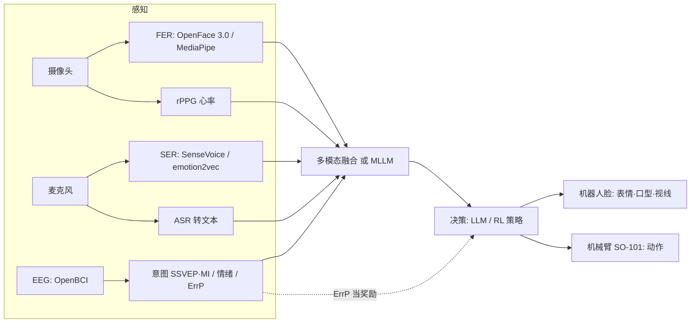

# 情感计算 × 脑机接口 × 机器人：调研报告

> 调研日期：2026-10-14
> 范围：脑机接口（BCI）控制机器人、语音情感识别（SER）、人脸情绪识别（FER）、生理信号 / 多模态 / LLM 情感与心理分析，以及低成本可复现的平台和开源项目。
> 说明：成功率、准确率等数字大多是作者自己报告的，我没有独立复现。GitHub 链接都用 API 确认过仓库存在（2026-10-14）。价格以官网或经销商页面为准，会变动。

---

## 0. 一页结论

| 子方向 | 当前最佳方案（一句话） | 能低成本上手的开源选择 |
|---|---|---|
| **BCI 控机器人：侵入式** | Neuralink CONVOY、BrainGate、北脑一号已经能让瘫痪患者控制机械臂喝水和进食，但都还在早期临床 | 个人和普通实验室做不了 |
| **BCI 控机器人：非侵入式** | **"EEG 解码器 + AI 副驾驶（copilot）"的共享自主**：UCLA 2025 年发在 Nature Machine Intelligence，用 64 导 EEG 加视觉 copilot 控制机械臂抓放 | OpenBCI Cyton（$1,249）或 PiEEG / HackEEG，配 MNE、MOABB、BrainFlow，用 SSVEP 或 ErrP 范式 |
| **语音情感识别（SER）** | 竞赛冠军普遍是**语音基础模型（WavLM / Whisper）+ 文本模型（RoBERTa / LLaMA）融合** | **emotion2vec+ large**（300M）、**SenseVoiceSmall**（234M，支持中英日韩粤，CPU 能跑） |
| **人脸情绪识别（FER）** | 专用模型仍然比通用视觉语言模型（VLM）强：POSTER 系列在 RAF-DB 上约 92.8% | **OpenFace 3.0**（2025）、LibreFace、py-feat、EmotiEffLib（HSEmotion）、MediaPipe blendshapes |
| **多模态 / LLM 情感理解** | 多模态大模型（MLLM）路线：Emotion-LLaMA（NeurIPS 2024）、AffectGPT（ICML 2025）；MER 2025 的主题就是"情感计算遇上大模型" | 两者都开源；评测用 MER-UniBench、EmoBench |
| **生理信号 / 心理状态** | 用摄像头测心率（rPPG）、可穿戴设备测压力（WESAD）、EEG 情绪识别（SEED）；抑郁筛查目前以文本 LLM 为主的流程最稳 | rPPG-Toolbox（NeurIPS 2023）、torcheeg |
| **低成本机器人平台** | 带表情的头部 / 桌面社交机器人：**Reachy Mini（$399 起，全开源）**、**Will Cogley 机器人头（你本地已经有文件）**、Blossom（零件 < $250）、Stack-chan、Columbia Eva（约 $900） | 见第 5 节 |

**推荐的入门组合（总成本约 ¥3,000 到 ¥12,000）：**
Will Cogley 头或 Reachy Mini，加普通摄像头（跑 OpenFace 3.0 或 MediaPipe）、麦克风（跑 SenseVoice 或 emotion2vec）、LLM 负责对话和决策。有余力再加 OpenBCI 做 EEG，或者把 ErrP 接到你的 SO-101 上当 RL 奖励。

---

## 1. 脑机接口（BCI）控制机器人

### 1.1 先分清两条路线

| | 侵入式（皮层内电极） | 非侵入式（头皮 EEG） |
|---|---|---|
| 信号质量 | 高，能做连续多关节控制 | 低，空间分辨率差，噪声大 |
| 门槛 | 需要外科手术和医疗器械审批 | 戴帽子就能用 |
| 代表 | Neuralink、BrainGate、Synchron、北脑一号 | UCLA AI-BCI、CMU 手指级控制、Stanford NOIR |
| 对你 | 只适合读论文 | **可以动手做** |

### 1.2 侵入式：已经能用，但离普及还远

- **Neuralink CONVOY**：在 N1 植入物基础上研究控制辅助设备，主要是机械臂。2026-01-28 的更新视频里，受试者 Nick 完成了进食、递饮料、挠痒等动作。注册页面上**没有汇总结果**，属于早期可行性研究。([ClinicalTrials NCT06710626](https://clinicaltrials.gov/study/NCT06710626)、[pharmaphorum 报道](https://pharmaphorum.com/news/neuralink-unveils-trial-linking-brain-implant-robotic-arm))
- **Synchron**：血管内的 Stentrode，接入了 NVIDIA 和 Apple Vision Pro 生态，主打用"认知 AI"辅助控制家居和设备。([R&D World](https://www.rdworldonline.com/watch-rodney-a-paralyzed-man-control-his-home-with-tech-from-synchron-nvidia-and-apple/))
- **国内**：
    - 北京"北脑一号"临床试验，2025 年 2 月有四肢瘫痪患者用意念控制机械臂喝水、吃饭。
    - 中科院脑智卓越中心和华山医院合作，颈髓损伤患者用意念控制智能轮椅和机器狗。
    - 侵入式 BCI 在国内属于三类医疗器械，目前还没有产品获批上市。
    - 来源：[新华网 2026-01-28](https://www.news.cn/tech/20260128/f5d6ac378dc8446f8510bc8f08fc4403/c.html)、[新华网 2025-12-17](https://www.news.cn/tech/20251217/262d25076b804376a7c3238a8e9d6b6a/c.html)

### 1.3 非侵入式：目前最好的几篇

| 论文 | 发表 | 做法 | 结果（作者报告） |
|---|---|---|---|
| **Brain–computer interface control with AI copilots**（UCLA，Jonathan Kao 组） | **Nature Machine Intelligence**，2025-09 | 64 导 EEG，解码器是 CNN 加类 ReFIT 的 Kalman 滤波；AI copilot 根据摄像头画面推断用户想抓哪个方块，和解码器共同控制光标或机械臂 | 健康受试者光标任务成功率约翻倍；瘫痪受试者没有 copilot 时完不成，有了以后成功率 93%；共 4 名受试者 |
| **EEG BCI 实时控制机器人手到单根手指**（CMU，Bin He 组） | **Nature Communications**，2025-06 | 用单指的运动执行和运动想象（MI）驱动机械手指，深度网络解码并做个体微调 | 21 名有经验的受试者：两指 MI 实时准确率 80.56%，三指 60.61%；作者称首次在 EEG 上做到手指级控制 |
| **NOIR**（Stanford，李飞飞、吴佳俊组） | **CoRL 2023** | EEG 分两步：SSVEP 选物体，MI 选动作；机器人学习适应不同用户、预测意图 | 完成 20 种家务任务 |
| NOIR 2.0 | CoRL 2024 workshop | 解码更快更准，并加入少样本学习 | 任务时间减少 46%，人的总投入时间减少 65% |
| AR 脑-机器人接口控制通用机械臂 | RO-MAN 2026 | EEG + AR 界面控制机械臂做操作 | — |
| EEG 视觉想象 + 运动想象混合控制抓放 | ICRA 2026 | 真机抓取和放置 | — |
| NeuroCommitSSM | IROS 2026 | 融合 EEG、肌电和眼动做共享自主，保证辅助操作安全 | — |

链接：[UCLA 新闻](https://samueli.ucla.edu/ai-co-pilot-boosts-noninvasive-brain-computer-interface-by-interpreting-user-intent/) · [CMU 论文 PMC 全文](https://pmc.ncbi.nlm.nih.gov/articles/PMC12209421/) · [NOIR arXiv](https://arxiv.org/abs/2311.01454) · [NOIR CoRL proceedings](https://mlanthology.org/corl/2023/zhang2023corl-noir) · [NOIR 2.0](https://arxiv.org/abs/2511.20848) · [AR-BRI](https://arxiv.org/abs/2606.16413) · [EEG VI+MI](https://arxiv.org/abs/2603.03181) · [NeuroCommitSSM](https://arxiv.org/abs/2607.15395)

**核心观点：** 非侵入式 BCI 现在最好的思路**不是把 EEG 解码做到极致**，而是**让 EEG 只负责给出粗略意图（选哪个、要不要），由机器人的自主能力和 AI copilot 补全细节**。UCLA 和 NOIR 都是这个思路。这和机器人学习里的共享自主（shared autonomy）完全是一回事，你学 RL 和 VLA 的背景正好用得上。

### 1.4 ErrP：把脑信号当成 RL 奖励（和你的 RL 方向最相关）

ErrP（错误相关电位）是人看到机器人做错时，EEG 里自动出现的一个波形，不需要人主动做什么。

| 工作 | 发表 | 要点 |
|---|---|---|
| Intrinsic interactive RL | Scientific Reports 2017 | 用 ErrP 当 RL 奖励，真机学会手势到动作的映射；ErrP 检测平衡准确率约 90% |
| Accelerated Robot Learning via Human Brain Signals | ICRA 2020 | 用 ErrP 加速机器人 RL |
| Aligning Humans and Robots via RL from Implicit Human Feedback | arXiv 2025 | 用公开的 HRI-ErrP 数据集（12 人，32 导）训练 EEGNet 分类器，输出当 RL 奖励 |
| RL from Implicit Neural Feedback for Human-Aligned Robot Control | arXiv 2025 | 同一方向的后续工作 |

可用的数据集：
- **Atari 迷宫 ErrP 数据集**：用 **OpenBCI Cyton** 采集，12 人，原本就是用来加速 RL 智能体学习的，是**最接近低成本 + RL** 的一个。
- IntEr-HRI 竞赛（IJCAI 2024）的触觉 ErrP 数据。
- Bologna 的 INTELLIMAN 遥操作 ErrP 数据。

链接：[Kim 2017](https://www.nature.com/articles/s41598-017-17682-7) · [ICRA 2020](https://arxiv.org/abs/1910.00682) · [RLIHF 2025](https://arxiv.org/abs/2507.13171) · [RLINF 2025](https://arxiv.org/abs/2512.00050) · [Atari 迷宫 ErrP 数据集](https://ieee-dataport.org/node/13121) · [IntEr-HRI（IJCAI 2024）](https://ijcai.org/proceedings/2024/0994.pdf)

### 1.5 EEG 基础模型：没有绝对的最佳

- 常用基线是 **LaBraM**（ICLR 2024）和 **CBraMod**（ICLR 2025）。新出的 REVE 用了目前最大的预训练数据。
- 但 **EEG-FM-Bench** 和 **EEG-Bench** 两个评测发现：在小样本临床任务上，LDA 这类经典方法经常和基础模型打平，甚至更好。例如 mTBI 任务上 LDA 超过了所有基础模型；LaBraM 在癫痫检测上平衡准确率只有 0.565。
- **结论：** 做机器人控制这种在线、小样本、需要个体校准的任务，**先用 EEGNet、FBCSP+LDA、Riemannian 方法做基线**，基础模型当对照组。

链接：[EEG-FM-Bench 论文](https://arxiv.org/abs/2508.17742)（[代码](https://github.com/xw1216/EEG-FM-Bench)） · [EEG-Bench](https://arxiv.org/abs/2512.08959) · [LaBraM](https://github.com/935963004/LaBraM) · [CBraMod](https://github.com/wjq-learning/CBraMod)

### 1.6 开源软件工具链

| 工具 | 用途 | 链接 |
|---|---|---|
| MNE-Python | EEG 预处理和分析的标准库 | [github](https://github.com/mne-tools/mne-python) |
| BrainFlow | 统一的硬件采集 API，支持 OpenBCI、Muse 等几十种设备 | [github](https://github.com/brainflow-dev/brainflow) |
| MOABB | BCI 算法的可复现基准，接了很多公开数据集 | [github](https://github.com/NeuroTechX/moabb) · [论文](https://arxiv.org/abs/1805.06427) |
| braindecode | 深度学习解码，内置 EEGNet 等模型，也有 CBraMod 的社区实现 | [github](https://github.com/braindecode/braindecode) |
| torcheeg | PyTorch 的 EEG 库，内置 SEED、DEAP 等情绪数据集 | [github](https://github.com/torcheeg/torcheeg) |
| **MetaBCI**（天津大学） | 国产一站式平台：brainda 负责数据和解码，brainflow 负责在线处理，brainstim 负责刺激范式 | [github](https://github.com/TBC-TJU/MetaBCI) |
| OpenBCI GUI | 硬件自带的可视化和数据流软件 | [github](https://github.com/OpenBCI/OpenBCI_GUI) |

### 1.7 EEG 硬件（价格来自官网或经销商）

| 设备                             | 通道数    | 价格                 | 适合                        |
| ------------------------------ | ------ | ------------------ | ------------------------- |
| OpenBCI Ganglion               | 4      | $624.99            | 入门、SSVEP                  |
| **OpenBCI Cyton**              | 8      | $1,249             | **研究入门首选**，ErrP 数据集也是用它采的 |
| OpenBCI Cyton + Daisy          | 16     | $2,499             | 运动想象、需要更多导联               |
| OpenBCI Ultracortex Mark IV 头架 | —      | $499.99 起          | 3D 打印干电极头架                |
| Emotiv Insight / EPOC X        | 5 / 14 | $499 / $999        | 消费级，SDK 有授权限制             |
| PiEEG（树莓派扩展板）                  | 8 / 16 | 低（DIY）             | 最便宜，开源                    |
| HackEEG（Arduino 扩展板）           | 8 到 32 | $495 到 $2,090（预售价） | 开源                        |

链接：[OpenBCI 商店](https://shop.openbci.com/collections/frontpage/openbci) · [Emotiv 价格](https://www.emotiv.com/blog/emotiv-eeg-headset-price) · [PiEEG-8](https://github.com/pieeg-club/PiEEG-8) · [PiEEG-16 论文](https://export.arxiv.org/pdf/2409.07491) · [HackEEG](https://github.com/starcat-io/hackeeg-shield)（[Crowd Supply](https://crowdsupply.com/starcat/hackeeg)）

注意：OpenBCI Cyton+Daisy 和医疗级设备相比，噪声表现接近，但时间精度略差，做 ErrP 这类事件相关的范式时要注意打标同步。

### 1.8 范式选择建议

| 范式 | 训练成本 | 稳定性 | 适合做什么 |
|---|---|---|---|
| **SSVEP**（盯着闪烁目标） | 几乎不用训练 | 最高 | 选物体、选菜单（NOIR 第一步） |
| MI（运动想象） | 要训练好几次 | 个体差异大 | 连续方向控制 |
| **ErrP**（看到错误时的自动反应） | 需要标定 | 中等 | **RL 奖励**、纠错 |
| P300 | 少量 | 高 | 拼写、选择 |

---

## 2. 语音情感识别（SER）

### 2.1 现在最好的方法是什么样的

- **Interspeech 2025 自然场景 SER 挑战赛**（用 MSP-Podcast 数据集）：任务是 8 类情绪分类，加上唤醒度、效价、支配度三个维度的回归。
- 组委会统计参赛方案：语音编码器 70% 用 **WavLM**、47% 用 **Whisper**；文本编码器 53% 用 **RoBERTa**、24% 用 **LLaMA**。**语音和文本互补**是最一致的规律。
- 有一个团队拿了 Task 2 的第一和第二名（"Developing a High-performance Framework for SER"）。
- **音频大模型的弱点**：Interspeech 2026 有论文指出，当语气和字面意思矛盾时（比如用讽刺的语气说"太好了"），SER 模型和音频 LLM 都会被文本带偏，论文把这叫作"semantic dominance"。**这正是机器人在真实对话里最需要识别的情况。**

链接：[IS25 挑战赛总结](https://www.isca-archive.org/interspeech_2025/naini25_interspeech.html)（[PDF](https://lab-msp.com/MSP/publications/Naini_2025_2.pdf)） · [冠军框架](https://www.isca-archive.org/interspeech_2025/lertpetchpun25_interspeech.pdf) · [MSP-Podcast 2024 挑战方案](https://arxiv.org/abs/2407.05746)

### 2.2 开源模型（可以直接用）

| 模型 | 规模 | 语言 | 特点 | 链接 |
|---|---|---|---|---|
| **emotion2vec / emotion2vec+ large** | 约 300M | 多语言（10 种语言上验证过） | 自监督的情感表示；在 IEMOCAP 上只加线性层就超过通用模型（ACL 2024 Findings） | [github](https://github.com/ddlBoJack/emotion2vec) |
| **SenseVoiceSmall** | 234M | 中、粤、英、日、韩 | 一个模型同时做语音识别、语种识别、情感识别、音频事件检测，CPU 能跑，**很适合机器人端** | [github](https://github.com/QwenAudio/SenseVoice) |
| FunASR | 工具包 | — | 统一调用 SenseVoice 和 emotion2vec，`pip install funasr` | [github](https://github.com/modelscope/FunASR) |
| Qwen2.5-Omni / Qwen3-Omni | 7B / 30B-A3B | 多语言 | 全模态大模型；我没找到纯语音情感的官方评测，有一个视频情感评测里 Qwen3-Omni 61.4%，Qwen2.5-Omni 55.0% | [Qwen3-Omni 技术报告](https://arxiv.org/abs/2509.17765) · [E3mo-Bench](https://arxiv.org/abs/2608.10796) |

### 2.3 评测基准和数据集

- **EmoBox**（Interspeech 2024）：32 个情感数据集、14 种语言，有统一的数据划分和跨语料评测。**选模型先在这上面看。** 第三方解读称 Whisper large v3 在库内和跨库两种设置下都最好，这一点没在原文核实。[论文](https://arxiv.org/abs/2406.07162) · [github](https://github.com/emo-box/EmoBox)
- 常用数据集：IEMOCAP（英文，表演）、MSP-Podcast（英文，自然对话，目前最主流）、CREMA-D、RAVDESS。中文常用 CASIA、ESD、M3ED。

### 2.4 用到机器人上的建议

1. 端侧用 **SenseVoiceSmall**，一次推理同时拿到文本和情感标签，延迟低。
2. 要更细的维度（唤醒度、效价）或者跨语料泛化，用 **emotion2vec+** 的特征再训一个小的回归头。
3. 把 ASR 文本和情感标签一起交给 LLM 做最终判断，这对应竞赛里的"语音 + 文本融合"。同时专门测一下语气和字面意思矛盾的样本。

---

## 3. 人脸表情 / 情绪识别（FER）

### 3.1 现在最好的方法

- **专用 FER 模型**目前最高：POSTER-Var 报告 RAF-DB 92.76%、AffectNet-7 67.91%、FER+ 91.89%。AffectNet 准确率一直在六七成，说明自然场景的表情本身就有歧义。
- **专用模型 vs 通用视觉语言模型**：Frontiers 2026 的一项研究发现，在 AffectNet 上训练的 DAN 模型泛化最好，**超过了所有 VLM**。所以机器人上做实时 FER，还是用专用小模型。
- **ABAW 竞赛（CVPR workshop）**是这个方向的风向标：赛道有效价-唤醒度回归、表情分类、动作单元（AU）检测、情绪模仿强度。2026 年第 10 届，云知声和中国科大联队拿了 EMI 和 AU 两个第一。

链接：[POSTER-Var（PMC）](https://pmc.ncbi.nlm.nih.gov/articles/PMC12923884/) · [FER vs VLM（Frontiers 2026）](https://www.frontiersin.org/journals/artificial-intelligence/articles/10.3389/frai.2026.1800342/full) · [ABAW 2026 云知声](https://www.unisound.com/en/news/152) · [ABAW 2025](https://www.unibw.de/vis-en/news-1/cvpr-2025-emi-challenge)

### 3.2 开源工具箱（推荐按这个顺序试）

| 工具 | 能做什么 | 特点 | 链接 |
|---|---|---|---|
| **OpenFace 3.0**（CMU，2025） | 关键点、AU、视线、情绪，一个模型全做 | 轻量，pip 安装，比同类更快更省内存 | [github](https://github.com/CMU-MultiComp-Lab/OpenFace-3.0) · [论文](https://arxiv.org/abs/2506.02891) |
| **LibreFace**（USC，WACV 2024） | AU 检测、AU 强度、表情分类 | AU 强度比 OpenFace 2.0 高 7%，速度约 2 倍，CPU 能跑 | [github](https://github.com/ihp-lab/LibreFace) · [论文](https://openaccess.thecvf.com/content/WACV2024/html/Chang_LibreFace_An_Open-Source_Toolkit_for_Deep_Facial_Expression_Analysis_WACV_2024_paper.html) |
| py-feat | 人脸检测、AU、情绪、可视化 | 偏心理学研究，文档好 | [github](https://github.com/cosanlab/py-feat) |
| EmotiEffLib（原 HSEmotion） | 高效表情识别 | 作者多次在 ABAW 拿名次，有 ONNX 版本 | [github](https://github.com/sb-ai-lab/EmotiEffLib) |
| DeepFace | 情绪、年龄、性别等 | 上手最简单，精度一般 | [github](https://github.com/serengil/deepface) |
| **MediaPipe Face Landmarker** | 478 个关键点 + 52 个 blendshape | **适合驱动机器人脸做模仿**，blendshape 可以直接映射到舵机 | [github](https://github.com/google-ai-edge/mediapipe) |
| DDAMFN / POSTER | 刷榜用的研究代码 | 精度高，但工程化差 | [DDAMFN](https://github.com/SainingZhang/DDAMFN) · [POSTER](https://github.com/zczcwh/POSTER) |

### 3.3 FER 和机器人脸结合的代表工作

| 论文 | 发表 | 要点 |
|---|---|---|
| **Human-Robot Facial Co-expression**（Emo） | Science Robotics 2024 | 26 个电机的机器人脸，提前约 840 ms 预测人要笑，和人同时笑 |
| **Learning realistic lip motions for humanoid face robots** | Science Robotics 2026-01 | 10 自由度硅胶嘴唇，用自监督方法从音频学口型 |
| Smile Like You Mean It | ICRA 2021 | 用学出来的模型驱动 Eva 机器人脸 |
| HAPI | IROS 2025 | 用人类偏好学机器人表情，类似 RLHF |
| VividFace | ICRA 2026 | 人形机器人实时模仿人的表情 |
| 仿生机器人脸 + 开源表情数据集 | IROS 2025 | 自称首个人形社交机器人的开源面部数据集 |

链接：[Emo（Columbia）](https://engineering.columbia.edu/news/robot-can-you-say-cheese) · [Lip motions](https://www.science.org/doi/10.1126/scirobotics.adx3017) · [Smile Like You Mean It](https://arxiv.org/abs/2105.12724) · [HAPI](https://arxiv.org/abs/2503.17046) · [VividFace](https://arxiv.org/abs/2602.07506) · [仿生脸 IROS 2025](https://arxiv.org/abs/2510.23059)

---

## 4. 其他情感 / 心理状态分析

### 4.1 多模态大模型做情感理解（目前最前沿）

| 工作 | 发表 | 要点 | 链接 |
|---|---|---|---|
| **Emotion-LLaMA** | NeurIPS 2024 | 音频、视觉、文本各有情感专用编码器；构建了 MERR 数据集（2.8 万粗标注 + 4,487 细标注）；MER2023-SEMI 上 F1 0.9036 | [论文](https://proceedings.neurips.cc/paper_files/paper/2024/hash/c7f43ada17acc234f568dc66da527418-Abstract.html) · [github](https://github.com/ZebangCheng/Emotion-LLaMA) |
| **AffectGPT** | ICML 2025 | MER-Caption 数据集（11.5 万样本，2,000 多个细粒度情绪类别）+ MER-UniBench 统一评测；比现有 MLLM 高 9% 以上 | [论文](https://proceedings.mlr.press/v267/lian25a.html) · [github](https://github.com/zeroQiaoba/AffectGPT) |
| Emotion-LLaMAv2 / MMEVerse | 2026 | 作者称超过 Qwen2.5-Omni 和 AffectGPT | [arXiv](https://arxiv.org/abs/2601.16449) |
| **MER 2025 挑战赛** | ACM MM 2025 | 第三届，主题"情感计算遇上大模型"；四个赛道：半监督分类、细粒度情绪、描述性理解、从情绪推断人格 | [论文](https://arxiv.org/abs/2504.19423) · [数据集](https://huggingface.co/datasets/MERChallenge/MER2025) |
| OmniVox | 2025 | 用全模态 LLM 做零样本情感识别 | [arXiv](https://arxiv.org/abs/2503.21480) |

### 4.2 LLM 的"情商"评测

- **EmoBench**（ACL 2024）：400 道中英文手工题，分"情绪理解"和"情绪应用"两部分。结论是现有 LLM 的情商和普通人类还有明显差距。[论文](https://arxiv.org/abs/2402.12071) · [github](https://github.com/Sahandfer/EmoBench)

### 4.3 生理信号

| 资源 | 内容 | 链接 |
|---|---|---|
| **rPPG-Toolbox**（NeurIPS 2023 D&B） | 用普通摄像头测心率（远程光电容积脉搏波），有监督和无监督模型都有；**机器人上不用穿戴设备就能拿到心率** | [github](https://github.com/ubicomplab/rPPG-Toolbox) · [论文](https://proceedings.neurips.cc/paper_files/paper/2023/hash/d7d0d548a6317407e02230f15ce75817-Abstract.html) |
| **SEED 系列**（上海交大吕宝粮组） | 62 导 EEG + 眼动，电影片段诱发正、负、中性情绪；还有法语、德语版和警觉度数据；需要申请 | [官网](https://bcmi.sjtu.edu.cn/home/seed) |
| **WESAD**（ICMI 2018） | 胸带 + Empatica E4 手环，15 人，中性 / 压力 / 愉悦三类；压力由 TSST 诱发 | [UCI](https://archive.ics.uci.edu/dataset/465/wesad+wearable+stress+and+affect+detection) |
| DEAP、DREAMER、AMIGOS | 经典的 EEG / 生理情绪数据集 | torcheeg 里都有加载器 |

### 4.4 心理健康评估（抑郁筛查）

- 常用基准是 **E-DAIC / AVEC**，用访谈视频、音频和转录文本预测 PHQ-8 抑郁量表分数。
- **npj Mental Health Research 2024**：用 LLM 从访谈文本里提取抑郁相关指标，再融合语音质量评估，最好结果 MAE 2.85、RMSE 4.02。**只用文本的模型就已经很稳**，加视频提升有限。[PMC](https://www.ncbi.nlm.nih.gov/pmc/articles/PMC11666580/)
- 新趋势是给音频 LLM 加上视觉，并在时间戳级别对齐音频和视觉特征。[arXiv 2511.19877](https://arxiv.org/abs/2511.19877)
- **伦理提醒**：心理状态推断涉及敏感数据，做真人实验要过伦理审查（IRB）。机器人场景里，"推断了但不该说出来"本身就是一个研究问题。

### 4.5 和机器人结合的代表工作（ICRA / IROS / HRI 系）

| 论文 | 发表 | 要点 |
|---|---|---|
| UGotMe | ICRA 2025 | 情感交互系统部署在真机上，解决多人场景里"该关注谁的情绪" |
| 用生理信号、视线和表情建模信任 | ICRA 2025 | 多模态实时估计人对机器人的信任度 |
| E2Map | ICRA 2025 | "经验与情绪地图"，用 LLM 根据过去的经历调整导航 |
| 多模态估计用户体验 | IROS 2025 | 用多实例学习从社交信号估计用户体验 |
| 老人社交辅助机器人的情感智能 | IEEE Trans. Affective Computing | 真实试点研究 |

链接：[UGotMe](https://arxiv.org/abs/2410.18373) · [Trust ICRA 2025](https://arxiv.org/abs/2504.05291) · [E2Map](https://arxiv.org/abs/2409.10027) · [UX IROS 2025](https://arxiv.org/abs/2507.23544) · [老人 SAR](https://arxiv.org/abs/2201.11167) · [情感机器人综述（Spitale & Gunes）](https://arxiv.org/abs/2304.01902) · [情感机器人演化综述](https://arxiv.org/abs/2407.02957)

---

## 5. 低成本可复现平台与开源项目（重点）

### 5.1 机器人头 / 表情脸 / 桌面社交机器人

| 平台                                     | 类型                         | 成本                                                | 开源程度                                          | 控制方式                                                                                                                               | 适合做什么                                        | 链接                                                                                                                                                                  |
| -------------------------------------- | -------------------------- | ------------------------------------------------- | --------------------------------------------- | ---------------------------------------------------------------------------------------------------------------------------------- | -------------------------------------------- | ------------------------------------------------------------------------------------------------------------------------------------------------------------------- |
| **Will Cogley 机器人头 α2.0.33**           | 拟人头：眼、眉、嘴、颈                | 3D 打印 + 舵机 + PCB，约几百元到一千多元（按 BOM 估算，未核实）          | 开源（Nilheim Mechatronics 声明可以自由修改和使用，未写明具体许可证） | **你本地已有**：树莓派 Pico 跑 MicroPython（`eyes.py`、`Brows.py`、`Mouth.py`），电脑上用 PySide6 界面串口控制（`HeadControlUI.py`）；EasyEDA 电路板、Bambu 打印文件齐全 | 表情生成、视线、口型同步，复现 Emo 或 VividFace 的简化版         | 本地 `../Head_α2.0.33/` · [Nilheim Notion](https://nilheim-mechatronics.notion.site)                                                                                  |
| **Reachy Mini**（Pollen / Hugging Face） | 桌面机器人：6 自由度头 + 身体旋转 + 两根天线 | 官网 Lite $399、无线版 $499（发布时 $299 / $449，Seeed 售价更高） | **硬件、SDK、仿真全部开源**，Python                      | 广角摄像头、4 麦克风阵列、5W 扬声器；应用商店有 50 多个应用，含情绪表达和对话                                                                                        | **最快搭出"感知 → LLM → 情感表达"闭环**；可以直接接 LeRobot 生态 | [HF 博客](https://huggingface.co/blog/reachy-mini) · [github](https://github.com/pollen-robotics/reachy_mini) · [应用列表](https://pollen-robotics.com/reachy-mini/apps/) |
| **Blossom**（Cornell，Hoffman 组）         | 柔软外壳、绳索悬挂的头                | **零件 < $250**                                     | 开源（ACM THRI 2019）                             | 可以用手机动作远程操控                                                                                                                        | 社交机器人用户研究、动作设计                               | [github](https://github.com/hrc2/blossom-public) · [Cornell 新闻](https://news.cornell.edu/node/311226)                                                               |
| **Eva**（Columbia，Lipson 组）             | 拟人头，25 根"肌肉"（拉线 + 电机）      | 约 $900                                            | 硬件图纸发在 HardwareX                              | 学出来的模型驱动表情                                                                                                                         | 复现 Emo 系列工作的前身                               | [HardwareX 论文](https://www.sciencedirect.com/science/article/pii/S2468067220300262)（[PMC](https://www.ncbi.nlm.nih.gov/pmc/articles/PMC9041256/)）                   |
| **Stack-chan**                         | 掌上机器人，屏幕当脸                 | 低（M5Stack CoreS3 + 舵机）                            | 外壳、电路、软件全开源，OSHWA 认证                          | ESP32-S3                                                                                                                           | 低成本的表情和对话实验                                  | [github](https://github.com/stack-chan/stack-chan) · [OSHWA](https://certification.oshwa.org/jp000017.html)                                                         |
| Robotic_Head（mrshah-xo）                | 拟人头 + 语音对话                 | 低                                                 | 开源                                            | 树莓派 4，眼、眉、嘴独立运动，口型和语音同步                                                                                                            | 语音 + 表情一体的现成参考                               | [github](https://github.com/mrshah-xo/Robotic_Head)                                                                                                                 |
| AnimatronicHead（ronibandini）           | 简易头                        | 很低（SG90 舵机）                                       | 开源                                            | Arduino，可选人脸检测                                                                                                                     | 最快能做出来的原型                                    | [github](https://github.com/ronibandini/AnimatronicHead)                                                                                                            |
| InMoov                                 | 真人大小的人形机器人（含头）             | 中等（大量打印件）                                         | 开源（MyRobotLab）                                | —                                                                                                                                  | 全身人形，头部可以单独做                                 | [github](https://github.com/MyRobotLab/InMoov)                                                                                                                      |
| **SO-101**（你已经有）                       | 6 自由度机械臂                   | 已有                                                | 全开源                                           | LeRobot                                                                                                                            | 情感化的动作表达、ErrP 当 RL 奖励                        | —                                                                                                                                                                   |

### 5.2 商业平台价格（只作对比，经销商报价，未核实）

| 平台 | 价格 |
|---|---|
| QTrobot（LuxAI） | 约 $10,450 |
| Furhat | 约 $35,000（含一年订阅） |
| Pepper 学术版 | 约 $49,900 |

来源：[LuxAI](https://luxai.com/?p=4453) · [Furhat（fitgap）](https://us.fitgap.com/products/038123/furhat-robotics) · [RobotLab](https://www.robotlab.com/?p=5692)

**结论：** 开源平台的成本只有商业平台的 1/10 到 1/100。顶会论文（Science Robotics 的 Emo、IROS 的 HAPI）大多用的也是自制的头，所以**自己做头并不会影响论文档次**。

### 5.3 推荐的三档复现方案

| 档位 | 硬件 | 软件 | 估算成本 | 能做什么 |
|---|---|---|---|---|
| **A. 最快闭环** | Reachy Mini Lite + 电脑 | SenseVoice + OpenFace 3.0 + LLM | 约 $399 | 两周内跑通"识别情绪 → 生成回应 → 用动作表达" |
| **B. 拟人脸** | Will Cogley 头（本地文件）+ USB 摄像头 + 麦克风 | MediaPipe blendshape 驱动舵机做表情模仿 + SenseVoice + LLM | 约 ¥1,000 到 ¥2,000（估算） | 复现 Emo 或 VividFace 的简化版：表情模仿、提前预测表情 |
| **C. 加脑信号** | A 或 B + OpenBCI Cyton（或 PiEEG）+ SO-101 | BrainFlow + MNE + EEGNet；SSVEP 或 ErrP | 再加约 $1,250 | 用 SSVEP 选物体、SO-101 执行（简化版 NOIR）；**用 ErrP 当 RL 奖励** |

---

## 6. 会议与期刊分档

| 档位 | 名称 | 备注 |
|---|---|---|
| 综合顶刊 | Science Robotics、Nature Machine Intelligence、Nature Communications | UCLA AI-BCI、CMU 手指控制、Emo 都发在这一档 |
| 机器人学习顶会 | CoRL、RSS | NOIR 发在 CoRL |
| HRI 方向顶级 | **ACM/IEEE HRI**、ACM THRI（期刊）、CHI | 社交机器人用户研究首选；很多论文不挂 arXiv，要去 ACM DL 查 |
| 情感计算方向 | **IEEE Transactions on Affective Computing**、ACII、ACM MM（MER 挑战赛） | |
| 机器学习顶会 | NeurIPS、ICML、ICLR | Emotion-LLaMA、AffectGPT、LaBraM、CBraMod |
| 语音方向 | Interspeech、ICASSP | SER 挑战赛 |
| 视觉方向 | CVPR（ABAW workshop）、WACV | FER 和 AU |
| 机器人大会 | ICRA、IROS | 量大，质量参差不齐 |
| 第二梯队 | RO-MAN、ICSR、IJSR、Frontiers in Robotics and AI | |

---

## 7. 结合你现有设备的实践路线和研究问题

**第 1 步（1 到 2 周）：搭出情感感知管线**
在 Mac 上跑 SenseVoice 和 OpenFace 3.0（或 MediaPipe），实时输出"情绪标签 + 效价 + 唤醒度"。顺便在 EmoBox 和 RAF-DB 上各测一次，建立基线。

**第 2 步（2 到 4 周）：情感表达的执行端**
- 方案一：打印 Will Cogley 头，把 MediaPipe 的 52 个 blendshape 映射到舵机，先做表情模仿。
- 方案二：买 Reachy Mini，直接用它的情绪应用和 SDK。

**第 3 步：接上 SO-101，和你的 RL 路线打通**
- **课题 1：ErrP 当 HIL-SERL 的奖励或干预信号。** 你之前看的 oye-Li-bc 项目，就是因为奖励分类器不稳定才改成人按键判断成功；ErrP 能把这一步变成隐式的、不用人主动操作。先用 Atari 迷宫 ErrP 数据集（同样是 OpenBCI 采的）离线验证分类器，再上真机。
- **课题 2：情感化的操作动作。** 同一个抓放任务，让 SO-101 用不同速度和轨迹表达"犹豫"或"自信"，用人类偏好学习（参考 HAPI）或 RL 优化，再做用户研究看人能不能读出来。
- **课题 3：简化版 NOIR。** 用 SSVEP 选物体，SO-101 加 ACT 或 VLA 执行，对照 UCLA 的 copilot 思路做共享自主。

**值得注意的空白（可能出论文的地方）：**
1. 低成本 EEG（8 导）加低成本机械臂做 ErrP 驱动的 RL，现有工作基本都用 32 导以上的研究级设备。
2. 语气和字面意思矛盾时的多模态情感识别，用在机器人对话里（音频 LLM 的已知弱点）。
3. 情感感知 → 机器人行为调整的**闭环评估**：大部分工作只做到识别或只做到表达，很少两头都做、再加真人实验。

---

## 参考来源

**BCI**
- [UCLA AI copilot BCI 新闻](https://samueli.ucla.edu/ai-co-pilot-boosts-noninvasive-brain-computer-interface-by-interpreting-user-intent/) · [Neuroscience News](https://neurosciencenews.com/ai-bci-movement-neurotech-29649/)
- [CMU EEG 手指级控制（PMC）](https://pmc.ncbi.nlm.nih.gov/articles/PMC12209421/) · [CMU 新闻](https://www.cmu.edu/ni/news-events/2025/bci-robotic-hand-control)
- [NOIR](https://arxiv.org/abs/2311.01454) · [NOIR 2.0](https://arxiv.org/abs/2511.20848)
- [Neuralink CONVOY 注册页](https://clinicaltrials.gov/study/NCT06710626) · [Synchron × NVIDIA](https://www.rdworldonline.com/watch-rodney-a-paralyzed-man-control-his-home-with-tech-from-synchron-nvidia-and-apple/)
- [新华网：国内脑机接口进展 2026-01](https://www.news.cn/tech/20260128/f5d6ac378dc8446f8510bc8f08fc4403/c.html) · [新华网 2025-12](https://www.news.cn/tech/20251217/262d25076b804376a7c3238a8e9d6b6a/c.html)
- [EEG-FM-Bench](https://arxiv.org/abs/2508.17742) · [EEG-Bench](https://arxiv.org/abs/2512.08959) · [MOABB 论文](https://arxiv.org/abs/1805.06427)
- [Kim 2017 ErrP RL](https://www.nature.com/articles/s41598-017-17682-7) · [ICRA 2020 脑信号加速学习](https://arxiv.org/abs/1910.00682) · [RLIHF](https://arxiv.org/abs/2507.13171) · [RLINF](https://arxiv.org/abs/2512.00050) · [Atari ErrP 数据集](https://ieee-dataport.org/node/13121)
- [OpenBCI 商店](https://shop.openbci.com/collections/frontpage/openbci) · [Emotiv 价格](https://www.emotiv.com/blog/emotiv-eeg-headset-price) · [SSVEP 控制 6 自由度机械臂（PMC）](https://www.ncbi.nlm.nih.gov/pmc/articles/PMC9269816/)

**SER**
- [emotion2vec](https://github.com/ddlBoJack/emotion2vec) · [EmoBox](https://arxiv.org/abs/2406.07162) · [SenseVoice](https://github.com/QwenAudio/SenseVoice) · [FunASR](https://github.com/modelscope/FunASR)
- [IS25 SER 挑战赛](https://www.isca-archive.org/interspeech_2025/naini25_interspeech.html) · [冠军框架](https://www.isca-archive.org/interspeech_2025/lertpetchpun25_interspeech.pdf) · [Qwen3-Omni](https://arxiv.org/abs/2509.17765)

**FER**
- [OpenFace 3.0](https://arxiv.org/abs/2506.02891) · [LibreFace](https://openaccess.thecvf.com/content/WACV2024/html/Chang_LibreFace_An_Open-Source_Toolkit_for_Deep_Facial_Expression_Analysis_WACV_2024_paper.html) · [POSTER-Var](https://pmc.ncbi.nlm.nih.gov/articles/PMC12923884/) · [FER vs VLM](https://www.frontiersin.org/journals/artificial-intelligence/articles/10.3389/frai.2026.1800342/full)
- [ABAW 2026](https://www.unisound.com/en/news/152) · [Emo](https://engineering.columbia.edu/news/robot-can-you-say-cheese) · [Lip motions](https://www.science.org/doi/10.1126/scirobotics.adx3017)

**多模态 / 心理**
- [Emotion-LLaMA](https://proceedings.neurips.cc/paper_files/paper/2024/hash/c7f43ada17acc234f568dc66da527418-Abstract.html) · [AffectGPT](https://proceedings.mlr.press/v267/lian25a.html) · [MER 2025](https://arxiv.org/abs/2504.19423) · [EmoBench](https://arxiv.org/abs/2402.12071)
- [rPPG-Toolbox](https://proceedings.neurips.cc/paper_files/paper/2023/hash/d7d0d548a6317407e02230f15ce75817-Abstract.html) · [SEED](https://bcmi.sjtu.edu.cn/home/seed) · [WESAD](https://archive.ics.uci.edu/dataset/465/wesad+wearable+stress+and+affect+detection) · [抑郁检测（npj MHR 2024）](https://www.ncbi.nlm.nih.gov/pmc/articles/PMC11666580/)

**平台**
- [Reachy Mini](https://huggingface.co/blog/reachy-mini) · [Blossom](https://news.cornell.edu/node/311226) · [Eva（HardwareX）](https://www.sciencedirect.com/science/article/pii/S2468067220300262) · [Stack-chan（OSHWA）](https://certification.oshwa.org/jp000017.html) · [Nilheim Mechatronics](https://nilheim-mechatronics.notion.site)
- [开源 animatronics 项目汇总（GitHub topic）](https://github.com/topics/animatronics)
